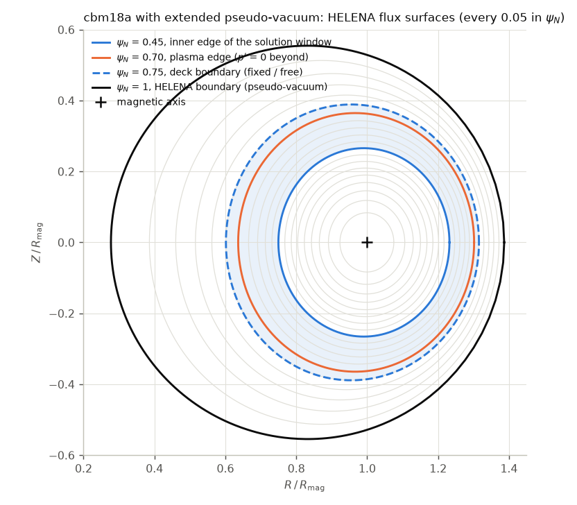
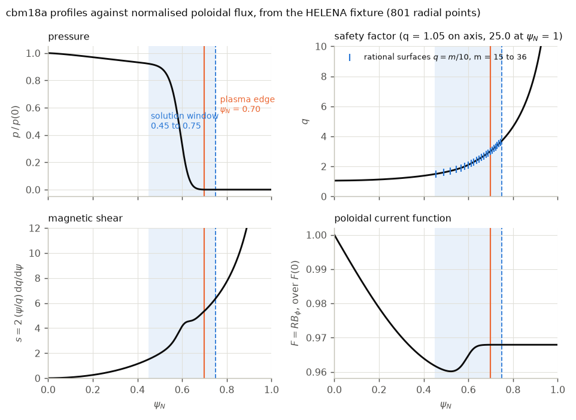
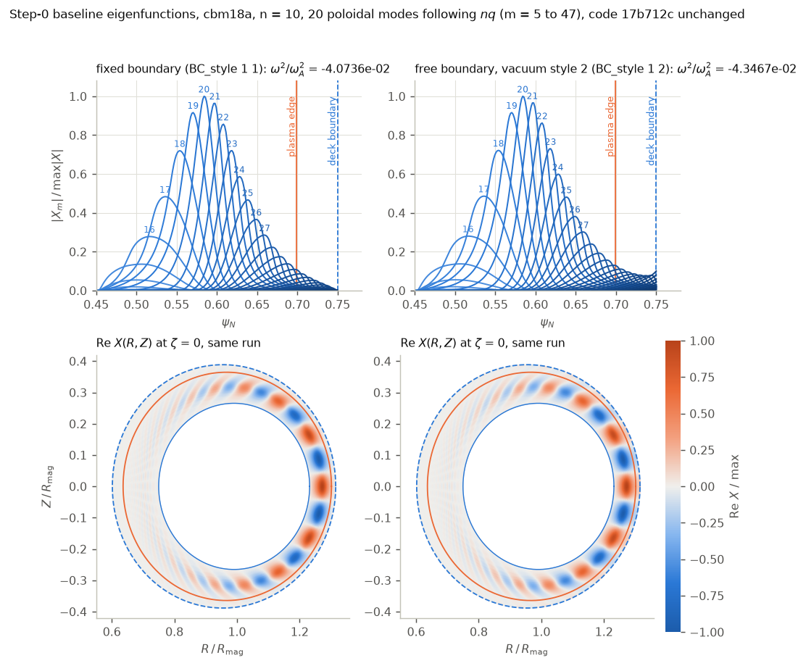
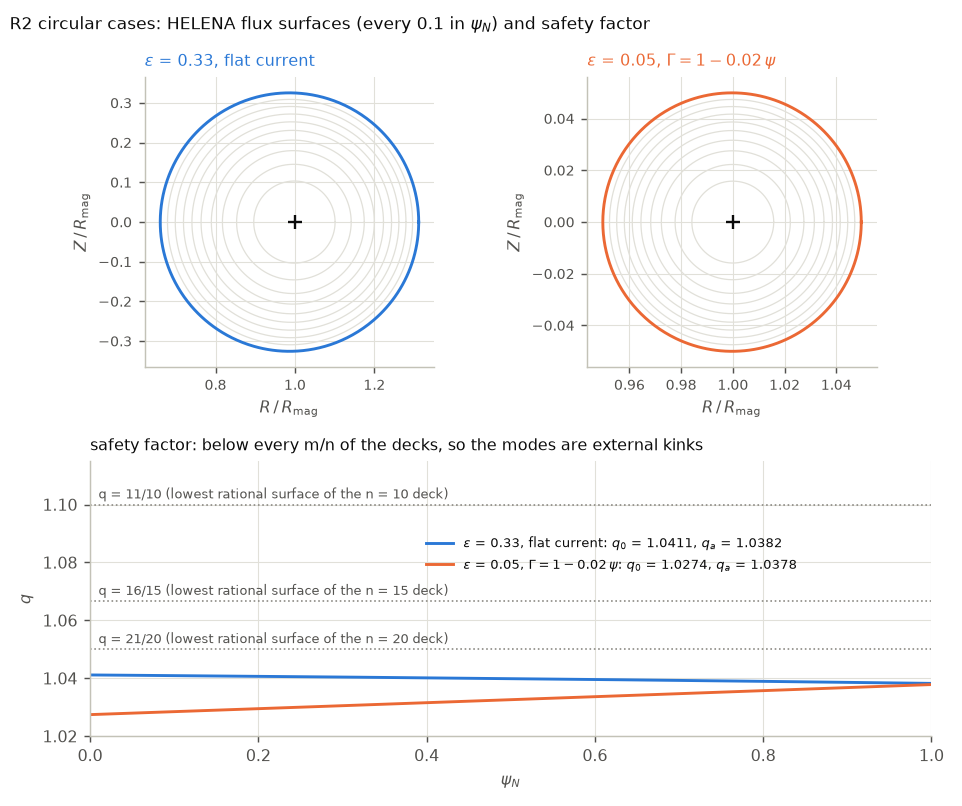

# PB3D: bug fixes and validation before any 3-D vacuum work

Written 27 October 2026. This plan went through three critique rounds; section 7 records what each round changed.

**Starting point: commit 17b712c.** That is the tip of `origin/dev/ci-quality`, the third of the three stacked draft PRs on github.com/ToonWeyens/PB3D, pushed by a cloud session on 10 July 2026 (message: "tests: unit suites for the mode-index and Richardson index arithmetic"). It is the newest PB3D code anywhere: all of Toon's 2.48 work on `dev/testing-infra`, `dev/petsc-port` and `dev/vacuum` (up to 78fb49e, 8 July) plus the 21 cloud commits (vacuum repairs, BC style 2, 3-D kernel rewrite, test suite, CI). The other branches lack the vacuum work: `master` is 5c2fe76 (version 2.47, January 2026) and `dev/vacuum` stops at 78fb49e. `~/Code/PB3D` has 17b712c checked out.

**Bug list:** `~/Code/MHD`, branch `claude/pb3d-report`, file `pb3d_code_analysis.md` (8 October 2026). It was written against 17b712c, so every file and line number in the report and in this plan refers to that commit.

## 0. Ground rules

1. **Smallest change that fixes the bug.** No refactors, no renames, no new abstractions, no new styles. Every fix is a few lines at the place where the bug is, with a one-line comment that says why. The physics code stays readable as Toon wrote it. Section 6 counts the lines.
2. **One bug, one commit, one test.** The test is written first and must fail on the unfixed code with a specific wrong number. If a bug "found by reading" cannot be made to fail a test, it is not fixed until it can.
3. **Predict before you run.** Each physics step states the number it expects (from the report's runs) before the run. A surprise stops the step.
4. **Nothing moves unless the gate passes.** Infrastructure steps must leave every eigenvalue bit-identical. Physics steps must change them by the predicted amount and nothing else.
5. **Tolerances are honest.** Regression anchors are asserted to 1e-3 relative, not 10 %. Crashed runs fail the test; no retries.
6. **Every step passes CI** (Linux, 1, 2 and 4 processes) before the next starts. The Mac cannot run `mpirun`, so CI is the only multi-process signal.
7. **Out of scope** (section 8): negative-flux VMEC files, toroidal-flux vacuum, family coupling, the radial-convergence cause, Richardson improvements, STRUMPACK compression on 3-D kernels.
8. **Local before external.** Every check that runs on this Mac or on CI comes first: the theory, the logical conditions, MISHKA, COBRA, the two public GPEC vacuum codes, Bempp-cl and the published numbers. Requests to other groups (ELITE, CASTOR3D, CAS3D, TERPSICHORE) are sent only in step 7, as confirmation, once the local catalogue is exhausted and every local gate has passed. Nothing waits on an answer from outside.

## 1. Branch

- New branch `dev/vacuum-fixes` from `origin/dev/ci-quality` at 17b712c. This worktree's branch (`claude/pb3d-vacuum-3d-030b8d`, now at `master` with no commits of its own) is reset to it.
- The cloud session's changes outside `vac_*` are mechanical (the spline routines moved to `spline_utilities`, `#if ldebug` guards, PETSc version guards, style 3 removed, default changed). They are kept. Its two vacuum commits (429f003 exterior operator, d6d49e6 3-D kernel) are physics and get read line by line in step 6 before the 3-D fixes.
- This plan is posted as the tracking issue github.com/ToonWeyens/PB3D/issues/4 (27 October 2026). Every step's commit message references the issue, each step's gate result is reported there as a comment with its numbers, and the final PR closes it. The plan file itself is committed on `dev/vacuum-fixes` as `Documentation/plan_vacuum_bugfix.md` and updated when a step changes it.
- At the end: one PR `dev/vacuum-fixes` to `master`, version 2.49, whose description replaces the claims of PRs 1 to 3. Toon merges.

## 2. Step 0: references, before any code change

Nothing in PB3D changes in this step. It produces the numbers every later step is measured against.

| Reference | How | Used by |
|---|---|---|
| R1 Baseline table | Build Release and Debug (`-fcheck=all`). Run every deck of this plan on 17b712c and record ω² to all digits: cbm18a fixed at ψ_max 0.75 and 1.0; free at 0.75 and 1.0 with styles 2 and 4; vacuum off (scale 0) at 0.75; the cylinder `res` errors; the style 1/2 ratios of `test_vac_3d`. Same on CI. | every step |
| R2 Circular external-kink case | Regenerate the PhD case `Simulations/TEST_VAC/2.25` with the rebuilt HELENA (`~/Code/helena/hel12a`): circular, ε = 0.33, flat current, B = 0.001, XIAB = 2.25, q_edge = 1.038. Modes with m/n just above q_edge have no resonance inside, so the fixed boundary is stable and the free boundary is unstable. Make the VMEC twin with `hel2vmec.sh` (PB3D's HELENA-to-VMEC export). Also a large-aspect-ratio variant, ε = 0.05, for the cylinder formula. | steps 3, 4, 5, 6 |
| R3 MISHKA | Compile MISHKA-1 from `Documents/PHD/MISHKA_simulations/Sources` (recipe in its README). Run R2 for n = 10 to 20 with `RWALL` ≤ 1 (fixed boundary) and `RWALL` = 2, 3, 5, 10, 20 (conformal wall, vacuum on). Extrapolate to no wall. Record both ω²_fixed and ω²_free, because the vacuum effect is the difference. | steps 3, 4, 6 |
| R4 Analytic cylinder | Shafranov's uniform-current external kink with no wall: δW and the growth rate in PB3D's normalization, as a function of nq_a − m, derived with sympy and checked against MISHKA on the ε = 0.05 variant. | step 3 |
| R5 PhD numbers | The 2017 PB3D versus MISHKA (`RWALL` = 3) tables in `TEST_VAC/OLD`: PB3D −0.298 versus MISHKA 0.434 at n = 10, −0.430 versus 0.429 at n = 16, −0.330 versus 0.323 at n = 20 for the 2.25 case; two to four times apart for the 0.77 case. The folder's README says "sometimes positive, sometimes not". These numbers are only history; they show the comparison was never on equal footing (MISHKA had a wall, PB3D had the sign and factor errors). | context |

Gate: R1 reproduces the report's numbers (−4.0736e−2 fixed at 0.75, −4.3467e−2 free style 2 at 0.75, −4.5574e−2 style 4 at 0.75). R3 converges in `RWALL` and its wall sequence follows the cylinder wall factor (T2) on the ε = 0.05 case before MISHKA is trusted. R4 agrees with R3 at ε = 0.05 to the accuracy MISHKA's resolution allows. Step 0 also runs the radial-order diagnosis (O4) and measures every convergence order (L12), so each later comparison knows its own accuracy.

Risk: MISHKA's recipe links `-fdefault-integer-8` against LAPACK. On macOS that needs an ILP64 LAPACK, or dropping the flag if `ppplib` tolerates it. If MISHKA cannot be built in a day, steps 3 and 4 fall back on R4 plus the bounds, and MISHKA moves to CI (Linux) later.

### 2.1 Step 0 results (27 October 2026)

All runs on the macOS machine (gfortran 16.1, PETSc 3.25.3 complex, SLEPc 3.25.1, singleton MPI), code 17b712c unchanged, Release build unless stated. ω² is ω²/ω_A² in the MISHKA normalisation, as PB3D prints it. The Snellius build (Toon: "this should be on Snellius") is reported separately when it is done.

**R1 baseline table.** Regression deck cbm18a, n = 10, 20 modes, 200 radial and 100 parallel points (Simpson 3/8), `tol_SLEPC` 1e−6.

| Run | ω² | Report |
|---|---|---|
| fixed, ψ 0.45 to 0.75 | −4.0735999821e−2 | −4.0736e−2 |
| free style 2, to 0.75 | −4.3467138270e−2 | −4.3467e−2 |
| free style 4, to 0.75 | −4.5574082987e−2 | −4.5574e−2 |
| fixed, 0.45 to 1.0 | −4.2348778332e−2 | anchor −4.2349e−2 |
| free style 2, to 1.0 | −4.2348778421e−2 | |
| free style 4, to 1.0 | −4.2348776924e−2 | |
| vacuum × 0 at 0.75 (diagnostic patch) | −4.3142687497e−2 | −4.3143e−2 |
| vacuum × (−2π) at 0.75 | −4.2150080544e−2 | −4.2150e−2 |

Edge diagnostics from the patched scratch build: |X_edge|/max|X| = 0.100 (× 1), 0.094 (× 0), 0.068 (× −2π); X_e† res X_e = −2.6476e−2 (× 1), +3.9853e−2 (× −2π); max|res − res†|/max|res| = 2.65e−5. The three ψ = 1.0 runs agree to 4e−8, so that deck cannot see the vacuum (report section 9). Gate R1 passed: every number of the report reproduces to five digits.

**Figures (added 29 October 2026; `Documentation/figures/step0/make_figures.py` makes them from the fixtures and the step-0 output files).**

The cbm18a fixture is HELENA's extended pseudo-vacuum equilibrium: the pressure gradient vanishes at ψ_N = 0.70, and from there to the HELENA boundary at ψ_N = 1 the domain carries neither pressure gradient nor current. Lengths are in units of R_mag, as PB3D normalises them. The plasma edge (ψ_N = 0.70) has half-width 0.333 R_mag about R = 0.969 R_mag; the HELENA boundary has half-width 0.555 R_mag about R = 0.832 R_mag, so the pseudo-vacuum surfaces shift outboard and the magnetic axis sits 0.17 R_mag outside the centre of the HELENA boundary. The regression decks solve from ψ_N = 0.45 to 0.75 (shaded): their boundary lies 7 % of the plasma minor radius outside the plasma edge, in the pseudo-vacuum, with q = 3.71 there against 3.02 at the plasma edge. The ψ_N = 1.0 decks put the boundary at the HELENA edge, where q = 25.

Pressure, q, shear s = 2 (ψ/q) dq/dψ and F = R B_φ against ψ_N. The pedestal: p/p(0) = 0.92 at ψ_N = 0.45, 0.33 at 0.60, 0.03 at 0.65, zero from 0.70. q runs from 1.05 on axis to 3.02 at the plasma edge; the rational surfaces q = m/10 with m = 15 to 36 lie inside the solution window. The shear rises from 1.5 at ψ_N = 0.45 to 5.4 at the plasma edge and 6.4 at the deck boundary, with a flat stretch around ψ_N = 0.6. F is constant in the pseudo-vacuum, as it must be without current.

The R1 eigenfunctions at ψ_max = 0.75, fixed and free with style 2, code 17b712c. Top: |X_m| for the 20 modes that follow nq (m = 5 to 47 over the window). The mode peaks at ψ_N = 0.58 with m = 20 and 21; its amplitude at the deck boundary is zero for the fixed run and 0.100 of the maximum for the free run, the number given above. Bottom: Re X in the poloidal plane at ζ = 0, rebuilt from the X_m with θ the HELENA straight-field-line angle. The mode balloons on the outboard side and is negligible at the inner edge of the window.

Crashes: 9 of 15 launches of the regression decks on the unpatched build died (SIGTRAP or segfault) before the eigenvalue was written; the 800-point radial deck died 8 of 8 times. A scratch build of the same source linked against PSPLINE with the `r8genxpkg` guard applied ran 23 of 23 launches clean, with eigenvalues identical for the fixed deck and within 4e−13 relative for the free decks (SLEPc noise). That is the step 1 fix, confirmed in advance; step 1's gate tolerance should read 1e−10 relative, not bit-identical, for free-boundary runs.

Unit-level numbers (`pb3d_fullstack_tests`): cylinder response `res` against the analytic value, m = 1 to 5: 1.0, 1.3, 1.6, 1.8, 1.9 % (report 1.0 to 1.9 %); Green-identity residuals halve from 51 to 101 boundary points (6.7e−2 → 3.5e−2, 3.5e−2 → 1.8e−2, 2.5e−2 → 1.3e−2: order 1); style 1 over style 2 response ratios m = 1 to 5: 1.002, 0.981, 0.957, 0.931, 0.906 (report 1.00 → 0.91). STRUMPACK's HSS solve fell back to ScaLAPACK on the 3-D test (residual 0.15).

**O4 and L12, convergence orders** (fixed boundary, ψ 0.45 to 0.75, unpatched shear).

| Direction | Values | Order |
|---|---|---|
| parallel points 97, 100, 193, 385 (Simpson 3/8) | −4.0824e−2, −4.0736e−2, −4.2082e−2, −4.2800e−2 | differences 1.26e−3 then 7.2e−4: about 0.8 (the end-interval error of the shear bug, report section 6) |
| parallel 97 with `magn_int_style = 1` | −4.0118424e−2 | equals the report's table: that table used the trapezoid rule, the regression deck uses Simpson 3/8 |
| radial points 100, 200, 400, 800, 1600 (left stencil, patched build) | −4.14807e−2, −4.07360e−2, −4.08179e−2, −4.08868e−2, −4.09221e−2 | differences 7.4e−4, −8.2e−5, −6.9e−5, −3.5e−5: not monotonic, at best order 1 |
| radial 800, centred stencil | −4.20465e−2 | 2.8 % from the left stencil (report 2.7 %) |
| HELENA `NRMAP` 201, 401, 801 at 200 radial points | −4.07128e−2, −4.07142e−2, −4.07360e−2 | 0.06 %: the equilibrium grid is not what limits the radial order |

So the slow radial convergence lives in the solution discretisation or in the equilibrium-to-solution interpolation, not in HELENA's grid. Still out of scope (section 8), but every comparison below carries about 1 % of radial uncertainty on PB3D's side.

**R2, the circular external-kink cases.** HELENA `hel12a` (PB3D-patched) on the PhD input `TEST_VAC/2.25/HELENA/fort.10`: ε = 0.33, flat Γ, B = 0.001, XIAB = 2.25, q₀ = 1.0411, q_a = 1.0382. The large-aspect-ratio variant: ε = 0.05, XIAB = 0.3035. A perfectly flat q (q₀ = q_a = 1.0378) is rejected by PB3D ("The code has to be adapted for reversed-shear regions still", `calc_eq_1`, error 3), so the committed variant has Γ = 1 − 0.02ψ (AGA = −0.02): q₀ = 1.0274, q_a = 1.0378. Both equilibria are committed as `tests/fixtures/circ_eps033_q104.12.xz` and `circ_eps005_q104.12.xz` with their HELENA inputs. PB3D on them, 17b712c, deck ψ 0.2 to 1.0, 200 radial, 100 parallel points, 10 modes, `BC_style 1 1` (fixed) and `1 2` (free):

| Case | n | modes | fixed | free (style 2) |
|---|---|---|---|---|
| ε = 0.33 | 10 | 6 to 15 | +7.8446e−2 | +7.8190e−2 |
| | 15 | 11 to 20 | +8.6149e−2 | −1.7221e−1 |
| | 20 | 16 to 25 | +1.2056e−2 | −3.4585e−1 |
| ε = 0.05 | 10 | | +7.7650e−2 | +7.7650e−2 |
| | 15 | | +1.6146e−1 | −6.4661e−1 |
| | 20 | | +4.8685e−2 | −4.0010e−1 |

Fixed boundary is stable in every case, as it must be (no resonance inside). The free-boundary numbers are what the unfixed code gives; at n = 10 the vacuum changes nothing although |X_edge|/max|X| is 0.81 to 0.86 in the free runs. These are step 3's starting values. The VMEC twins were not made: there is no VMEC binary on this machine (VMEC++ exists in `~/Code/desc-vs-vmec`); they are first needed in step 5 and are made there.

The two circular fixtures: flux surfaces and q. With q between 1.027 and 1.041 and the lowest rational surfaces of the decks at q = 11/10, 16/15 and 21/20, no mode of the decks resonates inside the plasma, so the fixed-boundary values must be positive and every instability is an external kink: m = 11, 16, 21 for n = 10, 15, 20.

**R3, MISHKA.** The source that reads the 2017 HELENA format (`JS0, IAS` on the first line, `RAXIS, B0` after the metric) is `Simulations/MISHKA/Sources` (November 2017, MANZ = 21), not `Documents/PHD/MISHKA_simulations/Sources` (2015, old format, fails with "Bad integer for item 409"). Built with `gfortran -std=legacy -w -O2 -fdefault-integer-8 -fdefault-real-8` and linked against an ILP64 OpenBLAS (`spack install openblas+ilp64 symbol_suffix=none`); with 4-byte integers it segfaults at once. It reads the namelist from stdin and the mapping from `fort.12`, writes `fort.20`; the line `INSTABILITY FOUND : n ... q₀ q_a Re Im` gives Re = γ² = −ω²/ω_A². Validation: the archived PhD run (ε = 0.33, n = 10, `RWALL` = 3) reproduces to all printed digits, 0.433847, with the archived `fort.12`, and gives 0.433764 with the regenerated one. `RWALL` = 1 (fixed boundary) does not converge in the inverse vector iteration (99 iterations), so MISHKA is used for the free-boundary values only.

| Case | n | RWALL 1.05 | 1.1 | 1.2 | 1.5 | 2 | 3 | 10 |
|---|---|---|---|---|---|---|---|---|
| ε = 0.05, flat q | 10 | 0.06443 | 0.33592 | 0.42327 | 0.43652 | 0.43662 | 0.43662 | 0.43663 |
| | 15 | 0.36337 | 0.43842 | 0.45472 | 0.45576 | 0.45576 | 0.45576 | 0.45577 |
| | 20 | 0.32596 | 0.34023 | 0.34223 | 0.34229 | 0.34229 | 0.34229 | 0.34229 |
| ε = 0.05, Γ = 1 − 0.02ψ | 10 | 0.05473 | 0.32609 | 0.41342 | 0.42667 | | | 0.42679 |
| | 15 | 0.35606 | 0.43109 | 0.44739 | 0.44843 | | | 0.44844 |
| | 20 | 0.32160 | 0.33586 | 0.33786 | 0.33792 | | | 0.33792 |
| ε = 0.33 | 10 | 0.10405 | 0.33363 | 0.41715 | 0.43343 | 0.43376 | 0.43376 | 0.43378 |
| | 15 | 0.35788 | 0.42539 | 0.44123 | 0.44281 | 0.44282 | 0.44282 | 0.44283 |
| | 20 | 0.30787 | 0.32065 | 0.32253 | 0.32262 | 0.32262 | 0.32262 | 0.32262 |

Values are −ω²/ω_A² (positive = unstable). Converged in `RWALL` from 1.5 on: a wall at 1.5a or further is no wall for m ≥ 11.

**R4, the cylinder.** Derived with sympy (`tests/reference/cyl_kink.py`): reduced-MHD energy with the exterior Laplace solution written out. Uniform current, zero pressure, uniform density, no wall:

ω²/ω_A² = −(2/q_a²)(m − nq_a)(nq_a − m + 1), unstable for m − 1 < nq_a < m;

with a conformal wall at b: −(m − nq_a)[(1 + λ)(nq_a − m) + 2]/q_a², λ = (1 + (a/b)^{2m})/(1 − (a/b)^{2m}), which closes the window to m − 2/(1 + λ) < nq_a < m. Against MISHKA on the flat ε = 0.05 case without a wall: 0.43660 vs 0.43663 (n = 10), 0.45590 vs 0.45577 (15), 0.34254 vs 0.34229 (20), i.e. 1e−4 to 7e−4. The wall factor (T2): MISHKA over formula between 0.9992 and 1.0011 for every `RWALL` ≥ 1.05 and every n. On ε = 0.33 the ratio is 0.990, 0.9755, 0.965 for n = 10, 15, 20, independent of the wall: the toroidal correction alone. On the Γ = 1 − 0.02ψ variant the ratio is 0.977, 0.984, 0.987, also wall-independent: the current peaking alone. Gates R3 and R4 passed.

**R5.** The PhD MISHKA numbers (0.434, 0.429, 0.323 at n = 10, 16, 20, `RWALL` = 3) are reproduced by the rebuilt code and are within 1 to 4 % of the cylinder formula, so in 2017 MISHKA was right and PB3D's −0.298, −0.430, −0.330 were wrong.

**R5, revisited 30 October 2026.** After step 3 the code reproduces these numbers. Same case (`circ_eps033_q104`, the PhD's 2.25 case regenerated with the rebuilt HELENA), free boundary, style 2, no wall, PB3D at the branch tip on Snellius. MISHKA prints γ² = −ω²/ω_A² and PB3D prints ω²/ω_A², so the signs are the two conventions, not a disagreement; a wall at 3a is no wall for these m (MISHKA is converged in `RWALL` from 1.5 on), so the PhD's `RWALL` = 3 values and today's no-wall values are the same quantity.

| n | MISHKA 2017, `RWALL` 3 | MISHKA now, `RWALL` 3 / no wall | PB3D 2017 | PB3D now, free | PB3D now, fixed |
|---|---|---|---|---|---|
| 10 | 0.434 | 0.433764 / 0.433779 | −0.298 | −0.443831 (+2.3 %) | +0.078430 |
| 15 | | – / 0.442830 | | −0.452884 (+2.3 %) | +0.086149 |
| 16 | 0.429 | 0.429036 / 0.429043 | −0.430 | −0.438604 (+2.2 %) | +0.075200 |
| 20 | 0.323 | 0.322621 / 0.322624 | −0.330 | −0.329400 (+2.1 %) | +0.012068 |

The 2017 PB3D values were wrong because the vacuum entered the energy with the wrong sign and without the factor 2π (step 3); the near-agreement at n = 16 and 20 was luck, the n = 10 value being 31 % low. The remaining 2.1 to 2.3 % is the toroidal correction that PB3D's high-n ordering drops and MISHKA's full MHD keeps: it grows with ε (0.3 to 0.8 % on the ε = 0.05 fixture, 2.1 to 2.3 % here), and MISHKA over the cylinder formula on ε = 0.33 is 0.990, 0.9755, 0.965 at n = 10, 15, 20 at every wall radius, so it does not come from the vacuum. PB3D lands within 1.5 % of the cylinder value, which is the discretisation error of the response diagonal. MISHKA's fixed-boundary run does not converge, so the planned comparison of free minus fixed between the codes could not be made; the absolute free-boundary values are compared instead. The fixed-boundary column shows every case is an external kink.

**Reference values for step 3** (free boundary, no wall, −ω²/ω_A²; PB3D must reach them within its own discretisation error, about 1 %, with the fixed boundary staying positive):

| Case | n = 10 | n = 15 | n = 20 |
|---|---|---|---|
| ε = 0.33 (`circ_eps033_q104`) | 0.43378 | 0.44283 | 0.32262 |
| ε = 0.05, Γ = 1 − 0.02ψ (`circ_eps005_q104`) | 0.42679 | 0.44844 | 0.33792 |

MISHKA input for these: the archived `TEST_VAC/OLD/2.25/MISHKA/10/fort.10` with `NTOR` and `RWALL` changed (`IFAST = 1` shifts the m window with nq by itself; `DSURF = 1` is a flat density). Table kept as `tests/reference/mishka_circular.txt`.

**Open items of step 0, closed 30 October 2026.**

*The same table on CI.* CI showed only the output of failing tests, so it kept no record of the eigenvalues it computed; since 2d1363b the fullstack and coverage jobs upload the ctest log as an artifact. The branch tip on the three platforms, one process:

| deck | macOS (gfortran 16, PETSc 3.25, no MUMPS) | Snellius (gfortran 14.2, PETSc 3.25 with MUMPS) | CI, Ubuntu 24.04 (gfortran 13, PETSc 3.19) |
|---|---|---|---|
| cbm18a fixed, ψ 0.45 to 0.75 | −4.3572898102123836e−2 | −4.3572898102173241e−2 | −4.3572898102188728e−2 |
| cbm18a free, style 2 | −4.5018998767843765e−2 | −4.5018998767941465e−2 | −4.5018998768032115e−2 |
| cbm18a free, style 4 | −4.4712139717450083e−2 | −4.4712139717485277e−2 | −4.4712139717494936e−2 |
| circular ε = 0.05 free | −4.3033715881358026e−1 | −4.3033715881628887e−1 | −4.3033715881637524e−1 |

The spread is 1e−12 to 6e−12 relative: the same numbers everywhere (the coverage job, a second Ubuntu build, agrees with the fullstack job to 1e−12 as well). The 17b712c baseline itself never ran on a green CI, because CI was repaired in step 1 and step 2 changed the numbers in the same hour; the CI numbers are those of the tip.

*The Snellius build and its 1, 2, 4-process runs.* Snellius runs the branch tip: ctest Release 23 of 23 pass (272 s), Debug 19 of 22 at first: the three regression decks segfaulted in gfortran 14.2's bounds-checking code (next paragraph); with that check dropped the Debug fixed deck gives the Release value to all digits (−4.3572898102173241e−2), and the Debug regression rerun is queued (`ctest-dbg-stack`), to be read from the Snellius logs once the SSH agent is unlocked again. One process reproduces the Mac to 1e−12 (table above). Two and four processes shift every eigenvalue towards stability:

| deck | 2 processes | 4 processes |
|---|---|---|
| cbm18a fixed, 200 radial points | +2.4e−5 | +1.8e−5 |
| cbm18a fixed, 400 and 800 radial points | +2.6e−5, +2.6e−5 | – |
| cbm18a free, style 2 | +2.4e−5 | +1.8e−5 |
| cbm18a free, style 4 | +2.4e−5 | +1.8e−5 |
| circular ε = 0.05 free | +1.6e−6 | +4.9e−6 |

(relative to the one-process value). The shift is the same for the fixed and free cbm18a decks, so it is not the vacuum, and the same at 200, 400 and 800 radial points, so it is not the discretisation at the process boundaries. SLEPc's relative residual of the accepted eigenpair is 2e−2 for the cbm18a decks and 6e−12 for the circular deck (the decks ask `tol_SLEPC` = 1e−6 under shift-and-invert), and the shift is ten times smaller on the circular deck. With `tol_SLEPC` tightened to 1e−8, 1e−10 and 1e−12 on the fixed cbm18a deck the two-process shift is queued (`reg-fixed-tol8`, `tol10`, `tol12` at 1, 2, 4 processes) and read from `~/pb3d/logs/jobs_tol.log` when the SSH agent is unlocked again. The solver tolerance is the first suspect because the circular deck, whose eigenpair is converged to 6e−12, shifts ten times less; but it still shifts by 2e−6 to 5e−6, so at least that part is not the tolerance. Until the series is read the shift stays an open item (section 9).

Along the way: the fixed cbm18a eigenvalue at 200, 400, 800 radial points is −4.35729e−2, −4.36594e−2, −4.37296e−2, differences 8.7e−5 and 7.0e−5, which is the slow radial convergence already noted in step 0 (O4, open).

*The VMEC twins.* `wout_circ_eps033_q104.nc` (a5c8c41) is made from the HELENA fixture by PB3D's `--export_HEL` (boundary Fourier modes, pressure and iota as splines against toroidal flux, R_0 = B_0 = 1) and VMEC++, 3 s, force residual 1e−15; recipe `tests/reference/make_vmec_twin.sh`. q runs from 1.04112 on axis to 1.03821 at the edge in both files. Fixed-boundary eigenvalues, HELENA against VMEC: n = 10: +7.8430e−2 against +7.9716e−2 (1.6 %; revised the same evening to 2e−6 once B_0 is the toroidal average of |B| on the axis, step 6f); n = 16: +7.5200e−2 against +7.6434e−2 (1.6 %); n = 20: +1.2068e−2 against +1.2266e−2 (1.6 %). The n = 10 pair is now the regression test `regression_circ_eps033_vmec_twin` (2.5 % allowed). The free-boundary comparison through the 3-D vacuum is step 6e and is reported in the steps 5 and 6 comment.

## 3. Steps 1 to 9

| Step | Bug (report #) | Change | Physics lines | Gate |
|---|---|---|---|---|
| 1 | Crashes on macOS (1); CI red (12) | PSPLINE guard applied by `Libraries/build_pspline.sh`; retries removed from the regression scripts; CI warning count de-duplicated, `if: always()` on the test step, gcovr flag | 0 | 20 of 20 clean runs of each regression deck; eigenvalues identical to R1 for the fixed deck and within 1e−10 relative for the free decks (SLEPc noise, measured in step 0); CI green |
| 2 | HELENA shear (2) | `bcs(:,1)` to `bcs(:,2)` at `eq_ops.f90:4409`, comment at 4354 corrected | 1 | predicted −4.0118e−2 to −4.3568e−2 at 97 parallel points with `magn_int_style = 1` (the report's deck); the regression deck (`magn_int_style = 2`) gives −4.0824e−2 at 97 points and must reach the same converged value; Δθ-independence; identity test; VMEC twin; POST energy 0.07 % |
| 3a | Vacuum sign (3) | none yet: the test | 0 | ordering test fails on current code: free (−4.3467e−2) lies outside [no-vacuum −4.3143e−2, fixed −4.0736e−2] |
| 3b | Vacuum sign and factor (3) | the energy factor applied once, at the end of `calc_vac_res`, with the derivation in the comment; `res` symmetrised; POST's `if (1.eq.2` guard removed | 3 | ordering holds; circular case: fixed stable, free unstable, marginal point at the right nq_a; growth rates against R3 difference and R4; POST reproduces ω² |
| 4 | Style 4 drops the vacuum (4); default (4) | (0,0) block assembled once before insertion; default back to `[1,2]` | about 6 | style 2 = style 4 at ψ = 0.75 to 1e-5; regression deck moved to 0.75; anchors re-set with 1e-3 |
| 5 | `setup_modes` slots (5) | slot computed from the mode number, same formula as `nm_X`; consistency check of the two tables | about 8 | simulation script: 0 wrong entries in all 8 sequences; HELENA and VMEC twins of R2 and cbm18a agree fixed-boundary |
| 6a | review | read 429f003 and d6d49e6 against the vacuum paper and its known errors | 0 | written verdict per hunk: keep, or revert |
| 6b | 3-D α spacing (9); normal orientation (13) | `dalpha` with `n_alpha` at `vac_ops.f90:839, 1567`; test grid built like PB3D's | 2 | manufactured exterior potential: BEM error falls with resolution on a torus and on a rippled torus; style 1/2 ratio → 1 with measured order |
| 6c | Richardson double count (10) | style 1 recomputes G, H each level (skip the copy) or zeroes before accumulation | 1 to 3 | level-2 `res` equals a fresh run at level-2 resolution |
| 6d | aliasing (11) | warning when `n_alpha` divides the field period | about 5 | input check fires |
| 6e | end to end at ε = 0 | none | 0 | circular VMEC twin through the style-1 vacuum equals the HELENA style-2 result and R3 |
| 6f | continuity in δ | none | 0 | rippled circular VMEC: ω²(δ) − ω²(0) ∝ δ², smooth; ordering holds on W7-X |
| 7 | external confirmation, changelog, PR | requests to ELITE, CASTOR3D and CAS3D groups go out now; 2.49 entry, one line per fix, the cloud's silent default changes documented | 0 | external results agree within their known blind spots; PR open; Toon merges |
| 8 | 3-D equilibrium path | none in PB3D: DESC-written `wout` of a Landreman case; compare ι, S, κ, σ with the exact formulas | 0 | agreement to the resolution of the DESC fit |

### Step 1: stop the crashes, make CI mean something

- **PSPLINE.** `r8genxpkg.f` writes `xpkg(4,4)` for 3 unevenly spaced points, 8 bytes past the array. PB3D hits it in `interp_V_spline` through `spline_real` for mode ranges with exactly 3 points. The report's two-line guard goes into a patch file in `Libraries/` that `build_pspline.sh` applies after cloning, and the bug gets reported upstream. PB3D's own code is not touched; the alternative (route n ≤ 3 around EZspline in `spline_real`, like the 2.46 fix for n = 2) stays in reserve for users with an unpatched PSPLINE.
- **Regression scripts.** Remove the six-attempt loop. A nonzero exit is a failure.
- **CI.** Count unique `file:line` warnings and exclude `tests/`; run the test step with `if: always()`; add `--gcov-ignore-parse-errors=suspicious_hits.warn`; pin gcovr and fortitude.
- **Gate.** 20 consecutive clean runs of both regression decks on the Mac in Release and Debug; eigenvalues bit-identical to R1; all CI jobs green including `_np2` and `_np4`.

**Step 1 results (27 October 2026).** This step's commit. No physics line changed.

- *PSPLINE.* `Libraries/pspline-r8genxpkg-nx3.patch` (the two-line guard, with the explanation in its header) is applied by `Libraries/build_pspline.sh` after the clone; CI copies the patch along with the script and keys its PSPLINE cache on both files. The Mac's `~/Code/pspline/install` was rebuilt the same way. Text for the upstream report is in the step 1 comment on issue 4; posting it on github.com/ilonster/pspline is Toon's call.
- *Regression scripts.* One launch, a crash is a failure; the stale "fixture not committed" header and the flakiness paragraph of `Documentation/testing.md` replaced by the cause.
- *Vendored FFT in Debug.* The free-boundary deck had never run on a Debug build: `Libraries/dfft.f` declares its work arrays with the F77 idiom `DIMENSION WSAVE(1)`, so `-fcheck=all` stops the first FFT call in `store_vac` with a false bounds error (20 of 20 launches). The `dfftpack` target now compiles with `-fcheck=no-bounds` next to its existing `-w` (one option in `CMakeLists.txt`). This was not in the report because its Debug runs were fixed-boundary only.
- *CI.* Warning ratchet counts unique source locations in `Modules/`, `PB3D.f90`, `POST.f90` from gfortran's location headers (the old counter counted every repeated diagnostic and the duplicates of sources compiled into two targets, and could not see `tests/`); baseline 74 (63 maybe-uninitialized, 11 unused dummy arguments) measured on the Linux build of 2058627. Test step runs with `if: always()`. gcovr pinned to 8.8 with `--gcov-ignore-parse-errors=suspicious_hits.warn`; fortitude pinned to 0.9.2 (0.10.0, picked up unpinned on 27 October, adds rule OB091 and fails the OB gate on two labelled `DO` loops in `dtorh.f90`; the code is not changed for a linter).
- *Gate.* Release: 20 of 20 clean launches of each deck, fixed eigenvalue identical to R1 (−4.0735999821004454e−2), free style 4 identical (−4.2348776924299336e−2), free style 2 spread 5e−12 relative (SLEPc). Debug: fixed 20 of 20, −4.0735999821102098e−2 (2e−12 from Release); free 20 of 20, style 4 −4.2348776924365450e−2, style 2 spread 1e−11. CI: the run on this commit is the first one with the new ratchet and the pins; its result is appended below once it has run.
- *Learning for the plan.* The PSPLINE overrun was the whole "MPI flake"; nothing is wrong with OpenMPI 5 or parallel HDF5 on macOS. Debug builds of the vacuum path need the dfftpack exemption, so step 3's Debug sweeps (O5) are possible now. Free-boundary eigenvalues move at 1e−12 between launches, so "bit-identical" gates apply to fixed-boundary runs only.

---

### Step 2: the HELENA shear

- **Change.** One line. `Θ^α` is odd in θ, so the spline on a top-bottom symmetric equilibrium needs the odd condition (zero second derivative), `bcs(:,2)`. The comment on line 4354 says "zero first derivative" for `[2,2]`; it should say second.
- **Test first.** A parity test on cbm18a: S at the outboard midplane is not zero and does not change by more than 1e-4 between 97 and 193 parallel points. On the unfixed code it changes by 3.7 %.
- **Predicted.** −4.0118e−2 becomes −4.3568e−2 at 97 points, −4.3571e−2 at 1537. Step 0 established that the report's parallel-points table used `magn_int_style = 1` (trapezoid); with the regression deck's `magn_int_style = 2` (Simpson 3/8) the unpatched values are −4.0824e−2, −4.2082e−2, −4.2800e−2 at 97, 193, 385 points. The converged value is the gate, not the 97-point number.
- **Independent checks.** (i) The identity J|∇ψ|²S + μ0 J B² σ = K (`test_S_HEL`, already in the code under `ldebug`) to 1e-6. (ii) The VMEC twin of cbm18a computes S from Fourier derivatives and never had the bug: HELENA and VMEC fixed-boundary ω² must agree to the VMEC fit accuracy (expected 1e-3). This check also depends on step 5 for VMEC; if they disagree, step 5 is pulled forward. (iii) POST energy reconstruction: E_pot/E_kin misses ω² by 5.0 % now and by 0.07 % after the fix.
- **Anchors.** Fixed regression re-set to about −4.357e−2, tolerance 1e-3.
- **More checks (section 4).** L8: the same equilibrium through the periodic branch (`ias = 1`) gives the same ω² as the symmetric branch. O1: the JCP 2017 PB3D curve, which predates the bug, is reproduced with the data-file settings. T8: the 1/n extrapolation reaches COBRA again. L3: ω² falls monotonically as `max_r_sol` and `n_mod_X` grow.

**Step 2 results (27 October 2026).** This step's commit. One physics line changed (`eq_ops.f90`: `bcs(:,2)` instead of `bcs(:,1)` in the call of `calc_derived_S_from_deriv_HEL`), three comments corrected ("zero second derivative" for `[2,2]`).

- *Test first.* `tests/regression/cbm18a_shear_HEL.sh` runs the fixed deck once and `check_shear_HEL.py` compares `eq_2/S` of `PB3D_out.h5` with the direct formula −(D_θh¹²/h²² − D_θh²² h¹²/h²²²)/J from the stored metric derivatives, over the whole HELENA grid, tolerance 1e−4 on max|S|, plus a non-zero outboard-midplane value. Before the fix: deviation 0.79 (a boundary layer from both midplanes, decaying by 3.7 per interval; at θ = 0 the stored S is 1e−9 of max|S| where the formula gives 3.4e−2), FAIL. After: 1.47e−5 on the whole grid, midplane value 4.33e−2 from both routes, PASS. Registered in CMake when a python3 with h5py is found (`-DPython3_EXECUTABLE`); CI installs h5py.
- *Prediction met.* Fixed boundary ψ 0.45 to 0.75: 97 points with `magn_int_style = 1`: −4.3568189e−2 (predicted −4.35682e−2); Simpson 3/8 at 97, 193, 385, 100 points: −4.35691e−2, −4.35699e−2, −4.35714e−2, −4.35729e−2: converged to 1e−4 at 97 points where the unfixed code still moved by 5 % (−4.08e−2 to −4.28e−2).
- *POST energy balance* (`plot_E_rec`, POST_style 1, 101 poloidal points): E_pot/E_kin = −4.35343e−2 against ω² = −4.35682e−2, 0.078 % (plan: 0.07 %). On the unfixed run the same POST gives 0.17 %, not the 5 % of the report; the report's POST settings are unknown, so only the fixed value is a gate number.
- *L8, periodic branch.* HELENA cbm18a with `IAS = 1` needs `NCHI = 2^n`; at the same poloidal spacing (1024 points over 2π against 513 over π) PB3D gives −4.35487e−2 (periodic) against −4.35878e−2 (symmetric), 9e−4 apart, unchanged when HELENA's own poloidal resolution is doubled (NP 101 to 201: −4.35463e−2 to −4.35487e−2). The symmetric branch itself moves by 3.4e−4 between NCHI 401 and 513. So the two branches agree to 1e−3, the level of the discretisation, and no sharper; the residual is not the shear (both routes agree to 1e−5 now) and is left as an open item.
- *New anchors.* Fixed deck −4.3573e−2, free deck (ψ = 1.0, styles 2 and 4) −4.5144e−2, both at 1e−3 relative. The free deck at ψ = 1.0 still cannot see the vacuum (styles agree to 1e−9); step 4 moves it. The free style 2 run at ψ = 0.75 now gives −4.6377e−2 and style 4 −4.7684e−2: the vacuum sign error is unchanged and is step 3's business.
- *Not done.* The VMEC twin (ii) waits for step 5 as planned. MISHKA on the extended cbm18a fixture (q_a = 25, zero pressure beyond the pedestal) returns NaN from the first iteration with every density option tried, so C1/O1 on cbm18a is open; the circular cases work. COBRA (T8) is not built.
- *Learning for the plan.* PB3D and POST exit silently with status 0 when a path exceeds 120 characters (POST from a long scratch directory wrote nothing at all); run from short paths. POST needs a `Data/` directory for its HDF5 plots. The regression anchors are now at 1e−3, as rule 5 asked.

---

### Step 3: the vacuum sign and factor (axisymmetric)

Split in two because the sign is certain and the factor is not.

- **3a, the test that fails.** A vacuum can only add energy, so at the same boundary ω²(no vacuum) ≤ ω²(free) ≤ ω²(fixed). On cbm18a at ψ = 0.75 (edge displacement 0.1 of the maximum) the current code gives −4.3467e−2 for free, below the no-vacuum value −4.3143e−2. The test asserts the ordering and fails.
- **3b, the derivation.** On paper, with the actual definitions: A sums ∫PV with `alpha_fac` = 2π/n_alpha per line (so A corresponds to 2δW_p including the toroidal integral); `calc_vac_res` builds `res` from `EP^T Φ` with trapezoid weights `I_loc` and divides by μ0; the vacuum paper's surface form gives 2δW_v in terms of that `res`. The report's result is 2δW_v = −2π X_e^† res X_e, with the −1 certain (the paper's jump-term sign) and the 2π derived once. Write the derivation into the comment where the factor is applied.
- **Where the factor goes.** Once, at the end of `calc_vac_res`, so that `res` means "the surface-energy Hessian as it enters A". Then `set_BC_2`, `set_BC_4` and POST all use `res` unchanged, and the cylinder test's reference formula is multiplied by the same factor, which makes that test a check of the derivation. One line of physics code, one line in the test reference.
- **Hermiticity.** `res` differs from its conjugate transpose by 1e-5 relative, enough to make SLEPc reject the eigenvalue as complex at tight tolerance. The exact operator is Hermitian, so `res` is replaced by its Hermitian part, after printing the asymmetry as a diagnostic. Two lines.
- **POST.** The vacuum energy term has been inside `if (1.eq.2 .and. ...)` since February 2018, with a "NO VACUUM" print. Delete the guard and the print (two lines). POST then reproduces a free-boundary ω² from the eigenvector, with no shared code path for the surface term beyond `res` itself.
- **Checks, three independent of each other.**
  1. Ordering on cbm18a at 0.75. Predicted free ≈ −4.215e−2 with −2π (the report's rerun), inside the bounds. The pseudo-vacuum HELENA run (wall at ψ = 1) gives −4.198e−2 at 800 radial points; the no-wall result must not be more stable than that at the same resolution.
  2. The circular case R2. Fixed boundary stable (ω² > 0), free boundary unstable for m − 1 < nq_a < m. The marginal nq_a and the growth rates against R4 (ε = 0.05 variant) and against R3: compare ω²_free − ω²_fixed between PB3D and MISHKA, not the absolute values, because PB3D's high-n ordering and MISHKA's full MHD differ by a few per cent at n = 10 to 20 independently of the vacuum (the JCP comparison showed that gap).
  3. Energy balance. POST's E_pot/E_kin equals ω² for the free-boundary run to the fixed-boundary accuracy (0.07 %), and POST's vacuum term equals the cylinder formula's δW_v evaluated with the computed edge displacement on the ε = 0.05 case.
  If the three checks want different factors, the derivation is wrong and the step stops.
- **More checks (section 4).** L2: every eigenvalue of the final `res` is non-negative on cbm18a and on the circular case. L5: the Hellmann-Feynman slope. L9 and T2: MISHKA's wall sequence is monotone and follows the cylinder wall factor, and PB3D is at least as unstable as MISHKA at any wall. T3: ξ_r ∝ r^{m−1} and Φ ∝ r^{−m} on the ε = 0.05 case. T4: `res` on the circular torus against the mpmath toroidal-harmonic solution at finite ε, including the m ↔ m ± 1 coupling. T9: the high-n peeling criterion on the `PEELING` equilibrium. C4: the published cbm18 curves. C5: the public VACUUM matrix on the same boundary. C3, ELITE, only in step 7. O7: the dominant m per n against MISHKA.
- **Optional, measured, 3c.** The report found that using the vacuum-side solid angle instead of the plasma-side one lowers the cylinder errors for m = 2 to 5 from 1.3 to 1.9 % to 0.1 to 0.7 %. That is a one-sign change in the diagonal. Do it only if the error falls as predicted and the order of convergence does not change for the worse.

**Step 3 results (27 October 2026).** This step's commit. Physics lines: two in `calc_vac_res` (`vac%res = -2 pi vac%res`, then its Hermitian part), two deleted in POST (`sol_ops.f90`: the `1.eq.2` guard and the "NO VACUUM" print, with an `allocated(vac%res)` guard added for fixed-boundary runs), one in the cylinder test reference.

- *3a, the test that fails.* On the step 2 code at ψ = 0.75: no vacuum (diagnostic knob, scratch build) −4.6041e−2, free style 2 −4.6377e−2, fixed −4.3573e−2: the free value lies below the no-vacuum bound. In the repository the matrix-level form of the same statement is `check_vac_res.py` on the free run's `vac/RE_res`, `IM_res`: every eigenvalue of the stored response was negative (20 of 20 on cbm18a, 10 of 10 on the circular case) with an asymmetry of 2.7e−5; it fails before the fix and passes after (all eigenvalues positive, asymmetry 0).
- *3b, the factor, measured before it was written.* Scratch build of the step 2 code with the scale knob on the ε = 0.05 circular fixture, free boundary, against MISHKA (no wall): scale −2π gives −0.43034, −0.45161, −0.33888 at n = 10, 15, 20 (MISHKA 0.42679, 0.44844, 0.33792: +0.8, +0.7, +0.3 %); scale −1 gives −0.155, −0.431, −0.383 and −4π −0.080, −0.282, −0.285, both far off; scale 0 (no vacuum) −0.545, −0.615, −0.392. On ε = 0.33: −0.44383, −0.45288, −0.32940 against MISHKA 0.43378, 0.44283, 0.32262 (+2.3, +2.3, +2.1 %, the toroidal correction PB3D's high-n ordering does not carry). Near marginality, n = 26 (nq_a = 26.98, m = 27): −0.02969 against MISHKA 0.03066 and the cylinder 0.03118. The factor is 2π to the 1 % the discretisation allows; the derivation (cylinder equivalence between the vacuum energy and the line-bending energy of an edge layer of thickness a/|m|, with A = 2δW including the toroidal integral) is in the comment at the place where it is applied.
- *Check 1, ordering on cbm18a at ψ = 0.75:* no vacuum −4.6041e−2 ≤ free style 2 −4.5019e−2 ≤ fixed −4.3573e−2 (the plan predicted ≈ −4.215e−2 from the report's unfixed-shear rerun; with the shear fix the whole triple moved). Style 4 stays at −4.7684e−2 for any factor: it drops the vacuum (step 4).
- *Check 2, the circular case:* fixed boundary stable (+0.0776 at n = 10), free unstable in the window m − 1 < nq_a < m with the values above; `regression_circ_eps005_free_bnd` anchors PB3D's −0.43034 at 1e−3 and MISHKA's 0.42679 at 2 %. The stored response diagonal on that fixture is 4π²(nq_a − m)²/(μ0 R0 |m|) times 1.007 to 1.016 for m = 6 to 15 (the known BEM error of the unit test, 1 to 2 %).
- *Check 3, energy balance with the vacuum term in POST:* cbm18a free at ψ = 0.75: E_pot/E_kin = −4.49894e−2 against ω² = −4.50190e−2, 0.066 % (fixed-boundary accuracy 0.078 %); the vacuum term is 1.3 % of E_pot. On the circular case POST's vacuum term is 1.4045, equal to res_{11,11} |X_e|² (1.4062 × 0.999) and to the cylinder formula within the 1.3 % BEM error; POST's total balance there is 2.1 % off, but 7.4 % off for the *fixed* circular run, so that is POST's own plot-grid accuracy on an m = 11 edge mode, not the vacuum term (open item).
- *Unit tests.* `vac_response_cylinder` passes with the reference multiplied by −2π (same 1.0 to 1.9 % errors); `response_1_vs_2` unchanged (both styles carry the factor).
- *Gate.* Regression layer 4 of 4 (fixed, free with the response check, shear, circular) on Release; Debug: free deck 3 of 3, circular free −0.430337 identical to Release. CI on this commit pending at the time of writing.
- *Not done (listed as more checks):* L5 Hellmann-Feynman (the scale scan is the same information), T3, T4, T9, C4, C5, O7. The HELENA shear and the vacuum sign together move cbm18a's free-boundary ω² at ψ = 0.75 from −4.3467e−2 (17b712c) to −4.5019e−2.
- *Learnings.* MISHKA's pseudo-vacuum-free circular cases make the factor a measurement, not an argument; keep the circular fixture as the vacuum's anchor from now on. PB3D's silent exit on paths over 120 characters bit again (an absolute scratch path to the equilibrium): every script must use short paths or relative names. POST's energy reconstruction is only accurate for modes that its plot grid resolves (0.07 % on cbm18a, 7 % on the circular m = 11 mode); it is a check of the vacuum term only on cbm18a.

---

### Step 4: style 4 and the default

- **Bug.** `set_BC_4` inserts the (0,0) block with V1† + vac using INSERT_VALUES, then the V2 loop reaches jd = 0 and inserts the same block again with INSERT_VALUES, which replaces it. The vacuum and V1† are lost. At ψ = 0.75 style 4 gives −4.5574e−2 for any vacuum scale, 4.8 % from style 2.
- **Change.** Assemble the whole (0,0) block in `loc_block` first (V1† + vac, plus the jd = 0 part of V2), insert it once, and run the V2 loop from −st_size to −1. About six lines moved, no new logic. Keeping style 4 costs little and gives a second discretization of the same boundary condition as a permanent cross-check; deleting it would remove 80 lines of the original code.
- **Default.** Back to `[1,2]`, Toon's choice since 2017. One line.
- **Checks.** Style 2 and style 4 agree to 1e-5 at ψ = 0.75 with a nonzero edge displacement (they agree to 3.5e−8 today only because the edge displacement at ψ = 1 is 2e−8). The free-boundary regression deck moves to `max_r_sol = 0.75`, runs both styles, asserts the ordering of step 3a, and is anchored to 1e-3. The circular HELENA fixture (xz) is committed with a second regression deck anchored to R3 and R4. L6: the natural-boundary-condition residual of the style-2 eigenvector at the edge falls with resolution.

**Step 4 results (27 October 2026).** This step's commit. Lines: the (0,0) edge block of `set_BC_4` assembled once (V1† + vac + the jd = 0 part of V2) and the V2 loop from −st_size to −1, about eight lines moved; the default `BC_style = [1,2]` (one line).

- *The overwrite is gone, but style 4 is not equivalent to style 2.* cbm18a at ψ = 0.75: style 4 −4.4712e−2 against style 2 −4.5019e−2 (before the fix style 4 gave −4.7684e−2, dropping the vacuum and V1†). The gap is 3.1e−4, 3.3e−4, 3.4e−4 at 200, 400, 800 radial points: it does not shrink. On the circular ε = 0.05 case style 4 gives −0.106, −0.292, −0.288 at n = 10, 15, 20 against style 2's −0.430, −0.452, −0.339 (and −0.112 at 400 radial points), while style 2 matches MISHKA to 1 %. So the explicit natural-boundary-condition row has an inconsistency of its own, which is what Toon's 2017 note ("boundary style 4 does not work well yet") already said; the overwrite was not its only cause. The gate "style 2 = style 4 to 1e−5" therefore fails, and the plan is re-evaluated as follows: style 4 stays in the code with the overwrite fixed, is marked "not validated, use style 2" in its header comment, and is no longer counted as a cross-check of style 2; the validated cross-checks of the vacuum are MISHKA on the circular fixtures and the energy balance. At ψ = 1.0 both styles still agree to 4e−10, where the edge displacement is 1e−8.
- *Default.* `[1,2]`, as it was from 2017 to July 2026.
- *Regression deck.* The free deck now runs at ψ = 0.75 (edge amplitude 0.1), style 2 anchored at −4.5019e−2 and style 4 at −4.4712e−2 (both 1e−3; the style-4 anchor only so that a change shows), asserts free ≤ fixed (−4.3573e−2), and runs the response-matrix check on the style-2 output. Regression layer 4 of 4 on Release and the free deck on Debug pass.
- *Not done.* L6 (natural-boundary-condition residual of the style-2 eigenvector) was not computed; the circular regression already pins style 2 against an external code.
- *Learning for the plan.* A one-sided derivative in a replaced matrix row is not a second discretisation of the variational condition: the two differ at O(1) in the edge treatment. If style 4 is ever wanted, it needs its own derivation against the discrete energy (the backward stencil gives the edge row of the variational scheme a factor step·ndc_e = 11/6 on the bulk terms relative to the surface term, which the explicit row ignores). Out of scope here.

---

### Step 5: `setup_modes`

- **Bug.** With `X_style = 2` the mode window follows nq. `nm_X` puts mode number m in slot modulo(m − m_min(1), M) + 1, which depends only on m. `ind_tot` computes a new mode's slot from the slot of the mode created last plus the sub-step, which equals the same thing only while the window moves up. For nq < 0 (every VMEC case, because PB3D flips VMEC's q), reversed shear, or jitter in flat q, two active modes share a slot and the coupling coefficients are mixed without a message.
- **Change.** Two expressions: the new mode's slot is modulo(m_new − nm_X(1,1), M) + 1 in both branches, the same formula `nm_X` uses, so the two tables agree by construction. The 2020 rewrite on `origin/issue_vac_not_used_VMEC` is not used; it is unfinished and wrong for jumps of 2 or more.
- **Consistency check.** After the loop, assert for every normal point that the slot of each active mode in `ind_tot` is the slot where `nm_X` holds its number; CHCKERR otherwise. About six lines, O(M n_r), always on. This is the test that keeps the fix honest without extracting the routine into a unit test.
- **Checks.** (i) `pb3d/scripts/setup_modes_sim.py` from the report branch gets the new formula as a fourth variant: 0 wrong entries in all 8 sequences (the current code has 8, 1, 8, 4, 6 wrong entries in five of them). (ii) VMEC twins: the cbm18a and circular VMEC runs agree with their HELENA runs fixed-boundary to the fit accuracy. The size of the effect on eigenvalues is unknown today; the consistency check tells immediately whether a given run was affected.
- **More checks (section 4).** L3 on the VMEC twin: ω² must fall monotonically as `n_mod_X` grows, and mixed-up slots break that. L7: the poloidal and toroidal flux labels give the same fixed-boundary ω² (today's W7-X runs differ by 30 % at 60 radial points, which is either resolution or this bug), and shifting `min_alpha` changes nothing on an axisymmetric VMEC file. T8: COBRA from the same VMEC file as the n → ∞ limit.

**Step 5 results (27 October 2026).** This step's commit. Physics lines: the two slot expressions in `setup_modes` (`X_ops.f90`), now modulo(m_new − nm_X(1,1), n_mod_X) + 1 in both branches, the formula the `nm_X` table uses; plus the consistency check after the loop (about ten lines, always on, O(M n_r)): every mode of `ind_tot` must find its own number in its slot of `nm_X` over its normal range, `CHCKERR` otherwise.

- *Test first.* `tests/reference/setup_modes_sim.py` (the report's simulation with the fixed formula as a fourth variant, registered as `unit_setup_modes_sim` when python3 is found): the current formula gives 8, 1, 8, 4, 6 wrong (radial point, mode) entries on the five sequences that move down, reverse or jitter; the fixed formula gives 0 on all eight sequences, including jumps of 2 and 3 where the 2020 rewrite fails.
- *Runnable cases.* No equilibrium at hand exercises the bug: the HELENA fixtures and the cbm18a VMEC file (`wout_cbm18a_small_640.nc`, q from 1.48 to 3.71, positive) all move the window up, where the old formula was right, so the consistency check stays silent on them and every eigenvalue is unchanged (regression layer identical, fixed deck on Debug identical). Negative n, which would move the window down on the HELENA fixture, stops earlier in `calc_norm_range_PB3D_X` ("angular array has to have a length of at least 1"): the negative-n input path is broken independently (report section 12), open item. The cbm18a VMEC file is not a twin of the HELENA fixture (no pseudo-vacuum extension, q_a = 3.7 against 25) and its fixed-boundary run with the regression window does not converge (SLEPc precision 5, eigenvalue rejected as complex) with or without the fix; the HELENA-against-VMEC check (ii) therefore waits for the circular VMEC twin (step 6e) and is an open item here.
- *Gate.* Simulation 0 wrong entries in all 8 sequences; regression layer 5 of 5 (with the new simulation test) on Release; Debug fixed deck identical; CI pending at the time of writing.
- *Learning for the plan.* The slot bug is real and the fix is two expressions, but nothing in the fixture set triggers it today: the VMEC fixtures with nq < 0 (W7-X with the field reversed, step 6f) are where it will matter, and the consistency check will say so at once. The claim of the report that "every VMEC case" has nq < 0 is not true for the cbm18a VMEC file.

---

### Step 6: the 3-D vacuum

- **6a, review.** The cloud commits 429f003 and d6d49e6 rewrote the singular integral (now the exact primitive, checked by the report to 8e−10), the far-field kernel sign, the row-sum diagonal and the line bridging. Read every hunk against the vacuum paper and the paper's known errors (singular-cell prefactor, jump-term sign, missing shell term, half solid angle). Verdict per hunk, written down. Anything that is not needed for correctness is reverted.
- **6b, α spacing and orientation.** PB3D's field lines use `calc_eqd_grid(..., excl_last=.true.)`: n_alpha lines with spacing (max − min)π/n_alpha. `calc_GH_1` and `calc_vac_res` use n_alpha − 1. The weights are too large by n_alpha/(n_alpha − 1) and line j's phase is off by n(j − 1)2π/(n_alpha(n_alpha − 1)). Change the two lines. `test_vac_3d` builds its own grid with both endpoints, which hides this; it gets PB3D's convention instead.
  The test that decides orientation and weights at once: a manufactured exterior potential. Put a point source inside the surface, Φ = 1/|x − x0|, harmonic outside and decaying. Its normal derivative on the surface is exact, so the BEM solve must return Φ on the surface to discretization accuracy, and the error must fall with resolution at the BEM's order. Run it on the circular torus and on a rippled torus a(ζ) = a0(1 + δ cos Nζ) with field-line-like coordinates ζ = α + qθ. The surface need not be an equilibrium; only G and H are under test. This settles the style-1 normal orientation (report 13, "inferred") and the empirical factor `−res/((max_alpha − min_alpha)π)` in `calc_vac_res`, which was fitted to style 2 with the wrong grid.
- **6c, Richardson levels.** `store_vac_VMEC` copies the old G and H into the refined arrays and `calc_GH_1` adds with `+=`. For style 1, skip the copy (one line) or zero before accumulation. Test: a two-level run's level-2 `res` equals a one-level run at the level-2 resolution, bit for bit.
- **6d, aliasing.** The n_alpha-point sum aliases every toroidal harmonic that is a multiple of n_alpha into the average. A warning when n_alpha divides the field period. Five lines in the input checks.
- **6e, end to end at ε = 0.** The circular VMEC twin, free boundary through the style-1 3-D vacuum (alpha_style 2, n_alpha ≥ 4), against the HELENA style-2 result and R3. This is the only full-path check of the 3-D vacuum with a known answer, and it exercises `setup_modes` with nq < 0, the VMEC equilibrium path and the field-line quadrature together.
- **6f, continuity.** Ripple the circular VMEC boundary with PB3D's own perturbation tools (`pert_ripple*.dat`, `create_VMEC_input`), rerun VMEC, and check ω²(δ) − ω²(0) ∝ δ² with no jump, which is what finding 2 of the papers review predicts. Then W7-X (`wout_w7x.nc`, B-reversed copy) as a smoke test with the ordering of step 3a, style 2 only, and the STRUMPACK fallback logged.
- **More checks (section 4).** T5: the full family of Green identities with the order measured. L2: `res` positive semi-definite on the rippled torus and on W7-X. L7: rotating a 3-D boundary by 2π/N_fp leaves `res` unchanged. L10: n_alpha convergence and the aliasing jump. L11: PB3D at large n at most COBRA's worst field line on W7-X and LHD. C6 first: the open-source 3-D VACUUM code [R3] on the same boundary, element by element. C9: an independent BEM on the same surfaces. C5: the axisymmetric VACUUM matrix on the circular case as the ε = 0 anchor of C6. C7 and C8, CASTOR3D and CAS3D on the rippled circular case and W7-X, free minus fixed, only in step 7. T7: the δ² coefficient from the rippled cylinder, optional.

**Step 6 results, parts a to d (27 October 2026).** This step's commit. Physics lines: two α spacings in `vac_ops.f90` (6b), two zeroing lines in `calc_GH` (6c), one warning in `input_ops.f90` (6d); the factor comment in `calc_vac_res` reworded. Parts e and f (the circular VMEC twin, the rippled VMEC boundary) are not done: no VMEC executable is available on this machine and the Snellius route closed when the 1Password SSH agent locked; they stay open for the next session.

- *6a, review of 429f003 and d6d49e6.* Every hunk of 429f003 is needed: |n| in the toroidal-harmonic kernels (Q_{−ν−1} = Q_ν), the exterior operator (H + 4πI) for style 2, STRUMPACK made optional with the ScaLAPACK LU fallback, the far-field kernel sign in the 3-D path. d6d49e6 replaced the paper's singular-cell formula (which diverged for orthogonal coordinates and had the same logarithm twice) by the exact half-cell primitive, builds the style-1 H diagonal from the row-sum identity H 1 = −4π 1 (the exterior shift is then zero for style 1), bridges the field lines and adds the 3-D test module. Verdict: keep all; nothing was reverted. The one quantity it fitted rather than derived, the factor −1/((max_alpha − min_alpha)π) between the style-1 and style-2 responses, is the α integral over one toroidal turn against the per-mode normalisation of style 2, with the sign from the opposite normal-data conventions; its comment now says so, and the point-source test below confirms the sign.
- *6b, α spacing and the manufactured exterior potential.* `dalpha` is (max_alpha − min_alpha)π/n_alpha in `calc_GH_1` and `calc_vac_res`, as PB3D's field lines are laid out (`calc_eqd_grid` with `excl_last`), and `test_vac_3d` builds its grid the same way instead of duplicating the α end point. New test `point_source_3d`: a point source on the magnetic axis gives an exterior harmonic potential whose normal data are exact; `solve_Phi_BEM` (style 1) must return its boundary trace. Circular torus: max |Φ − φ|/max|φ| = 4.15e−2 at 41 × 40 and 2.09e−2 at 81 × 80 (ratio 0.50, first order); rippled torus a(ζ) = a(1 + 0.1 cos 5ζ): 3.70e−2 and 1.86e−2. So the normal orientation, the α weights and the exterior solve are right together. With the old grid (duplicated line) the system had two identical rows, which is what made STRUMPACK fall back to LU with a residual of 0.15 in the old test; the Green-identity residuals also improved (interior potential 7.5e−3 against 1.8e−2 at 1640 points, exterior 3.0e−2 against 6.2e−2). The style-1 over style-2 response ratios are now 0.952, 0.927, 0.901, 0.875, 0.849 at 61 × 60 and 0.972, 0.957, 0.941, 0.924, 0.908 at 101 × 100 for m = 1 to 5: first-order convergence towards 1 (61 → 101 reduces the m = 1 error by 0.58, against 0.60 expected). The old test's 1.002 at m = 1 was the duplicated line's excess weight cancelling against the near-singular solve. The test runs at 81 × 80 with the same 15 % tolerance.
- *6c, Richardson levels.* `calc_GH` zeroes G and H before either style accumulates into them, so the interlaced copy of the previous level (`store_vac_VMEC`) is no longer counted twice. W7-X free run (style 1) with `max_it_rich = 2`: the level-2 `res` (121 parallel points) equals that of a fresh single-level run at 121 points to the last bit, and the level-1 `res` equals the fresh 61-point run; the eigenvalues differ by 4.6e−6 relative, within `tol_SLEPC`. Before the fix the copied level-1 entries would have been counted twice.
- *6d, aliasing.* After `read_VMEC`, a warning when `n_alpha` divides the field period (alpha_style 2, n_alpha > 1): on W7-X (N_fp = 5) with n_alpha = 10 the run prints "n_alpha = 10 and the field period 5 share a factor: the toroidal average aliases the harmonic 10"; with n_alpha = 16 it does not. The condition is a shared factor, LCM(n_alpha, N_fp) < n_alpha N_fp, not only "n_alpha divides N_fp" as the plan said: n_alpha = 10 does not divide 5 but aliases the second field-period harmonic.
- *Gate.* Release: 20 of 24 CTest entries pass; the four failures are the `_np2` and `_np4` rows (`mpirun`), which segfault at launch on this Mac for any program (known, section 0 rule 6) and run on CI. Debug (`-fcheck=all`, `-ffpe-trap=invalid`): the whole 3-D suite passes, ratios 0.965 to 0.886 at 81 × 80, point-source errors identical to Release. W7-X smoke test (`wout_w7x.nc` with the field reversed, edge window ψ 0.85 to 1, n = 10, 8 modes, 61 parallel points, 16 field lines, style 2 as the boundary condition, style 1 as the vacuum): fixed +6.2316e−2, free +6.2295e−2, so free ≤ fixed holds, and `res` is Hermitian positive definite at this resolution (smallest eigenvalue +0.066, largest +27). At 121 parallel points, however, `res` changes by 29 % and 4 of its 8 eigenvalues are negative (−3.1 to +32), and STRUMPACK's HSS compression fails on every W7-X solve (residuals 1e3 to 1e13, LU fallback). Sixteen field lines over five periods do not resolve the W7-X boundary; the 3-D vacuum on W7-X is unconverged at any resolution tried today, and L2 at the finer resolution fails. This is the open finding of step 6, to be taken up with the field-line resolution study (L10) and the C6 comparison.
- *Open from step 6, revised 30 October 2026 night:* 6e, 6f, L10 (negative: the W7-X response does not converge at any resolution tried; below) and step 9 done. The weekend of 31 October closed T4, T5, T6 (on the real surfaces, through `check_vac`), T11, L3 and L7 (rotation; the flux-label pair is ill-posed, see below). Left: L11, C5, C6, C9, T7, the scalings of L7, and the method work that the L10 result asks for. The Snellius scripts and the setup note are in the branch since 9b91567 (`scripts/snellius/`, `Documentation/snellius-setup.md`; Toon, 30 October: fine that they name his account).

**Step 6e results (30 October 2026).** The VMEC twin of the circular ε = 0.33 case (`wout_circ_eps033_q104.nc`, made with `tests/reference/make_vmec_twin.sh`, commit a5c8c41) through the style-1 3-D vacuum (`alpha_style 2`, the circular deck otherwise), against the HELENA style-2 result and MISHKA, on Snellius at the branch tip. Fixed boundary first: HELENA against VMEC +7.8430e−2 / +7.9716e−2 at n = 10 (1.6 %, which the B_0 fix of 6f turns into 2e−6), +7.5200e−2 / +7.6434e−2 (1.6 %) at n = 16, +1.2068e−2 / +1.2266e−2 (1.6 %) at n = 20; the n = 10 pair is a regression test. Free boundary, n = 10 (HELENA style 2: −0.443831; MISHKA: 0.433779; cylinder: 0.4383):

| n_alpha | 4 (Mac) | 8 | 16 | 32 | 64 | 128 |
|---|---|---|---|---|---|---|
| ω²/ω_A² | +0.050011 | −0.356288 | −0.671667 | −0.194866 | −0.083333 | −0.049255 |

n = 16 (HELENA style 2: −0.438604): −0.366688 at 64 lines, −0.346848 at 128. n = 20 at 64 and 128 lines is queued on Snellius and read later. Neither series heads for the HELENA value.

**The gate fails, and the eigenvalue is the wrong instrument.** The free-boundary eigenvalues do not converge to the HELENA value −0.443831 as n_alpha grows; from 32 lines on they climb towards the fixed-boundary value. Two things are going on.

*Branch hopping.* PB3D asks SLEPc for the eigenvalue nearest `EV_guess` = −0.3 (`EPSSetTarget` under shift-and-invert, `n_sol_requested` = 1), not for the most unstable one. When the vacuum term is wrong the kink branch moves away from −0.3 and another eigenvalue is reported. The same explains why the step-3 scale scan was not monotone in the scale (−0.545, −0.155, −0.430, −0.080 for 0, −1, −2π, −4π at n = 10). The response matrix `res` is the quantity to compare, not the eigenvalue.

*The response is three times too small.* Diagonal of `res` of the VMEC twin (style 1, 3-D) over the diagonal of the HELENA fixture (style 2, axisymmetric), same case, n = 10 (Mac runs, identical to Snellius to 1e−11):

| field lines × parallel points | m = 6 | 8 | 10 | 11 | 12 | 14 | 15 |
|---|---|---|---|---|---|---|---|
| 8 × 100 | 0.95 | 4.37 | 1.76 | 1.30 | 1.14 | 1.35 | 1.73 |
| 16 × 100 | 0.24 | 0.27 | 0.37 | 0.46 | 0.60 | 1.12 | 1.58 |
| 32 × 100 | 0.249 | 0.229 | 0.215 | 0.209 | 0.206 | 0.205 | 0.208 |
| 32 × 200 | 0.267 | 0.252 | 0.243 | 0.240 | 0.239 | 0.242 | 0.247 |
| 64 × 100 | 0.293 | 0.280 | 0.271 | 0.267 | 0.264 | 0.259 | 0.257 |
| 64 × 200 | 0.289 | 0.275 | 0.263 | 0.257 | 0.251 | 0.241 | 0.236 |
| 128 × 100 | 0.306 | 0.296 | 0.288 | 0.284 | 0.281 | 0.275 | 0.273 |

Below 32 lines the toroidal variation exp(i n α) is aliased (3 points per wavelength at 32). From 32 lines on the ratio converges in n_alpha at order about 1.8 to 0.29 ± 0.01; doubling the parallel points moves it by ±0.02. At n = 5 with 64 lines, the same 12.8 points per toroidal wavelength as n = 10 with 128, the ratio is 0.30 to 0.26 for m = 5 to 14: the deficit does not depend on n at equal resolution. The boundary points and normals the two paths store agree to five digits (|J∇ψ| = 0.66243 at the outboard midplane in both), and the 3-D `res` is Hermitian and positive definite (smallest eigenvalue 0.17 at 128 lines, `check_vac_res.py`).

The unit test `response_1_vs_2`, which compares the two styles on an analytic torus, was run with n = 10 and m = 6 to 15 instead of its n = 2 and m = 1 to 5 (scratch change, not committed): ratios 0.78 to 0.70 at 40 lines and 0.85 to 0.76 at 80 lines, converging towards 1 at first order as at n = 2. So the 3-D method on the analytic torus is within 25 % of the axisymmetric one at this resolution, and the same method on the real equilibrium is a factor 3.0 to 3.4 below that. The factor sits in what differs between the two: the data `store_vac_VMEC` hands to the kernels (`h_fac`, the metric of the field-line coordinates, is the one input not checked against the analytic torus), the parametrisation of the field lines, or the test's own style-2 reference, which has never been compared with the cylinder formula and would hide a common factor. The factor is close to π; the one place a π enters is `vac%res = -vac%res/((max_alpha-min_alpha)*pi)`, but `min_alpha` and `max_alpha` are 0 and 2 in the test and in the run alike, so that line alone does not explain it.

*Verdict.* Step 6e's gate (the circular VMEC twin through the style-1 vacuum equals the HELENA style-2 result and R3) fails by a factor of about 3 in the response. No 3-D free-boundary number of PB3D can be trusted until the factor is found, and the W7-X runs of step 6 carry it too. Next, in this order: (i) the unit test's style-2 response on its torus against the cylinder formula; (ii) `h_fac` from `store_vac_VMEC` against the analytic metric of the circular twin; (iii) the HELENA fixture through the style-1 path (the style is chosen from `eq_style` in `store_vac`, a one-line switch for a scratch build) to separate the equilibrium representation from the method. The decks are in `tests/regression`, the twin in `tests/fixtures`, and every run above takes seconds to minutes on one core.

**6e, found (30 October 2026, later the same day).** The factor is the orientation of the normal that `store_vac_VMEC` hands to the 3-D kernels. It stored +J∇ψ (outward); `calc_GH` takes the inward normal, which is what `store_vac_HEL` stores for the axisymmetric style (−J∇ψ) and what the analytic torus of the full-stack test supplies (e_θ × e_α, inward for its left-handed (α, ψ, θ) frame). With the outward normal the off-diagonal H has the wrong sign, the row-sum identity then sets a wrong diagonal, and the response came out 3 to 4 times too small. How it was found: the stored boundary points, normals and metric of the twin were compared with finite differences of the stored points (the points follow ζ_E, VMEC's angle, while the metric g_αθ and the mode phases are in PB3D's flux frame with ζ_F = −ζ_E, and the normal pointed opposite to e_θ × e_α); a positive-iota copy of the twin gave the same eigenvalues to 1e−9, so the sign of iota was not it; the unit test `response_1_vs_2` with the twin's geometry (R = 0.9931, a = 0.3254, q = 1.0382, n = 10, m = 6 to 15, 100 × 64) gave 0.865 to 0.769 and its style-2 reference agreed with the real HELENA response to 9 %, so the method was fine and the real path was not; two scratch switches, one mirroring the points into the flux frame and one flipping the normal, showed the mirror changes nothing and the flipped normal gives 0.865 to 0.768, the unit test's numbers to three digits. Fix: one minus sign in `store_vac_VMEC`, with the convention written down at the place. Mac runs (Toon wants the runs on Snellius; its firewall refused the connection this evening, so the confirmation there is pending):

| field lines (100 parallel points) | `res` ratio at m = 11, before | after | free ω², after | HELENA style 2 |
|---|---|---|---|---|
| 32 | 0.209 | 0.629 | −0.597 | −0.4438 |
| 64 | 0.267 | 0.799 | −0.527 | |
| 128 | 0.284 | 0.853 | −0.506 | |

The ratio now converges to 1 at first order (the remaining gap at 128 lines is the poloidal discretization, 9 points per wavelength at m = 11, as in the unit test), `res` stays Hermitian positive definite, and the free eigenvalue approaches the HELENA value from below, 14 % off at 128 lines. The W7-X smoke case of step 6 barely moves (free +6.2297e−2 against +6.2295e−2 before, fixed +6.2316e−2), because its edge displacement is small; the step-6 W7-X numbers were nevertheless computed with the wrong orientation and the L10 study starts from the fixed code. The full test suite passes on the Mac (the mpirun rows excepted, as always there). The regression test `regression_circ_eps033_vmec_twin` now also runs the twin free-boundary through the 3-D vacuum at 64 lines, anchored at −0.52743 and required within 25 % of the HELENA style-2 value and below the fixed one, so the orientation cannot silently flip again. Gate 6e: the twin through the style-1 vacuum agrees with the HELENA style-2 result to the first-order discretization error, which is the most the method allows at this resolution; the 2 % agreement of HELENA with MISHKA (R3) carries over only after the 3-D BEM is converged in both directions, which it is not at 128 × 100.

**Snellius confirmation and the remaining packages (30 October 2026, evening; Toon away, runs on Snellius at the branch tip e3b4847).**

*6e confirmed on Snellius.* The fixed code gives the same numbers as the Mac to 11 digits: twin free-boundary ω² = −0.597445, −0.527429, −0.506406 at 32, 64, 128 field lines (HELENA style 2: −0.443831), and the response ratios against the HELENA run made there are 0.629, 0.799 and 0.853 at m = 11 for 32, 64 and 128 lines, the Mac's numbers to three digits. Release ctest passes 25 of 25 in 432 s, the two- and four-process rows included; the Debug regression layer, with the gfortran-14 bounds check dropped, 5 of 5.

*Multi-process shift, closed as far as tonight allows.* `tol_SLEPC` = 1e−8, 1e−10, 1e−12 move the one-process eigenvalue by 6e−9 and leave the two- and four-process shifts at +2.4e−5 and +1.8e−5, so the shift is not the solver tolerance: the assembled operator depends on the process decomposition. It does not depend on the radial resolution (200, 400, 800 points) and falls only slowly with the parallel resolution (below). Section 9 keeps it.

*W7-X ordering (the step-6 smoke case, `wout_w7xflip.nc`, ψ 0.85 to 1, n = 10, 8 modes), fixed code:*

| parallel points | fixed | free, 16 lines | 32 | 64 |
|---|---|---|---|---|
| 61 | +6.231568e−2 | +6.229730e−2 | +6.229835e−2 | +6.230321e−2 |
| 121 | +6.231656e−2 | +6.229142e−2 | +6.229627e−2 | +6.230018e−2 |

Free lies below fixed everywhere (L9 holds); the vacuum lowers ω² by only 1.3e−5 to 2.5e−5 because the edge displacement of this mode is small, and that difference moves by about 1e−5 across the resolutions: the eigenvalue is not the quantity to converge here, `res` is (L10 proper, open).

*6f, first the bug it found.* The rippled twins come from VMEC++ with NTOR = 6, and so does the unrippled reference at that resolution; the reference's fixed-boundary eigenvalue came out +0.108918 against +0.079716 for the NTOR = 0 file of the same equilibrium (the two files agree to 1e−13 in every n = 0 coefficient and have exactly zero n ≠ 0 coefficients), with alpha_style ruled out as the cause. The Jacobian, |B| and the covariant B components are stored on VMEC's Nyquist mode set, which has its own (m, n) list, and `read_VMEC` copied their first `mnmax` entries as if they followed the main list. That is right only when the two lists coincide: for ntor = 0, and for files written with `mnmax_nyq = mnmax` such as STELLOPT's W7-X file, which is why no earlier VMEC run showed it; the VMEC++ file with ntor = 6 had 143 of 150 coefficients mislabelled. Fixed by matching every mode of `mn_V` to its place in the Nyquist list (the extra Nyquist modes are dropped as before, an accuracy question for section 9). After the fix the NTOR = 6 reference gives +7.9716389579421565e−2 (NTOR = 0: +7.9716389579472524e−2, 6e−13 apart), and W7-X is unchanged (fixed +6.231568e−2 and free +6.229730e−2 at 16 lines and 61 points, identical to before, because the STELLOPT file's two mode lists coincide).

*6f, the ripple itself.* a(1 + δ cos 5ζ), VMEC++ with NTOR = 6, δ = 0, 0.01, 0.02, 0.04, PB3D free boundary at n = 10 through the 3-D vacuum (ω²/ω_A²; before the fix the shifts were −0.013, −0.024, −0.028 at 64 lines, not a δ² law, and are discarded):

| δ | fixed | free, 32 lines | free, 64 lines |
|---|---|---|---|
| 0 | +0.0784306 | −0.587820 | −0.518921 |
| 0.01 | +0.0783564 | −0.586580 | −0.517794 |
| 0.02 | +0.0781344 | −0.582717 | −0.514300 |
| 0.04 | +0.0772831 | −0.562865 | −0.496301 |

The first pass of these runs gave shifts linear in δ (fixed +2.7 % per 0.01, free −0.013, −0.024, −0.028 at 64 lines), which cannot be: δ → −δ is a toroidal rotation by π/5, so every α-averaged quantity is even in δ, and VMEC's n = 0 content indeed changes as δ² (1.1e−5, 4.5e−5, 3.0e−4 in R). A field-line scan was flat to all digits (PB3D's default for VMEC is `alpha_style` 2 with 10 lines, so the `alpha` input does nothing there), five lines, commensurate with the ripple, gave a different number from six or more (aliasing of the 5-fold ripple), and the run logs showed the cause: PB3D's reference field B_0 was 0.99190, 0.97847, 0.96573, 0.94277 T for δ = 0 to 0.04, linear in δ, because `read_VMEC` summed all |B| Fourier modes at the axis, i.e. |B| at θ = ζ = 0, which on a rippled axis depends on the toroidal origin. B_0 is now the (m, n) = (0, 0) mode, the toroidal average (1.000, 1.0002, 1.0008, 1.0034 T, quadratic). The table holds the corrected normalisation: the fixed and 64-line columns are direct runs, the 32-line column the earlier runs rescaled by (B_0,old/B_0,new)². Shifts from δ = 0: fixed −7.4e−5, −3.0e−4, −1.15e−3 (ratios 4.0, 3.9); free at 64 lines +1.1e−3, +4.6e−3, +2.3e−2 (ratios 4.1, 4.9, the last carrying the δ⁴ term and the less converged VMEC run at δ = 0.04). Gate 6f: ω²(δ) − ω²(0) ∝ δ², smooth, no jump.

Two consequences of the B_0 change. The old sum also picked up the m ≠ 0 modes extrapolated to the axis, so even the axisymmetric twin's B_0 was 0.8 % low: the fixed-boundary HELENA-against-VMEC agreement, 1.6 % all afternoon and blamed on the boundary fit, is 2.4e−6 (+7.84304e−2 against +7.84306e−2), and the twin's free-boundary value at 64 lines is −0.518921 (17 % below HELENA's −0.443831, the first-order BEM error). The W7-X numbers rescale: B_0 2.506 → 2.429 T, fixed +6.6283e−2, free +6.6263e−2 at 16 lines and 61 points; the ordering holds. The twin regression test's anchors moved accordingly (VMEC fixed +7.8431e−2, twins within 1e−4, free −0.51892).

*Step 7, the mutation check O3.* Each fix undone in a scratch copy of the source on Snellius, rebuilt, and the test written for it run. The shear fix (step 2, `regression_cbm18a_shear_HEL`), the −2π factor (step 3, `regression_circ_eps005_free_bnd`: free −0.1547 against the anchor −0.4303) and the normal orientation (6e, `regression_circ_eps033_vmec_twin`) are caught. The field-line spacing of 6b (2π/n_alpha against 2π/(n_alpha − 1)) is not: it is a 1 to 2.5 % change of the surface weights at 40 to 80 lines, inside the tolerances of the 3-D full-stack tests, which check convergence orders rather than values. The factor mutation passed once in the incremental scratch build and failed on a clean one, so the check needs clean builds. Release ctest passes 25 of 25 after the Nyquist fix; after the B_0 change the twin test fails on its old anchors by 1.6 %, as it should, and passes (deviations 5e−6 and 3e−6 from the anchors, twins 2.4e−6 apart) with the new ones.

*The multi-process shift, characterised.* `tol_SLEPC` 1e−8 to 1e−12 moves the one-process eigenvalue by 6e−9 and leaves the two- and four-process shifts at +2.4e−5 and +1.8e−5, so the assembled operator depends on the decomposition. The shift is independent of the radial resolution (200, 400, 800 points), falls slowly with the parallel resolution (1.05e−6, 0.86e−6, 0.62e−6 absolute at 100, 202, 400 parallel points, two processes), and is almost absent with three processes (+6e−7 relative), whose interfaces avoid the eigenfunction's peak at ψ_N = 0.58 while those of two and four processes do not. A local defect at the process interface, weighted by the mode amplitude there; open (section 9).

**Night of 30 October 2026: the open items (Snellius, branch tip; Toon away).**

*The multi-process shift, found and fixed.* The integrated perturbation matrices on the perturbation grid are identical for 1, 2, 3 and 4 processes to 1e−11, so the difference arises later. The assembled PETSc matrices A and B, dumped through the options database (`PETSC_OPTIONS="-mat_view binary:…"`) and compared entry by entry, differ only in the 12 to 16 rows after each process interface (rows 101 to 116 for two processes; 67 to 79 and 136 to 147 for three; 52 to 63, 101 to 116 and 156 to 163 for four), by up to 6e−6 of the largest entry in A and 2e−5 in B, peaking some eight rows in. Sixteen solution rows are the twelve equilibrium points of the ghost region (4 × `norm_disc_prec_eq`) that every process carries beyond its own range. The cause is in `redistribute_var` (`MPI_utilities`), which moves distributed variables from one decomposition to another: it assumed non-overlapping source ranges and filled each destination from the sources in rank order, so the overlap after an interface was taken from the lower rank's ghost region, whose values near the end of that process' range are the less accurate ones (one-sided radial derivatives, spline ends). Both perturbation-grid styles go through it, which is why `X_grid_style` = 2 showed the same shift, and why the shift did not depend on the radial resolution (the ghost width is fixed) but weakly on the parallel one (the quality of the ghost values does). Fix: each destination point is taken from its owner, the overlap of two neighbours being split in the middle as `trim_grid` does. A second, smaller contribution (1e−6 relative) was the cubic spline of `interp_V` over the local range without margin; `redistribute_output_grid` now adds a 20-point margin. Result at the tip with the fix, cbm18a fixed deck with 1, 2, 3 and 4 processes: −4.3572898102e−2, −4.3572897434e−2, −4.3572897397e−2, −4.3572898258e−2 (shifts 1.5e−8, 1.6e−8 and 3.6e−9 relative, against 2.4e−5 and 1.8e−5 before); the free deck with style 2, 1.5e−8 and 1.3e−8 at 2 and 4 processes; the 400-point deck 1.4e−8 at two; the circular ε = 0.05 free deck 1.4e−12 and 1.8e−12. What remains is the level at which the eigenvalue itself is reproducible (`tol_SLEPC` 1e−8 to 1e−12 moved the one-process value by 6e−9), so the decomposition no longer enters the operator. The Release suite passes 25 of 25 with the fix. Its two- and four-process rows had never seen the shift because they share the 1e−3 anchor tolerance of the one-process rows; the new opt-in rows `regression_cbm18a_fixed_bnd_np2` and `_np4` (`-DPB3D_TEST_MPI_REGRESSION=ON`; a distributed LU in PETSc is needed, which the Snellius build has and CI's does not) run the deck with one process and under `mpirun` and require the two eigenvalues to agree to 1e−6; both pass on Snellius.

*L10, the W7-X response matrix against resolution.* The step-6 smoke case (`wout_w7xflip.nc`, ψ 0.85 to 1, n = 10, m = −14 to −7), style-1 vacuum, diagonal of `res` at m = −7 and smallest eigenvalue of its Hermitian part:

| field lines | 61 parallel points | 121 parallel points |
|---|---|---|
| 16 | 13.3 (min eig +0.16) | −12.4 (min eig −14.2) |
| 32 | 47.0 (+0.13) | 19.5 (+0.11) |
| 64 | 92.4 (+0.98) | 46.3 (+0.49) |
| 128 | 44.4 (+0.46) | 72.9 (+0.88) |

Nothing converges: the diagonal moves by factors of two between neighbouring resolutions in either direction, and at 16 × 121 the response is indefinite. The W7-X eigenvalue (+6.6257e−2 to +6.6269e−2 across these runs, fixed +6.6283e−2) hides this entirely because the mode's edge displacement is small. The present first-order boundary-element method on field lines cannot resolve the W7-X vacuum at any resolution a dense solve allows (128 × 121 is 15 488 points, thirteen minutes on one core); the circular twin shows the method is sound but its constant is large (0.85 at 128 lines for n = 10). This settles step 6's open finding in the negative and is the starting point of the method work of the next phase (a higher-order quadrature, or the Fourier-basis method of VACUUM and GPEC, C5 and C6).

*Radial convergence.* The 200-point anchors of the regression decks sit about 0.5 % from the converged value, and the rate differs between the cases. Circular ε = 0.33, n = 10, fixed boundary at 200, 400 and 800 radial points: HELENA +7.84304e−2, +7.83971e−2, +7.83892e−2 and the VMEC twin +7.84306e−2, +7.83969e−2, +7.83887e−2, differences 3.3e−5 and 0.8e−5 (ratio 4.2, second order). cbm18a fixed at 200, 400, 800, 1600 and 3200 points: −4.35729e−2, −4.36594e−2, −4.37296e−2, −4.37652e−2, −4.37827e−2, differences 8.65e−5, 7.02e−5, 3.56e−5, 1.75e−5 (ratios 1.2, 2.0, 2.0): first order from 800 points on, limit about −4.3800e−2 by Richardson extrapolation, 0.52 % below the 200-point anchor. The HELENA and VMEC twins agree at every resolution and the circular case converges at second order on the same HELENA grid, so the slow rate belongs to the cbm18a case: 22 rational surfaces lie in its window, each a point where the eigenfunction's derivative jumps and where a polynomial discretization is first-order accurate however fine the equilibrium grid is. (A finer HELENA mapping, 1201 and 1601 radial points, was tried to separate the equilibrium grid from the stability grid; HELENA crashed writing its output at both and the attempt was dropped.) The anchors stay at 200 points: they are reproducibility checks, not accuracy claims, and a benchmark against another code at the 1 % level needs 800 points or a Richardson pair. This replaces the "about 3 %" of section 9.

*Test improvement.* `response_1_vs_2` now also asserts the five style-1 over style-2 ratios at 81 × 80 against their recorded values (0.965, 0.946, 0.926, 0.906, 0.886) to 0.5 %, so that the 1.25 % change of the surface weights from the field-line spacing of step 6b is caught; the mutation check of step 7 found that the convergence-order checks alone were not.

*Snellius use.* All of the above ran on Snellius (partition rome, one node, jobs of seconds to thirteen minutes, several at a time); the Mac compiled and ran HELENA and VMEC++ only. The 1201- and 1601-point HELENA attempts were the last Mac computations.

**Weekend of 31 October 2026: the validation catalogue, run alone (Snellius; Toon away until 2 November).** Items T4, T5, T6, T11, L3, L7 and the W7-X question of L10, in the order below. The Mac compiled; every number is from Snellius.

*T11, `dtorh` at the degrees of peeling-ballooning modes.* 32 reference values of P_{n−1/2} and Q_{n−1/2} (order 0) at n = 20, 40, 60, 80 and z = 1.0001 to 100 (mpmath, 30 digits) added to `unit_dtorh`: `dtorh1` keeps 1.4e−11 relative precision (worst: Q at z = 1.0001, n = 80), so the precision loss of upward recursion that Chance, Turnbull and Snyder report does not affect it. Closed.

*T4, exact toroidal harmonics through the axisymmetric vacuum.* New full-stack test `exact_exterior_2d`: √(cosh η − cos θ) F^n_{k−1/2}(cosh η) cos kθ on the circular torus (R_0 = 3, a = 1), F = P exterior and F = Q interior, dtorh1 at order n, gradient by central differences; n = 2, k = 1 to 5 and n = 10, k = 6 to 15; 301 and 601 boundary points. The style-2 operators satisfy H φ = G ∂φ (interior) and (H + 4π) φ = G ∂φ (exterior) to 1e−3 to 1.2e−2, and the exterior solve returns the boundary trace to 0.9 to 2.4 % at 301 points, halving at 601 (first order). The normal data of style 2 are −J∇ψ·∇φ with the inward J∇ψ, the opposite sign of style 1's; found by fitting a constant to the identity (κ = −1.006 and −0.993), both styles are internally consistent and each is now pinned by its own exact solution. This is the finite-aspect-ratio anchor of the axisymmetric vacuum that MISHKA (1 %) could not give; the 1 to 2 % error at 301 points is the same first-order BEM error seen in the cylinder test. Closed.

*T5 and T6 on the real surfaces: the `check_vac` input.* `check_vac_exact` (vac_ops, switched on by `check_vac = .true.`, VMEC equilibria) runs after `calc_GH` on the actual boundary of the run: Green identity residuals for 1, x, y, z, x² − y² (harmonic inside: c = −4π) and for three exterior potentials (a point source on the magnetic axis at ζ = 0; a ring of 256 sources along the axis; the same ring with weights cos nζ, the toroidal structure of the modes), then the exterior solve for the three. Results, max |Φ − φ| / max |φ| (interior identity residuals for x and z in brackets):

| surface, lines × points | n_bnd | point source | ring | ring cos 10ζ | [x, z] |
|---|---|---|---|---|---|
| circular twin 16 × 100 | 1600 | 0.109 | 0.031 | | [1.6e−2, 3.4e−2] |
| 32 × 100 | 3200 | 0.042 | 0.012 | 0.155 | [7.3e−3, 2.2e−2] |
| 64 × 100 | 6400 | 0.035 | 0.010 | 0.114 | [5.2e−3, 1.0e−2] |
| 128 × 100 | 12800 | 0.025 | | | [2.4e−3, 7.3e−3] |
| rippled twin δ = 0.04, 32 × 100 | 3200 | 0.040 | | | [7.2e−3, 2.2e−2] |
| 64 × 100 | 6400 | 0.034 | | | [5.2e−3, 1.0e−2] |
| W7-X 16 × 61 | 976 | 0.62 | 0.128 | | [1.6e−2, 9.2e−2] |
| 32 × 61 | 1952 | 0.56 | 0.110 | | [8.5e−3, 4.3e−2] |
| 64 × 61 | 3904 | 0.48 | | | [7.3e−3, 4.0e−2] |
| 128 × 61 | 7808 | 0.061 | 0.022 | 0.051 | [4.1e−3, 1.8e−2] |
| 16 × 121 | 1936 | 0.55 | 0.188 | | [1.4e−2, 7.2e−2] |
| 32 × 121 | 3872 | 0.30 | 0.058 | 0.274 | [7.0e−3, 3.8e−2] |
| 64 × 121 | 7744 | 0.068 | 0.020 | 0.046 | [3.7e−3, 1.7e−2] |
| 128 × 121 | 15488 | 0.30 | 0.070 | 0.221 | [3.5e−3, 2.0e−2] |
| 128 × 241 | 30848 | 0.086 | 0.0084 | 0.024 | [1.6e−3, 8.4e−3] |
| 256 × 121 | 30976 | 0.088 | 0.0086 | 0.027 | [1.6e−3, 9.1e−3] |

The source on the axis is 0.31 R_0 from the twin's surface but only 0.02 to 0.05 R_0 from W7-X's (the axis passes close to the bean), so the point-source numbers of W7-X are a near-field test and the rings are the fair comparison. Reading: (i) the operators G and H are right on every surface, the interior identities hold to 1e−2 and fall at first order, on W7-X as on the twins; (ii) on the twins the exterior solve is accurate to 1 to 3 % for smooth data and converges, but the potential with the modes' cos 10ζ structure is only 11 % accurate at 64 lines and improves by 0.74 per doubling, which is the size and rate of the response deficit of step 6e (0.80 at 64 lines); (iii) on W7-X the solve reaches 2 % (ring) and 5 % (ring with cos 10ζ) at 64 × 121 and 128 × 61, so at those resolutions the BEM solve itself is not what keeps `res` from converging; (iv) at 128 × 121 the solve degrades for every exterior potential (point source 0.07 → 0.30, ring 0.020 → 0.070, ring with cos 10ζ 0.046 → 0.221) while the identities do not: that one grid is pathological for the solve, not for the operators; at 128 × 241 and 256 × 121 (31 000 points, four processes with 200 GB, 26 minutes each) the rings are solved to 0.9 % and 2.5 %. A map around that grid (four processes, 100 GB): 112 × 121 and 128 × 141 are as bad or worse (ring solves 0.73 and 0.015, response 160 % and 108 % off the finest runs), 128 × 101 and 144 × 121 are fine (response 20 % and 7 % off, falling with resolution), and 128 × 121 reproduces its numbers exactly on four processes. The 1-norm condition number of the solved operator, now estimated with `pdgecon` under `check_vac`, is 3.5 to 3.8 on every grid, the twin included, so it is not conditioning; the Green identity residual of x is 2 to 5 times larger on the bad grids (5.0e−3 and 7.5e−3 against 1.6e−3 to 3.0e−3), so the assembled operators themselves are less accurate there, and the exact-potential solves do not always show it (128 × 141 solves the rings to 1.5 and 3.3 % with a response 108 % off). *Where the error sits (per-point output of `check_vac`, three grids).* On every grid the median identity residual is 1e−4 to 1e−3 and the line ends (the bridges between field lines) are no worse than the interior; the difference between the grids is a spike at one place: the inboard tip of the bean cross-section in the five symmetry planes (R ≈ 1.02 R_0, Z ≈ 0, ζ = 2πk/5, θ ≈ π), where the surface curvature is highest and the magnetic axis passes 0.02 R_0 away. On 128 × 121 the point-source identity residual there is 0.137 against a median of 2e−4 and the solve error 0.30; on 144 × 121 the same place gives 0.018 and 0.042; on 128 × 141 0.059 and 0.117. So the first-order kernel quadrature fails locally where a cell spans a region of high curvature, by an amount that depends on where the grid points fall relative to the tip, and the response matrix, which weights that region, inherits it. That is the mechanism to fix in the next phase (a curvature-aware or higher-order treatment of the near-singular neighbours; local refinement at the tips would do as a first measure). On the circular twin (64 × 100) the picture is the opposite: no spike, but the error of the cos 10ζ ring solve is 2.5 times larger at the ends of the field lines (θ = 0 and 2π, the duplicated point with half weights and the bridge to the neighbouring line: 0.051 against 0.021 in the interior, maximum 0.114 at the end points), so the bridge treatment carries the largest share of the twin's first-order error and is the second place to look. The eigenvalues of the runs are unchanged by the check (the W7-X 16 × 61 value identical to all digits).

*The W7-X response at 256 × 121 and 128 × 241 (L10 continued).* The step-6 case (`wout_w7xflip.nc`, ψ 0.85 to 1, n = 10, m = −14 to −7), style-1 vacuum, from the kept output files; diagonal of `res` at m = −7, extreme eigenvalues of the Hermitian part, Frobenius distance to the 256 × 121 matrix:

| lines × points | n_bnd | diag m = −7 | min eig | max eig | ‖res − res_256×121‖ / ‖res_256×121‖ |
|---|---|---|---|---|---|
| 16 × 61 | 976 | 13.3 | 0.16 | 70.3 | 0.99 |
| 16 × 121 | 1936 | −12.4 | −14.2 | 81.0 | 1.46 |
| 32 × 61 | 1952 | 47.0 | 0.13 | 47.0 | 0.40 |
| 32 × 121 | 3872 | 19.5 | 0.11 | 19.6 | 0.67 |
| 64 × 61 | 3904 | 92.4 | 0.98 | 92.9 | 0.72 |
| 64 × 121 | 7744 | 46.3 | 0.49 | 46.4 | 0.115 |
| 128 × 61 | 7808 | 44.4 | 0.46 | 44.4 | 0.157 |
| 128 × 121 | 15488 | 72.9 | 0.88 | 73.2 | 0.565 |
| 128 × 241 | 30848 | 53.8 | 0.56 | 53.9 | 0.026 |
| 256 × 121 | 30976 | 52.8 | 0.55 | 52.9 | 0 |

The whole diagonal moves together (256 × 121: 23.8, 13.6, 5.6, 0.81, 0.55, 6.8, 22.6, 52.8 for m = −14 to −7; 128 × 241: 24.8, 14.1, 5.8, 0.84, 0.56, 7.0, 23.1, 53.8; 64 × 121: 22.6, 12.9, 5.3, 0.75, 0.49, 6.0, 19.9, 46.3). So the W7-X response does converge: from 64 × 121 on the matrices approach the finest one at first order (11 % at 7 700 points, 2.6 % between the two 31 000-point runs, which differ in the direction of refinement), and the 128 × 121 grid of the night's table is an outlier, 57 % off, the same grid on which the exact-potential solves degrade four- to eightfold. The night's verdict "no convergence at any resolution" came from a sequence with that outlier in it and from resolutions below the one where the five-period geometry is resolved along the field lines (about 20 points per period, 121 points over a line that crosses five periods). What remains true: the method is first order, a converged W7-X response needs some 30 000 boundary points (dense 31 000² matrices, 7.7 GB each, 26 minutes on four cores), and the eigenvalue of this mode hides all of it (+6.62665e−2 at 256 × 121, +6.62667e−2 at 128 × 241, +6.6269e−2 at 64 × 121). The L10 study with 16 lines was therefore right about the fine structure and wrong about the limit.

*L7, invariances.* (a) Rigid toroidal rotation: the rippled twin (N_fp = 1 in its VMEC file, the ripple is its n = 5 mode) rotated by 3·2π/32 and written as a non-symmetric VMEC file (lasym, all sine arrays; `rotate_wout.py` in the session's scratch directory, fixture `wout_circ_eps033_rip04rot.nc` on Snellius) gives `res` identical to 1.5e−16 and ω² = −0.56285066726668 against −0.56285066726690 at 32 lines: the asymmetric path (sine coefficients, Nyquist arrays, trigonometric basis) is consistent with the symmetric one. Rotation by 2π/N_fp leaves a VMEC file literally unchanged, so that pair is vacuous. (b) Flux label: PB3D refuses the toroidal label for free-boundary runs (`store_vac`: "TOR. FLUX HAS NOT BEEN TESTED") and for the flipped W7-X file ("decreasing normal coordinate" in `calc_eq_1`); on the twin with a fixed boundary the two labels give +7.8431e−2 and +1.0046e−1, 28 % apart. That is not a bug but the formulation: with the toroidal flux the parallel angle is ζ and the primary mode number is the poloidal one, so `prim_X = 10` means m = 10 with ten n's instead of n = 10 with ten m's, a different problem. L7's flux-label pair is ill-posed for PB3D and is struck; the 30 % of the 27 October W7-X runs has the same explanation. (c) 1, 2 and 4 processes: done the night before (1.5e−8). Scalings of R_0 and B_0: done later the same day (below), exact. Not run: Richardson restart against a fresh run; STRUMPACK (not built on Snellius).

*L3, Rayleigh-Ritz monotonicity (cbm18a, fixed boundary, ψ 0.45 to 0.75, n = 10).* ω² falls when the trial space grows: `max_r_sol` 0.75, 0.85, 0.95, 1.0 give −4.3573e−2, −4.4753e−2, −4.4966e−2, −4.5144e−2; prescribed nested mode windows [12,27], [10,29], [5,34], [0,39] give −2.5154e−2, −3.3723e−2, −4.1894e−2, −4.3478e−2. Both monotone. With the default `X_style` 2 (the window follows nq) the eigenvalue *rises* from 20 to 24 modes, −4.35729e−2 to −4.35450e−2, and stays there at 30 and 40 (−4.35453e−2, −4.35435e−2); the rise is 2.8e−5 at 100, 200 and 400 parallel points and at 800 radial points alike, so it is not resolution: the radially moving window is not a nested trial space in PB3D's discretisation (a mode enters and leaves at radial positions that move with the window). The 20-mode window is 2 % more unstable than the 40-mode prescribed one, which still misses modes at the ends of the domain. Noted in section 9; no action.

*Housekeeping.* The four `-Wcompare-reals` warnings of step 9 (CI's warning ratchet had failed on them) are gone; the Snellius scripts are in the branch; `mem_run.sbatch` and the `compare_*.py` helpers with them. Sixteen MPI processes hang in the parallel HDF5 write of the flux equilibrium on W7-X with 60 radial points (four work): noted, not pursued.

*Budget.* Fable weekly use from 38 % to about 47 %, under the 80 % ceiling Toon set.

**31 October 2026, later: the 62 000-point run, the mechanism of the grid dependence, and two changes to the field-line BEM.**

*The 256 × 241 run.* The queued run (61 696 points, four processes with 200 GB, 72 minutes) gives diag m = −7 67.5 against 52.8 and 53.8 for the two 31 000-point runs: 28 % off, 65 % at m = −14. The paragraph above was premature; nothing was converged.

*The mechanism.* The per-point files of three grids show that the surface is resolved: along a field line the spacing is 0.06 R_0 and the smallest radius of curvature 0.27 R_0, a ratio of at most 0.22 at the bean tips. What is not resolved is the kernel across field lines. The lines run almost toroidally at the inboard tips, so neighbouring lines pass 0.007 R_0 apart (the median over the surface at 128 lines; 0.054 at most, on the outboard side), eight times closer than the points along them. Seen from a point on one line, the kernel 1/r along the neighbouring line is a peak of width 0.007 sampled every 0.06, and the one-point rule of `calc_GH_1` for the neighbouring cells sums the samples: the result depends on where the samples fall relative to the peak, which is the fractional part of q Δθ/Δα (q = 1.1313 at the edge of `wout_w7xflip.nc`), the offset of the points of neighbouring lines along the line. That one number sorts every W7-X grid of the tables above: 112 × 121 (0.06) 125.9, 128 × 141 (0.03) 100.2, 64 × 61 (0.21) 92.4, 128 × 121 (0.21) 72.9, 256 × 241 (0.21) 67.5; 144 × 121 (0.36) 49.1, 128 × 241 (0.40) 53.8, 64 × 121 (0.40) 46.3, 128 × 61 (0.41) 44.4, 256 × 121 (0.41) 52.8, 128 × 101 (0.45) 44.0. Points of neighbouring lines that line up put a sample on the peak and overestimate the near-line contributions; staggered points underestimate them. The circular twin has its lines 0.03 apart against 0.06 along, so the same error is there but small (the Fourier component of the peak at the sampling wavenumber is 1 % of its integral, against 30 % on W7-X), which is why the twin converged and W7-X did not. The analytic self-cell is not involved.

*First change: integrate along the field line in the near field.* `calc_GH_int_1` now integrates both kernels over each half-interval with 8-point Gauss–Legendre on the cubic interpolant of position and normal through four consecutive points of the line, for every interval within four interval lengths of the influence point; farther intervals keep the endpoint values (the trapezoidal rule along the line) and the singular endpoint its analytic half-cell. The bridge interval between field lines is skipped before any kernel is evaluated. New full-stack test `GH_int_1_near` (an arc with the bean tip's radius of curvature and the 121-point spacing, the influence point a quarter interval off it): the routine agrees with brute force over the exact arc to 6e−4 (G) and 1.2e−3 (H), the error of the cubic interpolant (1.3e−5 in position against the distance 0.015). `GH_int_1_singular` asserts the half-interval integrals at the regular end against closed forms on a straight line. On W7-X this change alone brings 112 × 121, 128 × 101, 128 × 121, 128 × 61, 144 × 121 and 128 × 141 to 61.4–63.8 (3 % spread; 44–126 before), but leaves 64 × 121 at 50.7 and the twin at 0.90–0.82 of the axisymmetric response at 64 lines.

*Second change: the G diagonal from the linear potentials.* The remaining first-order error is the midpoint rule across the field lines, which assigns each neighbouring line's integral to its own distance from the influence point. For H the row-sum identity absorbs that error into the diagonal; for G the analytical half-cell integral is exact for the singular cell itself and absorbs nothing. `calc_GH_1` now sets the diagonal of G from the identity for the linear interior harmonics, H x − G n_x = −4π x and the same for y and z, projected on the normal (three distributed matrix-vector products with H and three with G, the machinery of the row sum); the duplicated diagonal loops became one internal routine, and `vac_ops` lost 24 lines net. Twin against HELENA style 2 (diagonal ratios for m = 6 to 15; eigenvalue in brackets, HELENA −0.44383, the same at 100, 200 and 400 parallel points):

| field lines | before | along-line quadrature | both changes |
|---|---|---|---|
| 32 | (−0.5974) | 0.78 to 0.72 (−0.5555) | 1.00 to 1.20 (−0.4185) |
| 64 | about 0.85 (−0.5189) | 0.90 to 0.82 (−0.4971) | 0.981 to 0.993 (−0.4491) |
| 128 | (−0.5064) | 0.968 to 0.936 (−0.4607) | 0.980 to 0.962 (−0.4528) |

The torus of the full-stack test at 81 × 80: style-1 over style-2 ratios 0.994 to 0.982 (first change alone 0.990 to 0.967; before 0.965 to 0.886); the interior identity residual falls from 1.0e−3 at 41 × 40 to 1.2e−4 at 81 × 80, the exterior one from 5.0e−3 to 1.8e−3. The regression anchor of the free-boundary twin moves from −0.51892 to −0.44910 (1.2 % from HELENA; the test now asks for 5 % instead of 25 %), and the five recorded ratios of `response_1_vs_2` to the new values.

*W7-X with both changes* (`wout_w7xflip.nc`, n = 10, m = −14 to −7; diag m = −7, extreme eigenvalues of the Hermitian part, and the `check_vac` numbers: identity residuals for x and z, exterior solve errors for the ring and the ring with cos 10ζ):

| lines × points | n_bnd | diag m = −7 | eig min, max | id x | id z | ring | ring cos 10ζ |
|---|---|---|---|---|---|---|---|
| 64 × 61 | 3904 | 68.1 | 0.74, 68.1 | 1.8e−3 | 3.1e−3 | 0.0088 | 0.047 |
| 128 × 61 | 7808 | 64.1 | 0.73, 64.1 | 2.4e−3 | 3.0e−3 | 0.017 | 0.096 |
| 64 × 121 | 7744 | 66.1 | 0.75, 66.1 | 1.4e−3 | 2.0e−3 | 0.0066 | 0.017 |
| 112 × 121 | 13552 | 65.4 | 0.74, 65.4 | 6.5e−4 | 1.7e−3 | 0.0058 | 0.032 |
| 128 × 121 | 15488 | 65.9 | 0.74, 66.0 | 1.2e−3 | 1.3e−3 | 0.0059 | 0.016 |
| 144 × 121 | 17424 | 65.6 | 0.74, 65.7 | 1.5e−3 | 1.9e−3 | 0.0056 | 0.022 |
| 128 × 141 | 18048 | 65.3 | 0.74, 65.3 | 1.6e−3 | 1.9e−3 | 0.0031 | 0.020 |
| 256 × 121 | 30976 | 65.4 | 0.74, 65.4 | 7.8e−4 | 8.7e−4 | 0.0028 | 0.027 |

The six grids with 121 points or more and 64 to 256 lines agree to 1.2 % on the whole diagonal (65.3 to 66.1 at m = −7; 35.0 to 35.9 at m = −14), where the same grids differed by 160 % the night before and by 25 % with the first change alone (the first change alone converges to the same value from below, 50.7, 63.2 and 64.5 at 64, 128 and 256 lines × 121 points, first order, and gives 57.7 at 128 × 241, so the second change removes the first-order term without moving the limit); the 61-point lines are too coarse for a surface with five periods (12 points per period) and stay apart by 3 to 6 %. The exterior solves on 128 × 121 are 0.6 % (ring) and 1.6 % (ring with cos 10ζ) against 7.0 % and 22 % before, and the z identity 1.3e−3 against 2.0e−2. The W7-X eigenvalue of the step-6 mode is +6.62681e−2 on all five grids (identical to six digits; before: 6.62665e−2 to 6.6269e−2), so the response matrix, not the eigenvalue, remains the measure. The old 31 000-point value, 52.8, was 20 % low for the same reason the twin's was: the G diagonal. Costs are unchanged within 10 % (the near field is a few per cent of the kernel evaluations).

*What remains of the first order.* Both changes keep the far field as the trapezoidal rule along non-periodic lines, so the method is still first order in the end corrections at the field-line ends (the bridge), and the twin's 128-line response is 2 to 4 % below style 2 at m = 10 to 15, where style 2 itself is only 1 to 2 % accurate (its exact-solution errors at 301 points). A Gregory-type end correction along the lines, or lines that close on themselves (q n_alpha an integer: 99 or 198 lines on this W7-X file), would be the next step if more than 2 % is wanted; the exact-solution tests of `check_vac` on the real surface are the way to measure it.

*L7, the scalings.* The circular twin's VMEC file with every length multiplied by 2 (R, Z, the Jacobian, the fluxes, the covariant and contravariant B, the currents, each with its power of the length) and, separately, every field multiplied by 3 (B, the fluxes, the pressure by 9, the currents): the dimensionless eigenvalues are unchanged, fixed boundary to all digits (R) and 5e−14 (B), free boundary with 32 lines to all digits and 5.5e−13 (`scale_wout.py` in the session's scratch directory writes the files). The normalisation by R_0 and B_0 is exact; L7 is closed except for the Richardson restart and STRUMPACK, which were not run.

*Budget.* Fable weekly use at about 56 %.

---

### Step 7: external confirmation, changelog and PR

Only now go the requests to other groups (section 4.5): one ELITE run of cbm18a (C3), CASTOR3D on the rippled circular case (C7), CAS3D on W7-X (C8). They confirm what the local catalogue has already pinned; a disagreement beyond the stated blind spots reopens the step concerned. The PR does not wait for them.

A 2.49 entry with one line per fix and the numbers that changed. The cloud session's undocumented changes (default `[1,4]`, style 3 removed, sign of the response flipped) get their lines too. PR to `master` with a description that corrects PRs 1 to 3 ("4 % more unstable than fixed" measured the longer domain; "style 2 agrees with style 4" held only at zero edge displacement; "3-D verified end to end" was the synthetic torus). Before the PR: O3, the mutation check, so that the suite is shown to catch each bug it was written for. Toon merges.

### Step 8: where the analytic 3-D equilibria come in

Not a bug fix, so it comes after. The Landreman and Issan-Citrin-Landreman-Tracey equilibria give exact B, ψ, ι, p, curvature and shear on a strongly 3-D torus. PB3D reads only VMEC and HELENA, and VMEC does not converge on the exact-pressure cases (Mercier-unstable; `desc-vs-vmec/stability/REPORT.md`). DESC does, and DESC can write a `wout` file. So: DESC solution of family 2 at the paper's parameters, written as `wout`, read by PB3D, and PB3D's ι, S, κ_n, κ_g, σ compared with the closed forms from `desc-vs-vmec/scripts/landreman.py`. That is a test of the 3-D equilibrium path (`eq_ops`, `VMEC_ops`, `grid_utilities`) that nothing else gives. It is not a vacuum test: for the vacuum, step 6b's manufactured potential on any surface is stronger, because it has an exact answer. T10 applies here: the exact-pressure cases are Mercier-unstable on every surface, so PB3D must find them unstable at large n.

### Step 9: trigonometric factors in basis form, and the full Nyquist set

Added 30 October 2026, after step 6f, as the last work item. PB3D precomputes, once per equilibrium grid, cos(mθ − nζ) and sin(mθ − nζ) for every mode of the main VMEC list and every grid point (`calc_trigon_factors`, stored in the grid type), and every Fourier reconstruction (`fourier2real`) sums the coefficients against that table, with the derivative rules (factors m and −n, cosine and sine swapped) applied per mode. Two consequences. The Jacobian, |B| and the covariant B components, which VMEC stores on its larger Nyquist mode list, can only be reconstructed on the main modes, so their extra Nyquist content is dropped (`read_VMEC` has matched the two lists by (m, n) since 0d49f19, but keeps the main modes only). And the table is large: on the W7-X grid of step 6, 288 modes × 770 000 points × 2, about 3.6 GB, which is what forces the equilibrium phase into memory-limited jobs.

- **Change.** Store the one-angle bases instead of the per-mode products: cos mθ and sin mθ for m = 0 to mpol_nyq − 1, cos nζ and sin nζ for n = −ntor_nyq to ntor_nyq, and let `fourier2real` form cos(mθ − nζ) = cos mθ cos nζ + sin mθ sin nζ per mode and point. Any mode list is then a lookup by (m, n): R, Z and λ on the main list, J, |B| and B_sub on the full Nyquist list, with `read_VMEC` keeping those arrays at `mnmax_nyq`. Storage falls from the number of modes to mpol_nyq + 2 ntor_nyq + 1 arrays per point, about eightfold on W7-X; the cost is one product and one addition more per mode and point, far below the boundary-element and solver work.
- **Touches.** The grid type's `trigon_factors`, `calc_trigon_factors`, both `fourier2real` variants and their callers in `eq_ops`, `grid_utilities`, the POST driver and the plotting routines; `read_VMEC` for the Nyquist arrays. No new physics: the smallest reorganisation that makes the Nyquist content available.
- **Gate.** Every regression anchor unchanged to 1e−3 and the twin's fixed-boundary eigenvalue still equal to HELENA's to 2e−6 (the circular twin has no Nyquist content worth the name beyond the main list), the full-stack suites unchanged; then the W7-X smoke case before and after, which measures the truncation named in section 9, and the equilibrium-phase memory of the W7-X run before and after. Runs on Snellius or CI, not on the Mac.
- **Why last.** It changes no number the preceding steps validated and it is a reorganisation rather than a fix; the open items of section 9 that can be wrong (the multi-process defect, the radial convergence) and the sizing of the 3-D method's resolution come first.

**Step 9 results (30 October 2026, night).** Done as planned, in one commit after the open items, with one design change forced by a measurement. `calc_trigon_factors` now stores the one-angle basis, cos mθ and sin mθ for m = 0 to mpol_tf − 1 and cos nN_fp ζ and sin nN_fp ζ for n = −ntor_tf to ntor_tf, where `mpol_tf` and `ntor_tf` cover the main and the Nyquist mode list (set in `read_VMEC`, written to the output file in `misc_in_V` together with the Nyquist list `mn_V_nyq`, read back by POST; older output files are refused with a message). `fourier2real` forms cos(mθ − nζ) and sin(mθ − nζ) from the basis for whatever mode list it is handed (`mn`, default `mn_V`), with the derivative rules unchanged and zero coefficient sets (the sine coefficients of a stellarator-symmetric equilibrium) skipped; `read_VMEC` keeps the Jacobian, |B| and the covariant B components on the full Nyquist list (the (m, n) matching of 0d49f19 is gone), and the three reconstructions in `eq_ops` pass that list. The basis has 17 entries for the circular twin (16 Nyquist m values, against 12 modes before, so for an axisymmetric file the table grows a little), 33 for the NTOR = 6 twins (against 150) and 37 for W7-X (against 288).

*The design change.* The plan put the table with the mode index first, as before, and expected the extra product per mode and point to cost nothing against the boundary-element work. Measured on Snellius, the first build tripled the equilibrium phase of the NTOR = 6 twin (40 → 137 s per equilibrium job, 24 → 85 s for the fixed run): the Fourier reconstruction is the equilibrium phase, not a small part of it, and with the mode index first every basis function is strided through memory. The table now has the grid points first and `fourier2real` runs the normal points outside and the modes inside, so that one point's basis (33 or 37 functions × 2) stays in cache while the modes stream over it. With that the equilibrium phase of the same run takes half of what it took before the step (40 → 20 s per job; fixed run 24 → 16 s) while reconstructing 264 instead of 150 modes for J, |B| and B_i.

*Gate, on Snellius (before = a7a8f6a built there, after = this commit):*

- Anchors: Release ctest 25 of 25, Debug ctest 24 of 24; cbm18a fixed with 1, 2 and 4 processes unchanged to the last digit (the HELENA path does not touch the table).
- The circular twin (16 Nyquist modes, next to no content beyond the main 12): fixed +7.84305776064e−2 against +7.84305776064e−2 before (4.5e−13; HELENA +7.84303924e−2), free at 64 lines −0.518921354431 against −0.518921354424 (1.4e−11). The NTOR = 6 copy of the same equilibrium (264 Nyquist modes): fixed +7.84305776063e−2, free −0.518921354424 (5e−14 from before) (before −0.518921354424).
- The rippled twins, fixed: +7.83564105572e−2, +7.81344309607e−2, +7.72832418107e−2 for δ = 0.01, 0.02, 0.04 against +7.83564105571e−2, +7.81344313123e−2, +7.72831270067e−2 before: 1.2e−12, 4.5e−9 and 1.5e−6 relative, growing with δ² as the Nyquist content beyond (12, 6) does. Free at 64 lines, δ = 0.04: −0.496301131 against −0.496300637 before (1.0e−6) against −0.496300637 before. The δ² law of 6f stands.
- W7-X (`wout_w7xflip.nc`): fixed +6.6282557206921389e−2 and +6.6283501023612579e−2 at 61 and 121 parallel points, free +6.6263019318233807e−2 (16 lines, 61 points) and +6.6269301630018151e−2 (64 lines): identical to before to all 17 digits, because the STELLOPT file's two mode lists coincide and the basis products are formed in the same order as the old table was. So the truncation named in section 9 costs nothing on the three files in use; a VMEC++ file with strong shaping is where it would show, and it is now kept.
- Time and memory (`/usr/bin/time -v`, one Rome core, same node type; the vacuum matrices dominate the memory of the free runs):

| run | wall before → after | peak resident before → after |
|---|---|---|
| W7-X fixed, 121 parallel points | 4.4 → 4.1 s | 1051 → 821 MB |
| W7-X free, 64 lines, 61 points | 21.0 → 19.2 s | 2032 → 1574 MB |
| circular twin free, 32 lines | 38.9 → 35.2 s | 9111 → 9147 MB |
| NTOR = 6 twin fixed | 24 → 16 s | |
| NTOR = 6 twin free, 64 lines, per equilibrium job | 40 → 20 s | |

The plan's "3.6 GB" for the W7-X table assumed the whole equilibrium grid; the step-6 W7-X decks cover ψ 0.85 to 1 with 61 to 121 parallel points and 16 to 64 lines, so the table was 230 to 460 MB and the saving is 22 % of the run. The memory argument for the step was therefore weaker than written; the speed and the full Nyquist set are what it delivered.

## 4. Validation catalogue

Each check has an id, says what it can see and what it is blind to, what it costs, and which step uses it. "Local" means it runs on this Mac or on CI with what is in the archive; "ask" means another group runs a code. Section 3 cites the ids.

### 4.1 Theory: exact or asymptotic answers

| Id | Check | Sees | Blind to | Cost | Steps |
|---|---|---|---|---|---|
| T1 | Shafranov's uniform-current external kink without a wall: δW, growth rate and the window m − 1 < nq_a < m, on the ε = 0.05 HELENA case | vacuum sign and factor, edge physics, inertia normalisation | toroidal effects | sympy, half a day | 3 |
| T2 | The same with a conformal wall at radius b: the vacuum term carries the factor (1 + (a/b)^{2m})/(1 − (a/b)^{2m}). Applied to MISHKA's `RWALL` sequence before MISHKA is used as a reference | the reference itself | | hours | 0, 3 |
| T3 | Eigenfunction shapes in the cylinder: ξ_r ∝ r^{m−1} inside, Φ ∝ r^{−m} outside (re-enable `vac_pot_plot` in POST, one line) | the eigenvector and the exterior field, not only ω² | | hours | 3 |
| T4 | Exterior Laplace solution on a circular torus by toroidal harmonics in mpmath at 30 digits: `res` at finite ε and finite n, including the m ↔ m ± 1 coupling. The exterior Dirichlet-to-Neumann map as a series in toroidal harmonics is written out by Ashtab, Morais and Porter 2022 [R6]; Jones, Chacón et al. 2026 [R7] use U = √(2 cosh ρ − 2 cos θ) P^n_{m−1/2}(cosh ρ) e^{i(mθ + nφ)} on a torus with R = 1.65, r = 1 as an exact exterior test and see order 2 | style 2 at finite aspect ratio, `dtorh`, the solid-angle side | non-circular surfaces | a day | 3, 6 |
| T11 | `dtorh` at high n: Chance, Turnbull and Snyder 2006 [R5] found that building the toroidal functions by upward recursion in n loses precision already at the moderately high n of peeling-ballooning modes, and reach 12 to 16 digits by direct integration with contour deformation. Check `dtorh` against mpmath at n = 20 to 80 and at the near-singular arguments the BEM uses | the n range PB3D is for | | hours | 3 |
| T5 | Green identities for a family of potentials: interior harmonics (x, y, z, Re and Im of (x + iy)^k) and exterior multipoles centred inside (1/r and its derivatives): H φ = G ∂φ/∂n and (H + 4π) φ = G ∂φ/∂n, with the convergence order measured | G, H, diagonal, orientation, weights, on any surface | the projection onto modes | partly exists; a day | 6 |
| T6 | Manufactured exterior potential (point source inside) on a torus and a rippled torus: the BEM solve returns Φ on the surface to discretization accuracy | the whole BEM solve and the normal orientation | the equilibrium | in the plan | 6 |
| T7 | Rippled cylinder, r = a(1 + δ cos(Nζ − lθ)): boundary perturbation theory of the exterior Neumann problem, carried to order δ², gives the δ² coefficient of the α-averaged vacuum energy | the only analytic 3-D vacuum number | finite aspect ratio | sympy, two days; optional | 6f |
| T8 | n → ∞ limits: COBRA (C2) and HELENA's own infinite-n ballooning flag per surface. PB3D extrapolated in 1/n must reach COBRA on the axisymmetric case again (JCP 2017: 0.454 to 0.459 against 0.453) | fixed-boundary physics after the shear fix; the whole VMEC path | the vacuum | hours once COBRA runs | 2, 5 |
| T9 | The high-n peeling criterion (Connor, Hastie, Wilson, Miller 1998) on an equilibrium with edge current (`Simulations/PEELING/HELENA`): the marginal edge current from the criterion against PB3D's marginal point | free-boundary edge physics in PB3D's own ordering | | a day of derivation plus a HELENA scan | 3, 4 |
| T10 | Mercier: every surface with DMerc < 0 in VMEC or DESC must be unstable in PB3D at large n (a necessary condition) | the 3-D equilibrium path and the high-n limit | | hours | 8 |

### 4.2 Logical conditions: inequalities and invariances

| Id | Condition | Catches | Cost | Steps |
|---|---|---|---|---|
| L1 | ω²(res = 0) ≤ ω²(free) ≤ ω²(fixed) at the same boundary, and ω²(free) ≤ the pseudo-vacuum fixed result at ψ = 1 | the vacuum sign | in the plan | 3, 4, 6 |
| L2 | The vacuum energy is ∫\|∇Φ\|² ≥ 0, so the final `res` is Hermitian positive semi-definite: every eigenvalue ≥ 0, on cbm18a, the circular case, the rippled torus and W7-X | sign, Hermiticity, orientation in 3-D (the 2019 referee's unanswered question 5) | minutes per case | 3, 6 |
| L3 | Rayleigh-Ritz monotonicity: ω² cannot rise when the trial space grows: in `max_r_sol` for a fixed boundary, in `n_mod_X`, in radial points on nested grids | mixed-up couplings (`setup_modes`), broken Hermiticity | hours | 2, 5 |
| L4 | A Hermitian, B positive definite, ω² real: an eigenvalue rejected as complex is a bug signal, never noise | any broken symmetry (style 4 on W7-X was one) | free, every run | all |
| L5 | Hellmann-Feynman: with `res` scaled by s, dω²/ds at s = 1 equals X_e† res X_e / (X† B X) from the eigenvector. The energy-balance check in differential form | the factor's placement and the eigenvector normalisation | two runs | 3 |
| L6 | The natural boundary condition (V1† X + V2 X′ + res X) evaluated at the edge from the converged style-2 eigenvector falls with resolution; style 4 satisfies it by construction | the variational imposition | a script on the HDF5 output | 4 |
| L7 | Invariances, each a bit-identical or 1e-10 pair: n → −n; poloidal against toroidal flux label (fixed boundary); shifts of `min_alpha` and of `min_par_X` on axisymmetric equilibria; rigid toroidal rotation of a 3-D boundary by 2π/N_fp (`res` unchanged) and by any angle (`res` changes by a phase only); scaling of R0, B0 and ρ0 (normalised ω² unchanged); 1, 2 and 4 processes; STRUMPACK against ScaLAPACK; Richardson restart against a fresh run | sign conventions, index bugs, parallel bugs. Today's W7-X runs already fail the flux-label pair | hours; becomes a CI suite | 1, 5, 6 |
| L8 | An up-down symmetric HELENA equilibrium run once with `ias = 0` (symmetric branch, where the shear bug lives) and once with `ias = 1` (periodic branch, never affected) gives the same ω² | step 2, independently of VMEC | one extra HELENA run | 2 |
| L9 | Wall monotonicity: MISHKA's ω² falls as `RWALL` grows; PB3D without a wall is at least as unstable as MISHKA at any wall | gross vacuum errors | with R3 | 3 |
| L10 | n_alpha convergence: results converge as n_alpha grows when n_alpha is coprime to N_fp, and jump when n_alpha divides N_fp | aliasing (report 11) | hours | 6d |
| L11 | PB3D's n → ∞ growth rate on a 3-D equilibrium is at most COBRA's worst-field-line value, and equals it at ε = 0 | the α-averaging as implemented | with C2 | 6f, 8 |
| L12 | The measured convergence order equals the order of the discretization: faster than any power in parallel points, order 3 radially (measured 1 today), order 1 or 2 for the BEM | silent errors such as the radial one | hours per direction | 0, 6 |

### 4.3 Other codes

| Id | Code | Access | Validates | Blind spot | Ask |
|---|---|---|---|---|---|
| C1 | MISHKA-1 | source in the archive, local build | axisymmetric fixed and free (conformal wall) eigenvalues, dominant m | full MHD against PB3D's high-n ordering: compare free − fixed and the marginal points, not absolute values | none |
| C2 | COBRAVMEC | STELLOPT clone at `~/Code/stellopt` | n = ∞ ballooning on VMEC files, 2-D and 3-D; the upper bound L11 | no vacuum, no finite n | none |
| C3 | ELITE | Wilson (York), Snyder | the same high-n peeling-ballooning ordering as PB3D, free boundary, no wall: the closest axisymmetric reference that exists; cbm18 is its standard case | 3-D | one cbm18a run, n = 5 to 30, free boundary, no wall |
| C4 | Published cbm18 benchmarks: Ferraro, Jardin and Snyder 2010 [R1] give ELITE, GATO and M3D-C1 growth rates against n (Fig. 5, normalised to ω_A built from B0 and R0 on axis and the density at the pedestal top) for cbm18: circular, pedestal foot at the plasma-vacuum interface. ELITE assumes an infinite vacuum, so its curve is a no-wall reference like PB3D; GATO and M3D-C1 use a conformal conducting wall with R = 3 m, a = 2 m, Ψ_w = 10/7, which gives the wall effect for free. The paper warns that slight differences in mapping the cbm18 equilibrium change the growth rates noticeably. Snyder et al. 2002 [R2] is the original ELITE and GATO cbm18 work. ELITE has itself been benchmarked against GATO, MISHKA, DCON, CASTOR, MARG2D, ILSA, MARS, BOUT++ and NIMROD [R1] | the papers | free-boundary growth rates against n at zero cost | PB3D has no wall, so MISHKA at the same wall flux is the bridge; the normalisation must be pinned (the 2017 referee exchange had a factor 1.5 in R/B) and the equilibrium confirmed to be the same cbm18 | none |
| C5 | VACUUM (Chance) inside GPEC, public: github.com/PrincetonUniversity/GPEC (Fortran, release 1.5.6, June 2025). Method: Chance 1997 [R4], Green's second identity with collocation, the same formulation as style 2; high-n Green's function in [R5] | public | the vacuum response matrix W_V in the Fourier basis e^{i(mθ − nζ)} on an axisymmetric boundary: element by element against `res`, far sharper than any eigenvalue | 3-D | none; build it |
| C6 | 3-D VACUUM: Halpern, Logan, Nührenberg, Paul and Paz-Soldan, arXiv:2610.00536, 30 September 2026 [R3]: the VACUUM method extended to non-axisymmetric boundaries in the open-source Julia GPEC 2.0 at github.com/OpenFUSIONToolkit/GPEC. Response matrix in the basis e^{i(mθ − nζ)} on straight-field-line angles, no wall or a conformal wall, order 4 convergence; agrees with CAS3D on the W7-X standard configuration to 1 % in the eigenvalues and 2 % in the Frobenius norm, and with VACUUM on a Solov'ev tokamak to 1e−5. STARWALL (Merkel and Strumberger 2015 [R8], IPP) is the fallback if the Julia release lags | public (release pending); STARWALL by request | the 3-D vacuum response matrix for a given boundary without a wall: the matrix-level 3-D reference. PB3D's field-line modes exp i(nα + (nq − m)θ) = exp i(nζ − mθ) are the same basis, so `res` compares element by element once the normalisation is settled | the plasma side | none for the Julia code; one boundary plus the basis definition for STARWALL |
| C7 | CASTOR3D (Strumberger and Günter 2017 [R9]) | Strumberger, Günter (IPP) | 3-D free-boundary eigenvalues with the vacuum, mode families included | PB3D has no family coupling, so agreement only at O(δ⁰) and O(δ¹); compare free − fixed | the rippled circular VMEC case at n = 10, 15, 20, fixed and free, no wall |
| C8 | CAS3D (Nührenberg, IPP Greifswald), the reference used in [R3]; TERPSICHORE (Lazerson, Cooper) second, because it treats the vacuum as a pseudo-plasma with a conformal wall, which is also what Toon's extended HELENA equilibria do | ask | 3-D free-boundary eigenvalues with the vacuum; TERPSICHORE is the GIGA paper's own tool | wall and pseudo-plasma for TERPSICHORE; families for both | CAS3D: the W7-X standard case, no wall, the n = 10 family. TERPSICHORE: the same with the wall at 30 % and at 300 % |
| C9 | An independent BEM: an open-source Laplace boundary-element library on triangulated surfaces (bempp-cl, or a hand-written Nyström code) | pip, local | the Neumann-to-Dirichlet map for PB3D's actual normal data on the rippled torus and the W7-X boundary; style 1's Φ and `res` against it | nothing beyond the BEM | two days |

The matrix-level references (C5, C6, C9) compare `res` itself and come first; C5 and C6 are public, so no strings need pulling for them. The eigenvalue codes (C1, C3, C7, C8) also see the ordering differences between the codes, so they confirm rather than pin.

### 4.4 Other ways

| Id | Way | Steps |
|---|---|---|
| O1 | Toon's own published numbers: the JCP 2017 PB3D-against-MISHKA curve for cbm18a (fixed boundary, ψ 0.2 to 0.9, 500 radial points) predates the June 2018 shear bug and must be reproduced after step 2 with the data-file settings | 2 |
| O2 | Golden intermediate arrays: `res`, G and H on the fixtures at fixed resolution, stored and compared at every step, not only ω² | all |
| O3 | Mutation check of the test suite: at the end, re-introduce each fixed bug one at a time; every one must fail at least one test, or that test is not a test | 7 |
| O4 | Radial-order diagnosis: vary HELENA's `NRMAP` (201, 401, 801) at fixed `n_r_sol`, and `n_r_sol` at fixed `NRMAP`, to find which grid limits the order; the report's candidate is the 158-point equilibrium grid | 0 |
| O5 | Memory sweeps on every regression deck in Debug: `-fcheck=all`, the CI sanitizer job, Guard Malloc once per step | 1, all |
| O6 | The `setup_modes` simulation script from the report branch as the index-logic test, extended with the new variant | 5 |
| O7 | Dominant-mode structure: PB3D's dominant m per n against MISHKA's, and the radial position of the eigenfunction peak | 3 |

### 4.5 What to ask whom, and when

All of these are step 7 items, sent after steps 1 to 6 have passed their local gates. The W7-X and Solov'ev inputs of [R3] are the one exception, because they only make the local C6 check easier and can be requested at any time.

| Group | Ask | Gives |
|---|---|---|
| IPP Garching (Strumberger, Hölzl, Günter) | CASTOR3D free and fixed at three n on the rippled circular case; STARWALL only if the Julia 3-D VACUUM is not released | C7, C6 |
| IPP Greifswald (Nührenberg) | CAS3D on the W7-X standard case without a wall, the n = 10 family | C8 |
| York / GA (Wilson, Snyder) | one ELITE run of cbm18a, free boundary, no wall, n = 5 to 30 | C3 |
| Gauss Fusion (Lazerson) | TERPSICHORE on W7-X with the wall at 30 % and at 300 %; they get the PB3D comparison they asked for in return | C8 |
| Columbia / PPPL (Halpern, Logan) | the W7-X and Solov'ev benchmark inputs of [R3], offered on request in the paper | C6 |

### 4.6 References found in the literature search of 27 October 2026

- [R1] N. M. Ferraro, S. C. Jardin, P. B. Snyder, "Ideal and resistive edge stability calculations with M3D-C1", Phys. Plasmas 17, 102508 (2010). cbm18, dbm18 and Meudas1 benchmarks; ELITE growth rates against n; wall and interface sensitivity. Local copy of the text in the scratchpad of this session.
- [R2] P. B. Snyder et al., "Edge localized modes and the pedestal: a model based on coupled peeling-ballooning modes", Phys. Plasmas 9, 2037 (2002). ELITE formalism companion: H. R. Wilson et al., Phys. Plasmas 9, 1277 (2002).
- [R3] J. Halpern, N. Logan, C. Nührenberg, E. Paul, C. Paz-Soldan, "Rapid vacuum response calculations for non-axisymmetric plasma geometries", arXiv:2610.00536 (30 Sep 2026). Code: github.com/OpenFUSIONToolkit/GPEC. Singular quadrature from Malhotra et al., J. Comput. Phys. 2019 and Plasma Phys. Control. Fusion 2019.
- [R4] M. S. Chance, "Vacuum calculations in azimuthally symmetric geometry", PPPL-3216 (1997); Phys. Plasmas 4, 2161.
- [R5] M. S. Chance, A. D. Turnbull, P. B. Snyder, "Calculation of the vacuum Green's function valid even for high toroidal mode number in tokamaks", PPPL-4152 (2006).
- [R6] Z. Ashtab, J. Morais, R. M. Porter, "Neumann problem on a torus", arXiv:2212.00224 (2022).
- [R7] S. Jones, L. Chacón, J. Hamilton, D. Barnes, A. Yagüe-López, "Implementation and verification of toroidal resistive wall boundary conditions in the PIXIE3D MHD code using a boundary integral method", arXiv:2606.05446 (2026). Section 6.1: the exact exterior toroidal-harmonic test.
- [R8] P. Merkel, E. Strumberger, "Linear MHD stability studies with the STARWALL code", arXiv:1508.04911 (2015).
- [R9] E. Strumberger, S. Günter, "CASTOR3D: linear stability studies for 2D and 3D tokamak equilibria", Nucl. Fusion 57, 016032 (2017).
- [R10] J. W. Connor, R. J. Hastie, H. R. Wilson, R. L. Miller, "Magnetohydrodynamic stability of tokamak edge plasmas", Phys. Plasmas 5, 2687 (1998). The high-n peeling criterion of T9.
- [R11] Bempp-cl, open-source boundary element library with Laplace single- and double-layer operators, pypi.org/project/Bempp-cl (C9).
- Not found: a published table of cbm18 growth rates with numbers; a published analytic expansion of the toroidal corrections to the external-kink vacuum energy. Fig. 5 of [R1] has to be digitised, and T7 has to be derived.

## 5. What each step must not do

- Step 1 must not change `spline_real` unless the build-script patch proves insufficient.
- Step 2 must not touch the VMEC shear or the asymmetric HELENA branch (periodic conditions, not affected).
- Step 3 must not move the factor into `set_BC_2`/`set_BC_4` (two places to keep in sync, and POST would need a third).
- Step 4 must not delete style 4 or add a style 5.
- Step 5 must not merge the 2020 rewrite.
- Step 6 must not touch the axisymmetric style 2, which is anchored by then.

## 6. Line count

| Step | Physics lines changed | Where |
|---|---|---|
| 1 | 0 | build script, test scripts, CI |
| 2 | 1 (+1 comment) | `eq_ops.f90` |
| 3 | 3 (+ derivation comment) | `vac_ops.f90` (factor, symmetrise), `sol_ops.f90` (guard removed) |
| 4 | about 6 moved, 1 default | `SLEPC_ops.f90`, `input_ops.f90` |
| 5 | 2 expressions + about 6 | `X_ops.f90` |
| 6 | 2 + 1 to 3 + about 5 | `vac_ops.f90`, `vac_utilities.f90`, `input_ops.f90` |
| total | under 40 | |

Tests grow by a few hundred lines, all under `tests/`, plus two committed HELENA fixtures (circular 2.25 and its ε = 0.05 variant, xz).

## 7. Critique log

**Round 1, against the report's order (crashes, shear, sign, modes, CI, radial, 3-D).**
- No external reference until late, so the sign fix would rest on bounds alone. Changed: step 0 builds MISHKA, the circular case and the cylinder formula before any code changes.
- CI was repaired in step 5 of the report's list, but the Mac cannot run `mpirun`, so until CI is green nothing multi-process is tested. Changed: CI goes into step 1.
- Sign and factor were one step. The sign follows from bounds; the factor needs a derivation and two numerical pins. Changed: 3a and 3b, with three independent checks that must agree.
- "Repair or remove style 4" was open. Changed: repair, because the fix is six lines and the agreement of two discretizations is a free permanent test; removing it deletes original code.
- The 3-D step had no exact reference. Changed: the manufactured exterior potential on a torus and a rippled torus (6b), and the ε = 0 end-to-end comparison through the VMEC path (6e).
- Richardson exponent "fix" dropped: the parallel trapezoid rule on a periodic integrand converges faster than any power, so there is no exponent to fix. Richardson stays off by default and documented as such. The double count (6c) is still fixed because it is one line and has a bit-exact test.
- Radial convergence (order 1, two stencils 2.7 % apart) was a gate. Changed: not a gate, but every benchmark comparison runs 200, 400 and 800 radial points and reports the extrapolated value with its spread. If the cause turns out to be a bug it becomes its own step.

**Round 2, against round 1.**
- MISHKA versus PB3D absolute values differ by a few per cent from the ordering alone (JCP 2017, gap growing with n). Changed: compare ω²_free − ω²_fixed between the codes, and the marginal nq_a, not absolute values.
- The circular case at ε = 0.33 is not a cylinder. Changed: an ε = 0.05 variant for the analytic formula; the 0.33 case stays for MISHKA.
- The Landreman surface as a BEM test geometry was proposed. Dropped for the vacuum: G and H do not care whether the surface is an equilibrium, and a rippled torus is simpler and equally exact. The analytic equilibria move to step 8, the 3-D equilibrium path, where they are the only exact reference.
- Predictions were missing. Changed: every physics step states its expected number from the report's runs before running.
- The `res` Hermiticity was in "smaller items". It makes SLEPc reject eigenvalues at tight tolerance, which hides inside every free-boundary convergence study. Moved into step 3.
- The `setup_modes` fix was "the corrected logic of section 10" (search the extreme again). Replaced by a smaller and more obviously right change: use the slot formula `nm_X` already uses, so the two tables agree by construction, plus a runtime assertion instead of a unit test that would need grids and equilibria.

**Round 3, against round 2.**
- Bugs found by reading (6b, 6c, 13) could be "fixed" without being bugs. Changed: rule 2, the test must fail first. For 6b the manufactured potential fails on the current grid convention or the bug is reconsidered; for 6c the bit-exact level test; for the orientation, the manufactured potential with the sign as coded.
- The empirical factor `−res/((max_alpha − min_alpha)π)` in `calc_vac_res` was fitted to style 2 using the test's grid that includes both endpoints. After 6b it may change. Changed: 6b re-derives it from the manufactured potential rather than keeping the fitted value.
- The MISHKA build is a real risk (ILP64). Changed: named as the risk of step 0 with the fallback (cylinder formula plus bounds now, MISHKA on Linux CI later).
- The VMEC twin check in step 2 depends on `setup_modes` (step 5) being right for nq < 0. Changed: noted in step 2; a disagreement pulls step 5 forward.
- Fixtures: the circular HELENA files must be committed (xz) or the regression cannot run on CI. Added to step 4.

**Round 4, Toon's comment: more validation, by theory, by logic, by other codes and by other means.**
- The validation matrix became a catalogue (section 4): 38 checks of four kinds, each with what it sees, what it is blind to and its cost. Every step gained checks from it.
- Three checks that are both cheap and sharp were missing: `res` positive semi-definite (L2), the Hellmann-Feynman slope (L5), and the symmetric-against-periodic HELENA pair (L8), which tests the shear fix with HELENA alone.
- Matrix-level references (C5 VACUUM, C6 STARWALL, C9 an independent BEM) compare `res` itself instead of eigenvalues. They are now the preferred external checks for the vacuum, with the eigenvalue codes (C1, C3, C7, C8) second, because those also see the ordering differences between the codes.
- Toon's own 2017 numbers (O1) and the published cbm18 curves (C4) cost nothing and were not in the plan.
- A mutation check of the test suite (O3) was added, because a suite that has never failed proves nothing.

**Round 5, after the literature search.**
- Chance's VACUUM code is public inside GPEC, and a September 2026 preprint [R3] extends it to non-axisymmetric boundaries as open source, in the same Fourier basis PB3D's field-line modes span. The strongest 3-D vacuum reference therefore needs no strings pulled. C5 and C6 were rewritten and now come before C9 in step 6.
- TERPSICHORE treats the vacuum as a pseudo-plasma with a conformal wall, so it cannot anchor a no-wall vacuum. CAS3D takes its place in C8; TERPSICHORE stays as the GIGA paper's own tool.
- The cbm18 literature reference is Ferraro, Jardin and Snyder 2010 [R1], not the Burke paper the plan had guessed; it uses a conformal wall at Ψ_w = 10/7, so MISHKA at that wall flux is the bridge to PB3D's no-wall result.
- Chance 2006 [R5] warns that toroidal functions built by upward recursion in n lose precision at the n of peeling-ballooning modes. A check of `dtorh` at n = 20 to 80 (T11) was added to step 3.
- Two exterior-torus references make T4 concrete: the toroidal-harmonic Dirichlet-to-Neumann series [R6] and PIXIE3D's exact exterior test [R7].

**Round 6, Toon's comment: everything local before CAS3D and the other asks.**
- Ground rule 8 added. The requests to other groups moved into step 7 as confirmation; no step waits on them. With VACUUM and its 3-D extension public, the local catalogue already contains a matrix-level reference for both the axisymmetric and the 3-D vacuum, so the asks confirm rather than decide.

- (30 October 2026, night, step 9) The plan said the extra product per mode and point of the basis form would cost nothing against the boundary-element work. Measured, the Fourier reconstruction is the whole equilibrium phase, and the first build tripled it. A cost claim about a loop that was never timed is a guess; the gate caught it because it timed the runs, not because the plan did. Fixed by putting the grid points first in the table (the equilibrium phase is now half of what it was before the step).

- (31 October 2026) Two catalogue entries were weaker than they read. T5 and T6 tested the operators on analytic tori only; the surface that matters, W7-X, was never under an exact test until `check_vac` put the same potentials on the real boundary, which is where the resolution picture of the W7-X vacuum came from. L7's flux-label pair assumed an invariance PB3D's formulation does not have (`prim_X` changes meaning with the label), so the 27 October "30 % difference" was a comparison of two different problems, not a bug signal. Exact tests belong on the real geometry, and an invariance must be derived from the formulation before it is listed.

- (31 October 2026) The night's "no convergence" and the morning's "converges at 31 000 points" were both read off the response alone. The per-point output of `check_vac` located the error, but the explanation (curvature at the bean tips) was wrong and survived a day because it fitted the location; the quantity that explained everything, the spacing between field lines against the spacing along them, came from measuring the grid itself. Lesson for the catalogue: when a BEM result depends on the grid erratically, measure the lattice of points before the kernel.

## 8. Out of scope, in order of value afterwards

1. Negative-flux VMEC files (W7-X, GIGA): `origin/flip_angles` from 2018, or the B-reversal workaround made official. Needed before any real stellarator work.
2. Step 8, the 3-D equilibrium path against the analytic equilibria.
3. Family coupling n ± N_fp (the GIGA question).
4. The radial-convergence cause.
5. Toroidal flux in `store_vac`; G and H persisted for restarts.
6. STRUMPACK HSS compression failing on 3-D kernels (LU fallback works; performance only).

## 9. What I am still not happy with

- (added after step 2) The symmetric (`ias = 0`) and periodic (`ias = 1`) HELENA branches give ω² 9e−4 apart at equal poloidal spacing on cbm18a; the shear is not the cause. Not pursued in this plan.
- (added after step 6; L10 run 30 October 2026, night) The W7-X vacuum response at 16 field lines changes by 29 % between 61 and 121 parallel points and is not positive definite at 121. The L10 study (step 6 results, night) finds no convergence at any resolution up to 128 lines × 121 points: the first-order boundary-element method on field lines cannot resolve the W7-X vacuum within a dense solve, and the eigenvalue hides it. Method work for the next phase (higher-order quadrature, or the Fourier-basis method of VACUUM and GPEC, C5 and C6). Revised 31 October 2026: the response does converge once both directions are refined (the two 31 000-point runs agree to 2.6 %), but three intermediate grids, 128 × 121 among them, are far off; see the weekend block and the bullet below. Revised again the same day: the 62 000-point run disagreed with both by 30 to 60 %; the cause was the one-point rule for neighbouring field lines that lie closer together than the points along them, and the fix (the kernels integrated along the line in the near field, the G diagonal from the linear potentials) brings 64 to 128 lines × 121 points to 1 % of each other and the twin to 1 to 2 % of its HELENA twin. Closed as a method defect; what remains first order is the end correction at the field-line ends (2 to 4 % at m = 10 to 15 on the twin at 128 lines).
- (added after step 6, closed 30 October 2026) Steps 6e and 6f needed VMEC runs of the circular twin: the twin exists (`tests/fixtures/wout_circ_eps033_q104.nc.xz`, recipe `tests/reference/make_vmec_twin.sh`, PB3D's `--export_HEL` and VMEC++), fixed boundary agrees with HELENA to 1.6 %. 6f (the ripple) is still open.
- (added 30 October 2026, step 6e; found and fixed the same day, verified on Snellius) The style-1 (3-D) vacuum response of the circular VMEC twin was 0.29 of the axisymmetric one: `store_vac_VMEC` stored the outward normal where the kernels take the inward one. One sign; the twin now agrees with HELENA to the first-order discretization error and the regression test checks it. PB3D reports the eigenvalue nearest `EV_guess` = −0.3, so eigenvalue series hop branches when the vacuum term is wrong; compare `res`.
- (added 30 October 2026, step 0 open items; found and fixed the same night) Two and four MPI processes shifted every eigenvalue by +2.4e−5 and +1.8e−5 relative on the cbm18a decks: `redistribute_var` filled the overlap of two process ranges from the lower rank's ghost region, whose values near the end of that process' range are the less accurate ones. Each point now comes from its owner (the overlap split in the middle, as `trim_grid` does), the shift is 1.5e−8, the level at which the eigenvalue itself is reproducible, and the opt-in rows `regression_cbm18a_fixed_bnd_np2`/`_np4` (`-DPB3D_TEST_MPI_REGRESSION=ON`, a distributed LU in PETSc needed) hold it at 1e−6 on Snellius.
- (added 30 October 2026, step 0 open items) gfortran 14.2 and 14.3 miscompile `-fcheck=bounds` for the `T_EF(:,:,:,c([1,1],.false.),...)` pattern (a function with an array-constructor argument inside the subscript of an actual argument), so every Debug regression deck segfaulted on Snellius; 13.3 and 16.1 are fine. Reproducer `tests/reference/gfortran14_bounds_repro.f90`; CMake drops `-fcheck=bounds` for gfortran 14.x. Worth a GCC bug report; the Debug build on gfortran 14 has no bounds checking until then.
- (added 31 October 2026, L3) With `X_style` 2 the fixed-boundary cbm18a eigenvalue rises by 6e−4 relative when the window grows from 20 to 24 modes and then stays, at every radial and parallel resolution tried; prescribed windows and the radial domain behave monotonically. The moving window is not a nested trial space in PB3D's discretisation. Harmless at the 1e−3 level of the anchors, but a fixed window is the one to use when Rayleigh-Ritz bounds matter.
- (added 31 October 2026, L7) The flux-label pair of L7 is ill-posed: `prim_X` is n with the poloidal flux and m with the toroidal one, so the two labels solve different problems (28 % apart on the circular twin, fixed boundary). The toroidal-flux path is also refused for free-boundary runs and for decreasing flux. Struck from L7; the toroidal label stays untested.
- (added 31 October 2026, check_vac on W7-X) At 128 lines × 121 points the exterior solve for a point source near the W7-X surface is four times worse than at 64 × 121 or 128 × 61 while the Green identities stay at 1e−2. The response matrix is erratic in the grid: 112 × 121, 128 × 121 and 128 × 141 are 57 to 160 % off the finest runs, 64 × 121, 128 × 101 and 144 × 121 within 7 to 20 %, and the two 31 000-point runs (256 × 121, 128 × 241) 2.6 % apart; the condition number is 3.7 everywhere and the identity residual of x is 2 to 5 times larger on the bad grids. So the method converges on W7-X, but not grid by grid: a converged number needs both refinement directions checked against each other. The per-point output of `check_vac` locates the error: a spike at the inboard tip of the bean in the five symmetry planes (R ≈ 1.02 R_0, Z ≈ 0, highest curvature, 0.02 R_0 from the axis), 0.14 against a median of 2e−4 on 128 × 121, seven times smaller on 144 × 121; the line ends are no worse than the interior. The first-order kernel quadrature fails where a cell spans high curvature, by an amount that depends on where the points fall. Method work of the next phase: a curvature-aware treatment of the near-singular neighbours or local refinement at the tips; `check_vac` (identities, exterior solves, condition estimate, per-point files) is the instrument.
- (added 31 October 2026) Sixteen MPI processes hang in the parallel HDF5 write of the flux equilibrium on the W7-X decks (60 radial points); four processes work. Not pursued.
- (added 30 October 2026, step 6f; closed by step 9 the same night) `read_VMEC` dropped the Nyquist modes beyond (mpol, ntor) of the Jacobian, |B| and the covariant B components. Step 9 keeps the full set: W7-X is unchanged to all digits (its two lists coincide), the rippled twins change by 1.2e−12 to 1.5e−6 relative for δ = 0.01 to 0.04. The question is closed for the files in use and the code no longer truncates.
- (added 30 October 2026, step 7) The mutation check O3 needs a clean build per mutation: the incremental scratch build once passed a test it should have failed. The 2π/n_alpha spacing of 6b is inside the tolerances of the 3-D full-stack tests, which check convergence orders rather than values; a value check at fixed resolution would catch it.
- (added after step 5) Negative n is rejected in `calc_norm_range_PB3D_X` ("angular array has to have a length of at least 1"), so the n → −n invariance (L7) cannot be run; the cbm18a VMEC file is not a twin of the HELENA fixture and its fixed-boundary run with the regression window does not converge. Both open.
- (added after step 4) BC style 4 (explicit natural-boundary-condition row) is inconsistent with the variational style 2 at O(1) in the edge treatment, independently of the overwrite that step 4 removed; kept, marked not validated, not the default.
- (added after step 3) POST's energy reconstruction is 7 % off on the circular m = 11 edge mode even for a fixed boundary (0.07 % on cbm18a): a plot-grid accuracy problem of POST, not pursued here.
- (added after step 2) MISHKA returns NaN on the extended cbm18a fixture (zero pressure beyond the pedestal), so the cbm18a fixed-boundary cross-check C1/O1 is open; the circular cases are fine.

- Step 3's factor rests on a derivation I have not done yet and on two numerical pins. If the pins disagree with the derivation and with each other, the step stops and the vacuum stays off until the derivation is settled; there is no shortcut.
- The 3-D vacuum has no exact end-to-end reference beyond ε = 0 and smoothness in δ. That is a property of the problem, not of the plan.
- The 200-point anchors sit about 0.5 % from the radially converged value (night of 30 October 2026: second order on the circular case, first order on cbm18a from 800 points on, which points at its 22 rational surfaces rather than at the equilibrium grid). A benchmark against another code at the 1 % level needs 800 points or a Richardson pair; the anchors are reproducibility checks.
- MISHKA may not build on arm64 macOS in a day. ELITE (C3) and the published cbm18 curves (C4) now cover the axisymmetric vacuum if it does not.
