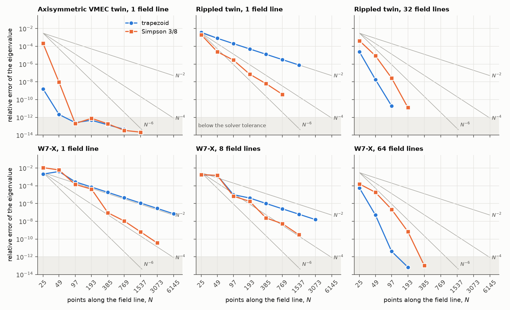
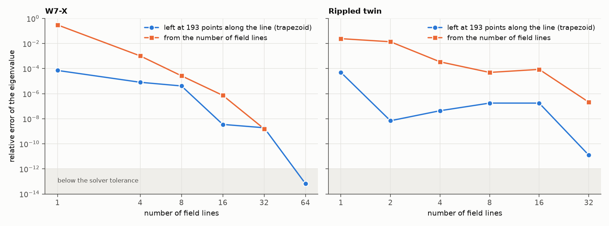
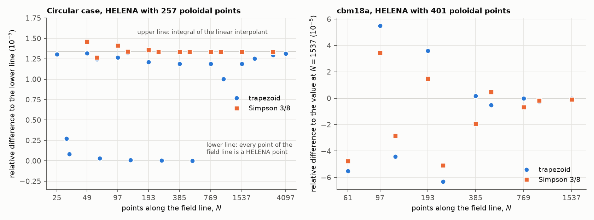
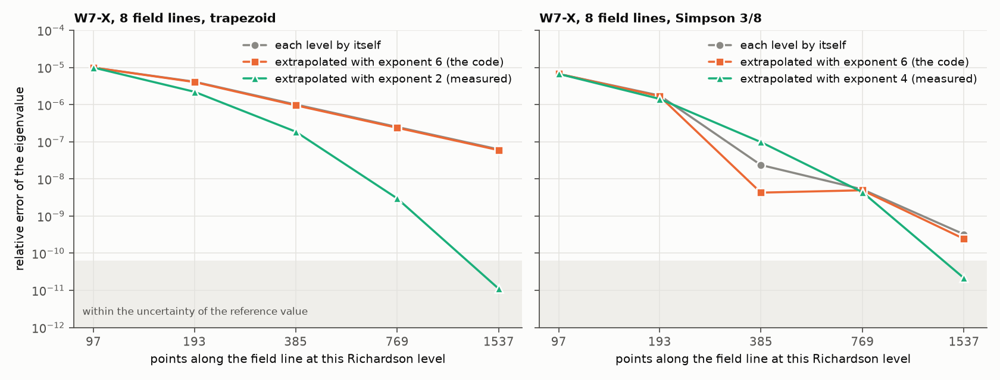
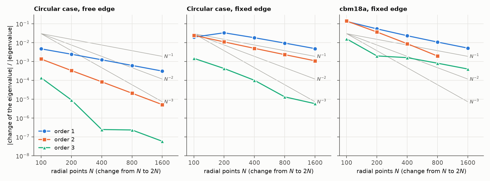

# The exponent of the Richardson extrapolation, and the order of the radial differences

19 November 2026, issue #12, commit da3ecba on `dev/vacuum-fixes` (version 2.50), all runs on
Snellius in the night of 18 to 19 November. Nothing in the code was changed.

This report answers two questions.

1. `calc_rich_ex` extrapolates the eigenvalue in the number of points along the field line with the
   exponent q = 2p, where p is the order of the radial difference (`norm_disc_prec_sol`), so q = 6 by
   default. Which exponent does the eigenvalue follow in practice? The theory document (sections
   7.4.2 and 7.16) and issue #12 both say that this has not been measured.
2. Does it make sense to open an issue that warns the user against an order of the radial
   differences that is too high, because the edge limits how fast the error falls?

## 1. The answers in short

**Question 1.** The eigenvalue never follows the exponent 6. What it follows depends on the
equilibrium and on the number of field lines, and there are three cases.

| case | trapezoid (`magn_int_style` 1) | Simpson 3/8 (`magn_int_style` 2) |
|---|---|---|
| 3-D equilibrium with too few field lines to resolve the toroidal variation (W7-X with 1, 4, 8 lines; the rippled twin with up to 16 lines; one line over 10 turns) | exponent 2.00 | exponent 4.0 |
| axisymmetric VMEC equilibrium, or a 3-D equilibrium with enough field lines (W7-X with 32 or 64, the rippled twin with 32) | no power: the error falls faster than any power of the step | no power, and about three times as many points are needed for the same error |
| HELENA | no power: the eigenvalue scatters with the number of points | the same |

The exponents 2 and 4 are what the two integration rules give for an integrand that is not the same
at the two ends of the field line. With the exponent 6 the code corrects the last level by 1/63 of
the last change, where an error proportional to the step squared needs 1/3 of it. On W7-X with 8
field lines and the trapezoidal rule, six levels from 25 to 769 points give an eigenvalue with a
relative error of 2.5e-7. The value that the code extrapolates from them has an error of 2.4e-7,
and PB3D prints for it "an error of the order O(Δ^42)". The same six values extrapolated with the
exponent 2 have an error of 6.8e-9.

**Question 2.** My reading of the measurements is: no, not an issue of that kind. The code refuses
an order above 3, and order 3 gave the smallest error in every radial scan up to 800 radial points.
What the scans do show is that at a fixed edge the error can fall only as 1/N in the number of
radial points N, and which order this happens to differs from case to case. An issue on the fixed
edge would be supported by the data. Section 6 has the numbers, and one correction to what I wrote
in the chat before this report.

## 2. What was run

All runs for question 1 have a fixed boundary (`BC_style = 1 1`), so that no vacuum enters the
measurement of the exponent. The radial scans for question 2 have a fixed boundary too, except one
scan of 18 runs on the circular HELENA case, which has a free boundary (`BC_style = 1 2`). Its
vacuum is the axisymmetric one, which does not depend on the number of points along the field line.

All runs use the toroidal mode number n = 10, one process, `tol_SLEPC = 1e-12` and
`max_it_rich = 1`: one run per number of points, without extrapolation. The number that is compared
is always the lowest eigenvalue λ = ω² in PB3D's normalisation.

| label | equilibrium file | what it is | radial range, radial points, poloidal modes |
|---|---|---|---|
| axisymmetric twin | `wout_circ_eps033_q104.nc` | VMEC, circular cross-section, inverse aspect ratio 0.33 | 0.2 to 1.0, 200, 10 |
| rippled twin | `wout_circ_eps033_rip04.nc` | VMEC, the same with a ripple of 0.04 in the toroidal harmonic 5 | 0.2 to 1.0, 200, 10 |
| W7-X | `wout_w7xflip.nc` | VMEC, W7-X standard case | 0.85 to 1.0, 60, 8 |
| circular HELENA | `circ_eps033_q104.12` | HELENA, 257 poloidal points; also files with 513, 1025 and 2049 | 0.2 to 1.0, 200, 10 |
| cbm18a | `cbm18a_extended_vac.12` | HELENA, 401 poloidal points | 0.45 to 0.75, 200, 20 |

- **Points along the field line.** N = 25, 49, 97, 193, 385, 769, 1537, and for some cases 3073 and
  6145. N − 1 doubles from one value to the next, as it does from one Richardson level to the next.
  The axisymmetric cases also have N = 31, 61, 121, 241, 481, 961.
- **Field lines.** `alpha_style = 2` with 1 to 64 field lines (`n_alpha`), each followed over one
  poloidal turn (`min_par_X = 0`, `max_par_X = 2`). In addition one field line over 10 poloidal
  turns (`alpha_style = 1`, `min_par_X = -10`, `max_par_X = 10`).
- **Both integration rules,** `magn_int_style` 1 (trapezoid) and 2 (Simpson 3/8).
- **The code's own Richardson loop,** `max_it_rich = 6` from 25 points, with `tol_SLEPC` given for
  every level.
- **Radial scans** for question 2: 100 to 3200 radial points (`n_r_sol`), orders 1, 2 and 3
  (`norm_disc_prec_sol`), fixed and free edge, at 100 points along the field line.

In total 483 PB3D runs. A run takes between 2 seconds and 4 minutes. The 52 runs with the two finest
HELENA files stopped at first, because these files need a larger `max_tot_mem`, and were repeated.

**How the error and the exponent are defined.** For one case and one number of field lines, the
reference value is the eigenvalue at the largest N, taken from the rule that changed least in its
last doubling. The error of a run is its relative difference to that reference. The exponent is

```
exponent = log2( [λ(N₂) − λ(N₁)] / [λ(N₃) − λ(N₂)] ),    N₃ − 1 = 2 (N₂ − 1) = 4 (N₁ − 1) ,
```

which is 2 for an error proportional to the step squared, and 6 for what the code assumes.

**The solver tolerance had to be tightened first.** With `tol_SLEPC = 1e-6`, the value of the
regression decks, the eigenvalue of the circular HELENA case differs by 3.7e-7 (relative) from the
one with 1e-12, and that of the axisymmetric twin by 3.6e-8. With 1e-9 the differences are 3.8e-10
and 2.7e-10. The values with 1e-12 and 1e-14 are identical, because PB3D raises 1e-14 to 1e-12.

## 3. What the two integration rules predict

This section is the mathematics of the sums of section 7.4 of the theory document. It predicts all
three cases of section 1, and the measurements of section 4 confirm it.

**The trapezoidal rule.** For a smooth integrand f between the ends a and b, with the step Δ, the
sum T(Δ) differs from the integral by terms at the two ends only (appendix G of the theory
document):

```
T(Δ) − ∫ f dθ = (Δ²/12) [f′(b) − f′(a)] − (Δ⁴/720) [f‴(b) − f‴(a)] + …
```

What remains after all these terms falls faster than any power of Δ.

**Simpson's 3/8 rule** is a combination of two trapezoidal sums, one with the step Δ and one with
every third point:

```
S(Δ) = [9 T(Δ) − T(3Δ)] / 8 .
```

Two things follow. The terms with Δ² cancel, so the first term of the error is

```
S(Δ) − ∫ f dθ = (Δ⁴/80) [f‴(b) − f‴(a)] + …
```

And the part that falls faster than any power is that of T(3Δ), a trapezoidal sum with a third of
the points. For an integrand without end terms Simpson's rule therefore needs about three times as
many points as the trapezoidal rule for the same error.

**Three situations.**

1. *Axisymmetric equilibrium, a whole number of poloidal turns.* The integrand has the same value
   and the same derivatives at both ends, so every end term vanishes. There is no power law.
2. *3-D equilibrium, one field line.* After one poloidal turn the field line is at another toroidal
   angle, where the equilibrium is different. The end terms do not vanish: the error is
   proportional to Δ² for the trapezoidal rule and to Δ⁴ for Simpson's rule.
3. *3-D equilibrium, several field lines.* The point where one field line ends is the point where
   another field line would start. In the integral over all field lines the end terms of all lines
   therefore cancel. With a finite number of equally spaced lines they cancel up to the error of
   the sum over the lines. So the terms with Δ² and Δ⁴ are still there, with a coefficient that
   falls as the number of lines grows, and that vanishes once the lines resolve the toroidal
   variation of the equilibrium.

**The eigenvalue** follows the sums. A small change of the matrices changes the eigenvalue by an
amount that is linear in that change, so the eigenvalue has the same exponent as the sums.

Nothing in this involves the order p of the radial difference. The exponent 2p in `calc_rich_ex`
has no relation to the points along the field line.

## 4. Results for the points along the field line

### 4.1 VMEC equilibria



*Figure 1. Relative error of the lowest eigenvalue against the number of points along the field
line, for the two integration rules. The thin lines are proportional to N⁻², N⁻⁴ and N⁻⁶ (the last
is what the code assumes). The grey band is below the solver tolerance of 1e-12.*

| case | rule | error at N = 25 | at 97 | at 385 | at 1537 | exponent from the last two doublings |
|---|---|---|---|---|---|---|
| axisymmetric twin, 1 line | trapezoid | 1.6e-9 | < 1e-12 | < 1e-12 | < 1e-12 | none |
| | Simpson 3/8 | 2.1e-4 | < 1e-12 | < 1e-12 | < 1e-12 | none |
| rippled twin, 1 line | trapezoid | 3.8e-3 | 2.0e-4 | 1.3e-5 | 7.9e-7 | 2.00 |
| | Simpson 3/8 | 2.0e-3 | 2.8e-6 | 6.2e-9 | reference | 3.92 |
| rippled twin, 4 lines | trapezoid | 1.5e-5 | 1.9e-7 | 1.1e-8 | 6.7e-10 | 2.01 |
| | Simpson 3/8 | 3.8e-4 | 1.3e-7 | 5.3e-10 | reference | 4.05 |
| rippled twin, 32 lines | trapezoid | 2.3e-5 | 1.9e-11 | not run | not run | none |
| | Simpson 3/8 | 4.2e-4 | 2.7e-8 | not run | not run | none |
| W7-X, 1 line | trapezoid | 2.1e-3 | 2.8e-4 | 1.8e-5 | 1.1e-6 | 2.00 |
| | Simpson 3/8 | 1.1e-2 | 1.4e-4 | 9.1e-8 | 6.3e-10 | 4.03 |
| W7-X, 8 lines | trapezoid | 1.7e-3 | 9.9e-6 | 1.0e-6 | 6.2e-8 | 2.00 |
| | Simpson 3/8 | 1.8e-3 | 6.7e-6 | 2.4e-8 | 3.0e-10 | 4.02 |
| W7-X, 64 lines | trapezoid | 5.5e-5 | 4.0e-12 | < 1e-12 | not run | none |
| | Simpson 3/8 | 1.6e-4 | 2.2e-7 | < 1e-12 | not run | none |

"Reference" means that this run is the reference value of its case. The other numbers of field
lines give the same picture. W7-X with 4 lines has the exponents 2.00 and 4.00. The rippled twin
has 2.00 and 4.11 with 8 lines, 2.01 for the trapezoidal rule with 16 lines, and 4.04 for Simpson's
rule with 2 lines. Its trapezoidal error with 2 lines is below 1e-8 from 193 points on and shows no
clean power.

Three observations.

- **Axisymmetric twin.** With the trapezoidal rule the eigenvalue at 25 points is already within
  1.6e-9 of its limit, and at 49 points within 2e-12. Simpson's rule has 2.1e-4 at 25 points and
  9.2e-9 at 49. This is situation 1 of section 3, with the factor of about three in the number of
  points.
- **3-D with few field lines.** The trapezoidal exponent is 2.00 over four or more doublings, and
  Simpson's reaches 4.0 in the last one or two. The W7-X runs with one field line were continued to
  6145 points to make sure: the trapezoidal exponent stays at 2.00, and Simpson's is 4.09 and 4.03
  in the last two doublings.
- **3-D with many field lines.** The power-law part is gone, and the error falls as for the
  axisymmetric twin. On W7-X this happens between 8 and 32 lines: with 16 lines the trapezoidal error
  is below 1e-8 from 193 points on, without a clean power.

**One field line over 10 poloidal turns** behaves in the same way. The rippled twin has the
exponents 2.01 (trapezoid) and 4.4, still falling towards 4 (Simpson). W7-X has 2.10 for the
trapezoidal rule; Simpson's rule has not reached its power law at 3841 points. The axisymmetric
twin again has no power law.

### 4.2 The coefficient falls with the number of field lines



*Figure 2. Two errors against the number of field lines. Blue: the relative difference between the
eigenvalue at 193 points along the line (trapezoid) and its limit for many points, with the same
number of field lines. Orange: the relative difference between that limit and the limit with 64
field lines.*

Figure 2 shows situation 3 of section 3 on W7-X: the error that is left along the line falls
together with the error from the number of field lines, and both are gone at 64 lines. A user who
has enough field lines for the second error therefore has no power-law error along the line left
to extrapolate.

The rippled twin does not fall as regularly. The reason is in its VMEC file, see section 5.3.

### 4.3 HELENA equilibria



*Figure 3. Left: the eigenvalue of the circular HELENA case against the number of points along the
field line, as the relative difference to the value for which every point of the field line is a
HELENA point. Right: the same for cbm18a, relative to the value at 1537 points with the trapezoidal
rule.*

For HELENA the eigenvalue does not converge with a power of the step. It scatters, and the size of
the scatter is set by HELENA's poloidal grid, not by N.

**The reason.** PB3D interpolates the HELENA quantities linearly between HELENA's poloidal points
(`interp_HEL_on_grid`). At a point that lies a fraction x of the way between two HELENA points,
with the distance h between them, linear interpolation of a function g is off by

```
− x (1 − x) h² g″ / 2 .
```

So the error of a sum depends on where the points of the field line fall between HELENA's points.

- If every point of the field line is a HELENA point, x = 0 everywhere and there is no
  interpolation error. The file has 257 poloidal points over half a turn (the equilibrium is
  top-bottom symmetric), that is 512 intervals per turn, so this is the case for N − 1 = 32, 64,
  128, 256 and 512. This is the lower line of figure 3: λ = 7.8429313e-2. The run with 33 points is
  still 8e-7 above it, because 32 intervals do not resolve the integrand yet.
- If the points of the field line are spread evenly between HELENA's points, the average of
  x (1 − x) / 2 is 1/12. The sum is then the integral of the linear interpolant. This is the upper
  line: λ = 7.8430360e-2, which is 1.33e-5 (relative) above the lower line.
- If there are k points of the field line per HELENA interval, at the fractions 0, 1/k, 2/k, …,
  the average is (1 − 1/k²) / 12. The eigenvalue should then lie at the fraction 1 − 1/k² of the
  way from the lower to the upper line.

The last statement can be checked, and it holds to all digits that the solver gives:

| N | k | measured | predicted |
|---|---|---|---|
| 1025 | 2 | 7.8430097827e-2 | 7.8430097829e-2 |
| 1537 | 3 | 7.8430243208e-2 | 7.8430243209e-2 |
| 2049 | 4 | 7.8430294092e-2 | 7.8430294093e-2 |
| 3073 | 6 | 7.8430330437e-2 | 7.8430330438e-2 |
| 4097 | 8 | 7.8430343158e-2 | 7.8430343158e-2 |

**What this means in practice.**

- At the numbers of points that are used in practice (the decks have 100) the eigenvalue of the
  circular case can lie anywhere in a band that is 1.3e-5 wide, depending on N. Most values of N
  give a value near the upper line. Extrapolation in N cannot remove this.
- The value without interpolation error is the lower line. The regression value of this case,
  7.84304e-2 at 100 points with Simpson's rule, lies near the upper line.
- For cbm18a the scatter between 61 and 481 points is about ±6e-5, a band about nine times as wide
  as for the circular case.
- The scatter should fall as h², that is, by a factor of 4 when the number of poloidal points
  doubles. The file with 513 points confirms this: its scatter is 2.9e-6, against 1.33e-5 for 257.
  The files with 1025 and 2049 points do not: their scatter is 2.5e-5 and 8.2e-5. I have not
  looked into why. These two files were made on 31 October for another purpose.

### 4.4 What the extrapolation of the code does

`calc_rich_ex` combines the eigenvalues of the levels as

```
s(l, r) = s(l, r−1) + [s(l, r−1) − s(l−1, r−1)] / (2^(q r) − 1) ,    q = 2p = 6 .
```

Table: relative error of the eigenvalue after six levels of PB3D's own Richardson loop, from 25 to
769 points, with `tol_SLEPC = 1e-12` on every level. "Exponent 2 or 4" is the same formula applied
to the same six level values with q = 2 for the trapezoidal rule and q = 4 for Simpson's rule.

| case | rule | last level by itself | extrapolated by the code (q = 6) | extrapolated with q = 2 or 4 |
|---|---|---|---|---|
| W7-X, 8 lines | trapezoid | 2.5e-7 | 2.4e-7 | 6.8e-9 |
| W7-X, 8 lines | Simpson 3/8 | 5.2e-9 | 4.9e-9 | 4.4e-9 |
| rippled twin, 4 lines | trapezoid | 2.7e-9 | 2.5e-9 | below 2e-12 |
| rippled twin, 4 lines | Simpson 3/8 | 3.2e-11 | 2.4e-11 | below 2e-12 |

The reference value of the rippled twin is known to 2e-12, so the last column of its two lines is
an upper limit.



*Figure 4. W7-X with 8 field lines: relative error of each level by itself, of the value that the
code's formula gives with the exponent 6, and of the value that the same formula gives with the
measured exponent. The levels here start at 97 points. The grey band is the uncertainty of the
reference value (Simpson at 3073 points, corrected once with the exponent 4).*

- **With the exponent 6 the extrapolation does almost nothing.** The correction is 1/63 of the last
  change. An error proportional to Δ² needs 1/3 of the last change, and one proportional to Δ⁴
  needs 1/15.
- **With the exponent 2 the trapezoidal rule gains several digits:** from 6.2e-8 to 1.1e-11 at 1537
  points in figure 4, which is the uncertainty of the reference value.
- **The first level must already lie where the power law holds.** On W7-X the first two levels of
  the run from 25 points (25 and 49 points) have errors of 1.7e-3 and 1.5e-3, which do not follow
  any power yet. They stay in the table of the extrapolation and spoil it, which is why the gain in
  the table above (from 2.5e-7 to 6.8e-9) is smaller than in figure 4. For Simpson's rule on W7-X
  the power law starts at about 769 points, and the extrapolation gains nothing before that.
- **For Simpson's rule the formula of the code is right in its first step only.** The error of
  Simpson's rule has the powers Δ⁴, Δ⁶, Δ⁸, while the formula with q = 4 removes Δ⁴, Δ⁸, Δ¹². For
  the trapezoidal rule the formula with q = 2 removes Δ², Δ⁴, Δ⁶, which are the right ones.
- **The levels are right.** The level values of the Richardson loop equal those of single runs with
  the same number of points to 8e-13 (relative) or better, for both rules. The reuse of the sums of
  the previous level is correct. Only the exponent is not.

## 5. Other things found on the way

### 5.1 The solver tolerance of the levels after the first

`tol_SLEPC` is an array with one entry per Richardson level. If the input gives one value, the
levels after the first get the default 1e-5 (`adapt_tols` in `input_ops`, with a warning), and
`check_conv` then lowers the tolerance of the next level to 0.01 times the last relative change.
With one value of 1e-12 in the input, the second level of the axisymmetric twin (Simpson) came out
3.6e-7 away from the single run with the same 49 points. The difference between the levels that the
extrapolation works with is 9e-9 there. A run that extrapolates needs a tolerance for every level,
for example `tol_SLEPC = 6*1.0E-12`.

### 5.2 The comment on Simpson's rule in `calc_magn_ints`

The comment says that Simpson's 3/8 rule converges faster than the trapezoidal rule. This is true
only in situation 2 of section 3 (3-D, few field lines). For an axisymmetric equilibrium, and for a
3-D equilibrium with enough field lines, the trapezoidal rule reaches the same error with about a
third of the points. The regression decks use Simpson's rule on axisymmetric cases.

### 5.3 The rippled twin is not five-fold symmetric

The eigenvalue of the rippled twin still moves in the fifth digit between 16 and 32 field lines.
Relative to the value with 64 lines, at 97 points along the line:

| field lines | 5 | 10 | 12 | 16 | 20 | 24 | 32 | 40 | 48 |
|---|---|---|---|---|---|---|---|---|---|
| relative difference | −1.0e-2 | −5.4e-5 | +1.6e-4 | +8.7e-5 | −8.5e-6 | −2.7e-6 | −2.1e-7 | +3.4e-10 | +7.5e-11 |

If the equilibrium contained only the toroidal harmonics 0, 5, 10, …, then 8 field lines and 40
field lines would make the same error, and they do not (5.0e-5 against 3.4e-10). The file
`wout_circ_eps033_rip04.nc` (one field period, toroidal harmonics up to 6) explains it. Its boundary
has the harmonics 0 and 5 only, but inside the plasma the other harmonics are not zero:

| toroidal harmonic | λ, largest coefficient on the surface next to the edge | \|B\|, largest coefficient at the edge |
|---|---|---|
| 0 | 4.6e-1 | 1.0 |
| ±5 | 5.2e-3 | 1.1e-1 |
| ±1 | 3.3e-3 | 9.6e-5 |
| ±6 | 2.4e-3 | 5.7e-4 |
| ±4 | 2.6e-4 | 4.1e-5 |

The safety factor of this case is 1.04, so the harmonic with poloidal and toroidal number 1 is
close to resonance, which may be why VMEC++ gives it this size. I have not looked further. It
matters for anyone who uses the rippled twins as five-fold symmetric cases, and it means that this
case needs 40 field lines before the sum over the lines is converged to 1e-9. This is a property of
the file, not of PB3D.

## 6. Question 2: the order of the radial differences



*Figure 5. Change of the lowest eigenvalue when the number of radial points doubles from N to 2N,
relative to the eigenvalue, for the orders 1, 2 and 3 of the radial difference. The thin lines are
proportional to N⁻¹, N⁻² and N⁻³. A change that falls along one of these lines means an error that
falls with that power.*

**The measured powers.** "Error at 200" is the relative difference between the eigenvalue at 200
radial points and the best estimate of its limit.

| case | order | the error falls as | error at 200 points | error at 3200 points |
|---|---|---|---|---|
| circular, free edge | 1 | 1/N (exponent 1.00) | 4.9e-3 | 3.1e-4 |
| | 2 | 1/N² (2.01) | 4.4e-4 | 1.7e-6 |
| | 3 | faster than 1/N³ down to 2e-7, then a rest below 3e-7 | 9.1e-6 | below 1e-7 |
| circular, fixed edge | 1 | 1/N (0.97) | 7.1e-2 | 4.9e-3 |
| | 2 | 1/N (1.09) | 2.0e-2 | 1.0e-3 |
| | 3 | between 1/N² and 1/N³ down to 1e-5, then changes of 6e-6 with both signs | 5.3e-4 | about 6e-6 |
| cbm18a, fixed edge | 1 | 1/N (1.06) | 9.8e-2 | 5.0e-3 |
| | 2 | 1/N² (2.1 to 2.2) | 4.8e-2 | 3.1e-4 at 1600 |
| | 3 | 1/N from 400 points on (1.02) | 5.2e-3 | 4.0e-4 |

The reference values are −0.4378828 (circular, free), 7.83886e-2 (circular, fixed) and −4.3800e-2
(cbm18a). The last one is the least certain: it assumes that the 1/N of order 3 continues. The
series of order 2 points to about −4.3789e-2 instead, which is 2.5e-4 away.

**What the scans say.**

- **Free edge.** The error falls as 1/N^p for p = 1 and 2, and at least as 1/N³ for p = 3. This is
  what section 7.11 of the theory document derives, and the edge does not limit order 3.
- **Fixed edge, circular case.** Orders 1 and 2 both fall only as 1/N. Order 3 does not, and its
  error is 40 times smaller than that of order 2 at 200 points and more than 100 times smaller at
  3200. The VMEC twin gives the same numbers as HELENA to four or five digits, so this does not come from
  the equilibrium code.
- **Fixed edge, cbm18a.** Here it is the other way round: order 2 falls as 1/N², and order 3 as 1/N
  from 400 points on. Order 3 is still the most accurate up to 800 points. At 1600 points order 2
  has caught up: its distance to the two candidate limits is 1.3e-5 or 2.4e-5 (absolute), against
  3.5e-5 or 2.5e-5 for order 3.
- **The inner end is not the cause in the circular case.** With the inner end moved from 0.2 to 0.1
  and to 0.4, at the same radial step, the eigenvalues of orders 2 and 3 change by 1.3e-7
  (relative) at most.

**A correction.** In the chat I wrote that order 3 had the smallest error at every resolution in
every scan. For cbm18a with a fixed edge this holds up to 800 radial points only.

**The one-mode model** of the theory document (`model/onemode.py`), at a fixed edge with equal
weights, which is what the code uses there:

| order | error of the lowest eigenvalue (true value 34.50) at 101, 201, 401, 801, 1601 points | falls as |
|---|---|---|
| 1 | −8.9e-3, −2.2e-3, −5.5e-4, −1.4e-4, −3.5e-5 | 1/N² |
| 2 | +5.3e-1, +2.5e-1, +1.2e-1, +5.8e-2, +2.9e-2 | 1/N, about +45.7/N |
| 3 | +3.4e-1, +1.7e-1, +8.5e-2, +4.2e-2, +2.1e-2 | 1/N, about +33.8/N |

In the model a higher order is worse at a fixed edge: at 1601 points the errors of orders 2 and 3
are 800 and 600 times that of order 1. This is the effect that the question is about. With
the weights of the sum rule at the fixed edge the model gives 1/N² for order 2 and 1/N³ for order 3.

**The code does not follow the model here, and I cannot say why.**

- Order 1 falls as 1/N in the code and as 1/N² in the model. The model has no term with one
  derivative (L¹ = 0); the code has, and a one-sided difference of order 1 in such a term gives an
  error proportional to the step. This is probably the difference, but I have not checked it.
- Order 2 falls as 1/N in the circular case, as in the model, but as 1/N² in cbm18a.
- Order 3 should fall as 1/N with about 0.74 times the coefficient of order 2. The circular case
  does not show this: the coefficient of order 2 is 0.29 (absolute), and that of order 3 is below
  0.002.
- cbm18a has 22 rational surfaces in its radial range, and the mode numbers that PB3D uses change
  along the radius there (`X_style` 2). An earlier session attributed the 1/N of order 3 to that.
  The circular case has neither, which makes it the cleaner test.

**My recommendation.**

- *No issue that warns against a high order.* Orders above 3 are refused, order 3 is the default,
  and at the resolutions that are used (200 to 800 radial points) it was the most accurate in all
  three cases. Against order 2 its error was smaller by a factor of 40 or more in the two circular
  cases, and in cbm18a by a factor of 9 at 200 points, 3 at 400 and 1.4 at 800.
- *An issue on the fixed edge would be justified.* Its content would be: at a fixed edge the error
  of the eigenvalue can fall as 1/N whatever the order (measured: order 2 in the circular case,
  order 3 in cbm18a); the code keeps equal weights there; the model gives 1/N³ with the weights of
  the sum rule; and a convergence study or an extrapolation in the radial points at a fixed edge
  must not assume 1/N^p. This is the point "the fixed edge" in the list of unsettled points of
  section 7.16 of the theory document, now with numbers from the code.

Whether to open it is your decision. I have not opened any issue.

## 7. Options for the Richardson extrapolation

These are options, not decisions, and none of them is in the code.

- **A. Take the exponent from the integration rule.** In `calc_rich_ex` and in the text that
  `term_rich` prints: column r removes Δ^(2r) for the trapezoidal rule, and Δ^(2r+2) for Simpson's
  rule (not Δ^(4r)). This is right for 3-D equilibria with few field lines. Where the error falls
  faster than any power, the extrapolation then changes the eigenvalue by a third of the last
  change, which is far below the error of the first levels and does no harm.
- **B. Leave the extrapolation as it is and say what it is.** It is off by default
  (`max_it_rich = 1`), and no test uses it. The documentation would say that the exponent 2p has no
  basis and that the levels serve as a convergence check in N only.
- **C. Remove the extrapolation and keep the levels.** The loop over levels, the reuse of the sums
  and the stopping test on the change between two levels would stay.

Independent of A to C:

- one `tol_SLEPC` in the input could apply to all levels (section 5.1);
- for HELENA, the points of the field line could be chosen on HELENA's points, or the interpolation
  could be of a higher order (section 4.3);
- the comment on Simpson's rule could be corrected (section 5.2).

## 8. What this report does not cover

- **The exponent with a free boundary.** With the 3-D vacuum the points along the field line are also the points of the
  boundary elements, and the vacuum has its own error in N (issue #11). The axisymmetric vacuum does
  not depend on N.
- **Other modes.** Only the lowest eigenvalue and n = 10 were measured.
- **The files with 1025 and 2049 HELENA points** (section 4.3) and **the origin of the harmonics in
  the rippled twin** (section 5.3) were not investigated.
- **The fixed edge** (section 6): why order 3 in the circular case shows no 1/N, and which of the two
  limits of cbm18a is right. A scan to 6400 radial points and a look at the slope of the mode at the
  edge would be the next steps.
- **No documents were changed.** Sections 7.4.2 and 7.16 of the theory document and issue #12 still
  say that the exponent has not been measured.

## 9. Files

- `Documentation/richardson_scan/results.txt`: one line per run, with the eigenvalue of every level.
- `Documentation/richardson_scan/figs.py`: makes the five figures in `fig/`; `figs.py tables` prints
  the numbers of sections 4 to 6.
- `Documentation/richardson_scan/gen.py`, `scan.sbatch`, `fetch.sh`: make the decks, run a list of
  them on Snellius, and collect the results.
- `Documentation/richardson_scan/model_fixed.py`: runs the one-mode model of the theory document at
  a fixed edge; it takes the folder with `onemode.py` as its argument.
- On Snellius everything is in `~/pb3d/rich` (source of da3ecba, Release build, decks, run folders
  with logs). It can be deleted with `rm -rf ~/pb3d/rich`.
