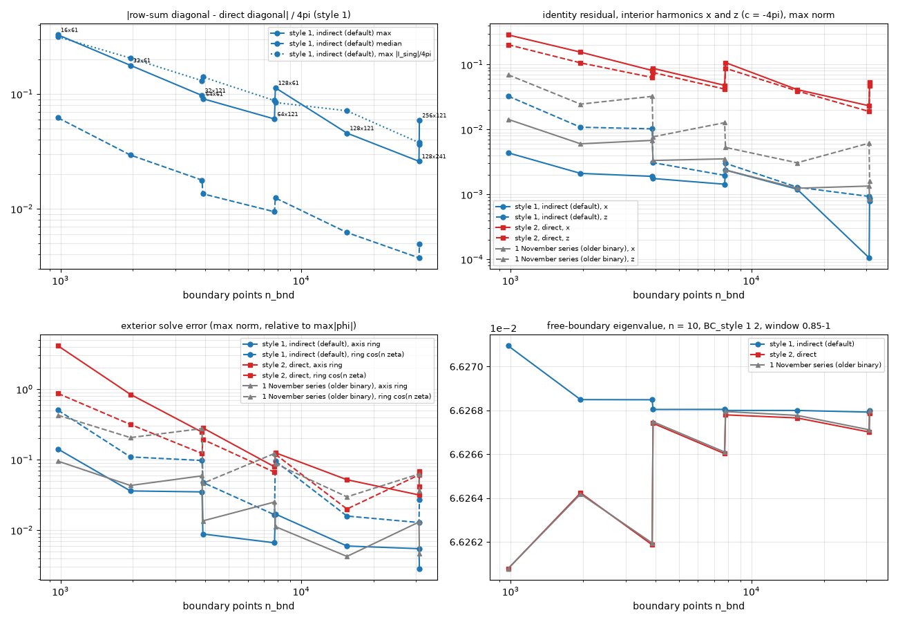
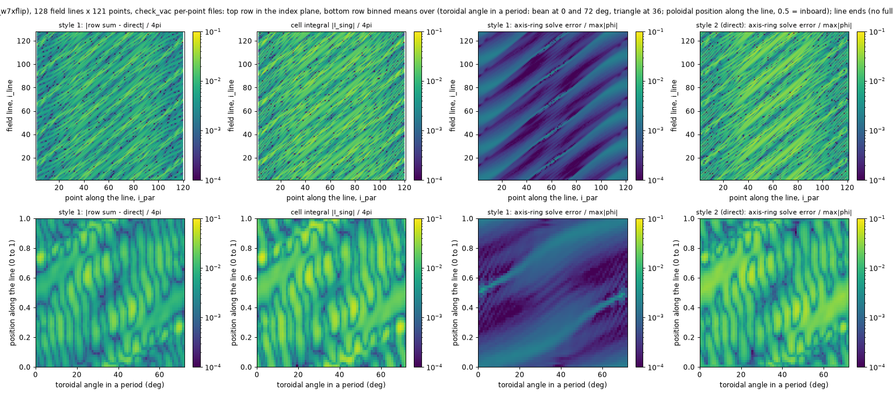

# W7-X: `check_vac` with the indirect and the direct diagonals

6 November 2026, issue #4, commit 225aa72 on `dev/vacuum-fixes`, all runs on Snellius.

The input `vac_diag_style` (5 November) selects how the diagonals of the boundary-element
operators H and G are set: indirect (1, the default), from the identities the discrete operators
must satisfy for known potentials, or direct (2), from the corner term and the integral of the
kernel over the node's cell. The default was chosen on the circular cases. This report applies both
options to a stellarator surface, the W7-X standard case, on the grids of the earlier alignment
study, and measures what the `check_vac` exact potentials say about each.

Short version: on W7-X the indirect diagonals are the only usable ones. At 128 field lines × 121
points the identity residual for the harmonic x is 1.2e-3 with them and 4.1e-2 with the direct
diagonals, and the exterior solve for the axis ring is off by 5.9e-3 against 5.2e-2. The row sum and
the direct diagonal of H differ by up to 0.33 of 4π on the coarsest grid and still by 0.03 to 0.06 of
4π at 31 000 points, as much as the cell integral of the kernel itself, which there is the size of a
cell as wide as the local radius of curvature. The free-boundary eigenvalue of this stable case is
the same to 1e-5 from 32 lines × 61 points on with the indirect diagonals, while with the direct ones
it wanders by up to 1.4e-4 even at 31 000 points.

## 1. What was run

- Equilibrium `wout_w7xflip.nc` (STELLOPT W7-X standard case, toroidal flux sign flipped for PB3D),
  `n = 10`, `BC_style = 1 2`, edge window 0.85 to 1.0 of the poloidal flux with 60 radial points,
  8 poloidal modes, `check_vac = .true.`, and `vac_diag_style = 1` or `2`. The decks are the
  `input_cv_w7x_<grid>` decks of the alignment study with that one line added
  (`~/pb3d/decks/input_cv_w7x_<grid>_d1`, `_d2`).
- Grids, field lines × points per line: 16 × 61, 32 × 61, 64 × 61, 128 × 61, 32 × 121, 64 × 121,
  128 × 121, 256 × 121 and 128 × 241, that is 976 to 30 976 boundary points. Four MPI processes;
  the four smallest grids also with one process. The eigenvalues of the one- and four-process runs
  agree to 2e-7 relative and the `CHECKVAC` lines are identical, so the distributed direct diagonal
  (`calc_diag_direct`, `dis_diag`) works under the block-cyclic distribution.
- Job script `scripts/snellius/jobs_diag.sh` (jobs `d8s1_*`, `d8s2_*`), statistics
  `scripts/snellius/diag_table.py`, figures `Documentation/figures/w7x_diag/make_figures.py`. The
  31 000-point runs take 27 minutes on four Rome cores with 200 GB; the smaller ones seconds to
  minutes. The per-point files `check_vac_*.dat` of every run are kept under
  `~/pb3d/runs/d8s<style>_w7x_<grid>-<job>/np4/`.
- Gate: `ctest` of the Release build on Snellius, 27 of 27 tests passed, including the two- and
  four-process rows that the Mac cannot run.

What `check_vac` measures. The Green identity H φ − G φ′ = c φ is evaluated for the interior
harmonics 1, x, y, z and x² − y² (c = −4π) and for three exterior potentials (c = 0): a point source
0.02 R₀ from the surface, a ring source on the magnetic axis and the same ring with cos nζ weights.
The residual is the maximum over the points relative to 4π max |φ|. The three exterior potentials
are then solved for from their normal derivatives, and the solution error is the maximum relative to
max |φ|. Finally the diagonal of H as assembled is compared per point with the alternative: for
style 1 the direct value −2π + I_sing, with I_sing the cell integral of the kernel of the corrected
eq. (69) of the 2019 manuscript, computed only at points with a full cell (the two end points of
every field line are left out); for style 2 the two are equal by construction. The faceted
alternative, −Ω_v + I_sing with Ω_v the exact solid angle of the faceted node (eq. 45), is reported
as well. Every per-point quantity is written to a file with the point's indices and position.

## 2. Results

The tables are the output of `diag_table.py` on the run directories. R and Z are in units of R₀,
`zeta in period` is the toroidal angle reduced to one of the five periods (bean plane at 0 and 72
degrees, triangular plane at 36). The `cv7` rows are the 1 November series on the same decks, run
with an older binary (section 3.6).

**Table 1: identity residuals (interior harmonics at c=-4pi, exterior sources at c=0) and exact-solve errors (max norm), eigenvalue**

```
run                          np   st  n_bnd | id x     id z     id x2-y2 | id point id ring  id ring_n | sv point sv ring  sv ring_n | cond1 EV
cv7_w7x_na16_p61-28788922    np4  -     976 | 1.43e-02 6.95e-02 2.91e-02 | 3.30e-01 6.47e-02 2.32e-01 | 6.33e-01 9.50e-02 4.26e-01 | 3.82  6.6260786e-02 
d8s1_w7x_na16_p61-28936156   np1  1     976 | 4.36e-03 3.26e-02 8.67e-03 | 2.72e-01 6.18e-02 2.14e-01 | 5.81e-01 1.41e-01 5.02e-01 | 3.82  6.6270949e-02 
d8s1_w7x_na16_p61-28936156   np4  1     976 | 4.36e-03 3.26e-02 8.67e-03 | 2.72e-01 6.18e-02 2.14e-01 | 5.81e-01 1.41e-01 5.02e-01 | 3.82  6.6270948e-02 
d8s2_w7x_na16_p61-28936165   np1  2     976 | 2.86e-01 2.02e-01 2.66e-01 | 2.36e-01 2.28e-01 1.24e-01 | 7.07e-01 4.11e+00 8.67e-01 | 4.73  6.6260787e-02 
d8s2_w7x_na16_p61-28936165   np4  2     976 | 2.86e-01 2.02e-01 2.66e-01 | 2.36e-01 2.28e-01 1.24e-01 | 7.07e-01 4.11e+00 8.67e-01 | 4.73  6.6260775e-02 
cv7_w7x_na32_p61-28788924    np4  -    1952 | 6.00e-03 2.45e-02 1.24e-02 | 2.90e-01 2.66e-02 1.01e-01 | 6.06e-01 4.29e-02 2.05e-01 | 3.86  6.6264183e-02 
d8s1_w7x_na32_p61-28936157   np1  1    1952 | 2.10e-03 1.08e-02 4.25e-03 | 2.65e-01 1.85e-02 5.14e-02 | 5.80e-01 3.59e-02 1.09e-01 | 3.86  6.6268489e-02 
d8s1_w7x_na32_p61-28936157   np4  1    1952 | 2.10e-03 1.08e-02 4.25e-03 | 2.65e-01 1.85e-02 5.14e-02 | 5.80e-01 3.59e-02 1.09e-01 | 3.86  6.6268491e-02 
d8s2_w7x_na32_p61-28936166   np1  2    1952 | 1.55e-01 1.06e-01 1.41e-01 | 1.63e-01 1.33e-01 7.00e-02 | 3.46e-01 8.41e-01 3.15e-01 | 4.08  6.6264226e-02 
d8s2_w7x_na32_p61-28936166   np4  2    1952 | 1.55e-01 1.06e-01 1.41e-01 | 1.63e-01 1.33e-01 7.00e-02 | 3.46e-01 8.41e-01 3.15e-01 | 4.08  6.6264235e-02 
cv7_w7x_na64_p61-28788926    np4  -    3904 | 3.32e-03 7.69e-03 7.16e-03 | 2.73e-01 7.03e-03 2.45e-02 | 5.82e-01 1.35e-02 4.61e-02 | 3.66  6.6267482e-02 
d8s1_w7x_na64_p61-28936158   np1  1    3904 | 1.75e-03 3.07e-03 3.61e-03 | 2.71e-01 3.77e-03 2.09e-02 | 5.91e-01 8.80e-03 4.73e-02 | 3.66  6.6268057e-02 
d8s1_w7x_na64_p61-28936158   np4  1    3904 | 1.75e-03 3.07e-03 3.61e-03 | 2.71e-01 3.77e-03 2.09e-02 | 5.91e-01 8.80e-03 4.73e-02 | 3.66  6.6268042e-02 
d8s2_w7x_na64_p61-28936167   np1  2    3904 | 8.73e-02 7.52e-02 8.19e-02 | 2.14e-01 6.74e-02 6.37e-02 | 4.94e-01 2.81e-01 1.93e-01 | 3.71  6.6267433e-02 
d8s2_w7x_na64_p61-28936167   np4  2    3904 | 8.73e-02 7.52e-02 8.19e-02 | 2.14e-01 6.74e-02 6.37e-02 | 4.94e-01 2.81e-01 1.93e-01 | 3.71  6.6267411e-02 
cv7_w7x_na128_p61-28788928   np4  -    7808 | 2.37e-03 5.28e-03 4.54e-03 | 8.92e-02 5.56e-03 4.14e-02 | 2.02e-01 1.12e-02 8.75e-02 | 3.96  6.6267947e-02 
d8s1_w7x_na128_p61-28936160  np4  1    7808 | 2.36e-03 3.00e-03 4.73e-03 | 9.10e-02 5.91e-03 4.26e-02 | 2.09e-01 1.69e-02 9.55e-02 | 3.96  6.6267998e-02 
d8s2_w7x_na128_p61-28936169  np4  2    7808 | 1.07e-01 8.74e-02 1.02e-01 | 1.03e-01 7.57e-02 5.55e-02 | 2.31e-01 1.25e-01 1.19e-01 | 3.90  6.6267795e-02 
cv7_w7x_na32_p121-28788925   np4  -    3872 | 6.77e-03 3.23e-02 1.36e-02 | 1.49e-01 3.62e-02 1.36e-01 | 3.08e-01 5.88e-02 2.75e-01 | 3.81  6.6261947e-02 
d8s1_w7x_na32_p121-28936159  np1  1    3872 | 1.89e-03 1.02e-02 4.03e-03 | 5.42e-02 1.71e-02 4.67e-02 | 1.13e-01 3.48e-02 9.71e-02 | 3.81  6.6268483e-02 
d8s1_w7x_na32_p121-28936159  np4  1    3872 | 1.89e-03 1.02e-02 4.03e-03 | 5.42e-02 1.71e-02 4.67e-02 | 1.13e-01 3.48e-02 9.71e-02 | 3.81  6.6268485e-02 
d8s2_w7x_na32_p121-28936168  np1  2    3872 | 8.09e-02 6.31e-02 7.18e-02 | 8.60e-02 7.22e-02 6.44e-02 | 1.71e-01 2.45e-01 1.22e-01 | 3.93  6.6261856e-02 
d8s2_w7x_na32_p121-28936168  np4  2    3872 | 8.09e-02 6.31e-02 7.18e-02 | 8.60e-02 7.22e-02 6.44e-02 | 1.71e-01 2.45e-01 1.22e-01 | 3.93  6.6261868e-02 
cv7_w7x_na64_p121-28788927   np4  -    7744 | 3.52e-03 1.27e-02 7.16e-03 | 6.76e-02 1.52e-02 5.97e-02 | 1.37e-01 2.50e-02 1.22e-01 | 3.81  6.6266100e-02 
d8s1_w7x_na64_p121-28936161  np4  1    7744 | 1.43e-03 1.96e-03 3.10e-03 | 2.21e-02 3.81e-03 7.42e-03 | 4.56e-02 6.60e-03 1.65e-02 | 3.81  6.6268045e-02 
d8s2_w7x_na64_p121-28936170  np4  2    7744 | 4.77e-02 4.18e-02 4.19e-02 | 4.35e-02 4.93e-02 3.52e-02 | 8.33e-02 7.90e-02 6.62e-02 | 3.84  6.6266024e-02 
cv7_w7x_na128_p121-28788931  np4  -   15488 | 1.24e-03 3.06e-03 2.50e-03 | 2.20e-02 2.19e-03 1.44e-02 | 4.62e-02 4.23e-03 2.96e-02 | 3.72  6.6267772e-02 
d8s1_w7x_na128_p121-28936162 np4  1   15488 | 1.20e-03 1.29e-03 2.40e-03 | 2.22e-02 3.49e-03 7.13e-03 | 4.59e-02 5.94e-03 1.58e-02 | 3.72  6.6267997e-02 
d8s2_w7x_na128_p121-28936171 np4  2   15488 | 4.11e-02 3.92e-02 3.69e-02 | 2.43e-02 3.23e-02 1.16e-02 | 5.51e-02 5.18e-02 1.99e-02 | 3.73  6.6267655e-02 
cv7_w7x_na256_p121-28788934  np4  -   30976 | 8.36e-04 1.61e-03 1.52e-03 | 8.66e-02 2.24e-03 1.76e-02 | 1.80e-01 4.60e-03 3.66e-02 | 3.86  6.6267997e-02 
d8s1_w7x_na256_p121-28936163 np4  1   30976 | 7.83e-04 8.65e-04 1.38e-03 | 7.99e-02 1.59e-03 1.27e-02 | 1.66e-01 2.83e-03 2.71e-02 | 3.86  6.6267999e-02 
d8s2_w7x_na256_p121-28936172 np4  2   30976 | 5.35e-02 4.77e-02 4.81e-02 | 8.86e-02 3.89e-02 1.96e-02 | 1.84e-01 6.79e-02 4.17e-02 | 3.83  6.6267870e-02 
cv7_w7x_na128_p241-28788935  np4  -   30848 | 1.34e-03 6.14e-03 2.67e-03 | 6.68e-02 8.10e-03 3.05e-02 | 1.38e-01 1.30e-02 6.24e-02 | 3.80  6.6267116e-02 
d8s1_w7x_na128_p241-28936164 np4  1   30848 | 1.05e-04 9.28e-04 1.88e-04 | 2.97e-02 2.57e-03 6.20e-03 | 6.22e-02 5.45e-03 1.28e-02 | 3.80  6.6267922e-02 
d8s2_w7x_na128_p241-28936173 np4  2   30848 | 2.31e-02 1.89e-02 2.29e-02 | 6.60e-02 1.75e-02 2.96e-02 | 1.36e-01 3.15e-02 6.06e-02 | 3.81  6.6267012e-02 
```

**Table 2: assembled diagonal of H against the direct one, |assembled - direct|/4pi over the points with a full cell** style 1: row sum vs -2pi + cell integral (the quadrature error of the off-diagonal row); style 2: zero by construction

```
run                          st  n_bnd  n_cell | max      mean     median   | facet max Ising max | omega max omega med | largest at (i_par, i_line, R, Z, zeta in period)
cv7_w7x_na16_p61-28788922    -     976       - | -        -        -        | -        -        | -        -        | -
d8s1_w7x_na16_p61-28936156   1     976     944 | 3.27e-01 8.94e-02 6.20e-02 | 7.38e-01 3.15e-01 | 4.60e-01 1.72e-01 | (15, 12, R=1.036, Z=+0.078, 56 deg)
d8s2_w7x_na16_p61-28936165   2     976     944 | -        -        -        | 4.60e-01 3.15e-01 | 4.60e-01 1.72e-01 | -
cv7_w7x_na32_p61-28788924    -    1952       - | -        -        -        | -        -        | -        -        | -
d8s1_w7x_na32_p61-28936157   1    1952    1888 | 1.78e-01 4.59e-02 2.93e-02 | 6.59e-01 2.06e-01 | 4.94e-01 9.61e-02 | (45, 24, R=1.024, Z=-0.057, 17 deg)
d8s2_w7x_na32_p61-28936166   2    1952    1888 | -        -        -        | 4.94e-01 2.06e-01 | 4.94e-01 9.61e-02 | -
cv7_w7x_na64_p61-28788926    -    3904       - | -        -        -        | -        -        | -        -        | -
d8s1_w7x_na64_p61-28936158   1    3904    3776 | 9.09e-02 2.11e-02 1.35e-02 | 5.12e-01 1.41e-01 | 4.36e-01 1.74e-01 | (58, 21, R=1.075, Z=-0.034, 28 deg)
d8s2_w7x_na64_p61-28936167   2    3904    3776 | -        -        -        | 4.36e-01 1.41e-01 | 4.36e-01 1.74e-01 | -
cv7_w7x_na128_p61-28788928   -    7808       - | -        -        -        | -        -        | -        -        | -
d8s1_w7x_na128_p61-28936160  1    7808    7552 | 1.13e-01 1.60e-02 1.24e-02 | 4.74e-01 8.42e-02 | 4.01e-01 1.98e-01 | (2, 15, R=1.075, Z=+0.012, 39 deg)
d8s2_w7x_na128_p61-28936169  2    7808    7552 | -        -        -        | 4.01e-01 8.42e-02 | 4.01e-01 1.98e-01 | -
cv7_w7x_na32_p121-28788925   -    3872       - | -        -        -        | -        -        | -        -        | -
d8s1_w7x_na32_p121-28936159  1    3872    3808 | 9.70e-02 2.39e-02 1.77e-02 | 5.76e-01 1.30e-01 | 4.98e-01 1.06e-01 | (36, 25, R=1.015, Z=+0.045, 56 deg)
d8s2_w7x_na32_p121-28936168  2    3872    3808 | -        -        -        | 4.98e-01 1.30e-01 | 4.98e-01 1.06e-01 | -
cv7_w7x_na64_p121-28788927   -    7744       - | -        -        -        | -        -        | -        -        | -
d8s1_w7x_na64_p121-28936161  1    7744    7616 | 6.05e-02 1.20e-02 9.39e-03 | 4.67e-01 8.76e-02 | 4.36e-01 1.80e-01 | (49, 45, R=0.877, Z=+0.002, 47 deg)
d8s2_w7x_na64_p121-28936170  2    7744    7616 | -        -        -        | 4.36e-01 8.76e-02 | 4.36e-01 1.80e-01 | -
cv7_w7x_na128_p121-28788931  -   15488       - | -        -        -        | -        -        | -        -        | -
d8s1_w7x_na128_p121-28936162 1   15488   15232 | 4.56e-02 7.54e-03 6.20e-03 | 3.98e-01 7.13e-02 | 3.90e-01 1.56e-01 | (89, 98, R=1.000, Z=-0.142, 3 deg)
d8s2_w7x_na128_p121-28936171 2   15488   15232 | -        -        -        | 3.90e-01 7.13e-02 | 3.90e-01 1.56e-01 | -
cv7_w7x_na256_p121-28788934  -   30976       - | -        -        -        | -        -        | -        -        | -
d8s1_w7x_na256_p121-28936163 1   30976   30464 | 5.90e-02 6.73e-03 4.92e-03 | 3.62e-01 3.62e-02 | 3.65e-01 1.35e-01 | (92, 148, R=1.019, Z=-0.131, 6 deg)
d8s2_w7x_na256_p121-28936172 2   30976   30464 | -        -        -        | 3.65e-01 3.62e-02 | 3.65e-01 1.35e-01 | -
cv7_w7x_na128_p241-28788935  -   30848       - | -        -        -        | -        -        | -        -        | -
d8s1_w7x_na128_p241-28936164 1   30848   30592 | 2.59e-02 4.60e-03 3.73e-03 | 3.82e-01 3.77e-02 | 3.76e-01 1.29e-01 | (236, 17, R=1.073, Z=-0.009, 35 deg)
d8s2_w7x_na128_p241-28936173 2   30848   30592 | -        -        -        | 3.76e-01 3.77e-02 | 3.76e-01 1.29e-01 | -
```

**Table 3: where the largest exact-solve error sits (relative to max|phi|): max (i_par, i_line, R, Z, zeta in period) median**

```
run                          st | axis ring                                      | ring with cos n zeta                           | point source
cv7_w7x_na16_p61-28788922    -  | 9.50e-02 (33, 13, 1.021, -0.011, 2) 1.1e-02    | 4.26e-01 (33, 13, 1.021, -0.011, 2) 1.8e-02    | 6.33e-01 (30, 9, 1.016, +0.031, 2) 9.0e-03
d8s1_w7x_na16_p61-28936156   1  | 1.41e-01 (31, 3, 1.020, -0.011, 71) 2.1e-03    | 5.02e-01 (31, 3, 1.020, -0.011, 71) 9.5e-03    | 5.81e-01 (30, 9, 1.016, +0.031, 2) 9.5e-03
d8s2_w7x_na16_p61-28936165   2  | 4.11e+00 (31, 3, 1.020, -0.011, 71) 3.7e-01    | 8.67e-01 (30, 6, 1.018, -0.011, 69) 4.2e-02    | 7.07e-01 (34, 10, 1.020, -0.011, 4) 1.8e-02
cv7_w7x_na32_p61-28788924    -  | 4.29e-02 (31, 5, 1.020, -0.011, 71) 3.7e-03    | 2.05e-01 (31, 5, 1.020, -0.011, 71) 8.0e-03    | 6.06e-01 (30, 17, 1.016, +0.031, 2) 8.6e-03
d8s1_w7x_na32_p61-28936157   1  | 3.59e-02 (32, 18, 1.018, +0.010, 3) 1.1e-03    | 1.09e-01 (32, 18, 1.018, +0.010, 3) 3.3e-03    | 5.80e-01 (30, 17, 1.016, +0.031, 2) 8.7e-03
d8s2_w7x_na32_p61-28936166   2  | 8.41e-01 (34, 19, 1.020, -0.011, 4) 7.9e-02    | 3.15e-01 (34, 19, 1.020, -0.011, 4) 1.7e-02    | 3.46e-01 (30, 17, 1.016, +0.031, 2) 8.6e-03
cv7_w7x_na64_p61-28788926    -  | 1.35e-02 (1, 52, 1.108, +0.001, 1) 1.2e-03     | 4.61e-02 (31, 8, 1.007, +0.039, 4) 3.7e-03     | 5.82e-01 (30, 33, 1.016, +0.031, 2) 8.7e-03
d8s1_w7x_na64_p61-28936158   1  | 8.80e-03 (31, 61, 0.999, -0.047, 66) 9.9e-04   | 4.73e-02 (31, 8, 1.007, +0.039, 4) 2.8e-03     | 5.91e-01 (30, 33, 1.016, +0.031, 2) 8.7e-03
d8s2_w7x_na64_p61-28936167   2  | 2.81e-01 (32, 48, 1.020, -0.000, 2) 3.0e-02    | 1.93e-01 (32, 48, 1.020, -0.000, 2) 6.9e-03    | 4.94e-01 (30, 33, 1.016, +0.031, 2) 8.0e-03
cv7_w7x_na128_p61-28788928   -  | 1.12e-02 (31, 119, 1.021, -0.000, 72) 8.5e-04  | 8.75e-02 (31, 119, 1.021, -0.000, 72) 3.7e-03  | 2.02e-01 (31, 68, 1.020, -0.006, 71) 2.3e-04
d8s1_w7x_na128_p61-28936160  1  | 1.69e-02 (31, 119, 1.021, -0.000, 72) 8.3e-04  | 9.55e-02 (31, 119, 1.021, -0.000, 72) 3.3e-03  | 2.09e-01 (31, 68, 1.020, -0.006, 71) 2.1e-04
d8s2_w7x_na128_p61-28936169  2  | 1.25e-01 (60, 95, 1.075, -0.012, 33) 2.0e-02   | 1.19e-01 (31, 119, 1.021, -0.000, 72) 4.7e-03  | 2.31e-01 (31, 68, 1.020, -0.006, 71) 5.1e-04
cv7_w7x_na32_p121-28788925   -  | 5.88e-02 (61, 24, 1.020, +0.010, 1) 5.0e-03    | 2.75e-01 (61, 24, 1.020, +0.010, 1) 6.8e-03    | 3.08e-01 (62, 18, 1.020, -0.011, 72) 5.4e-04
d8s1_w7x_na32_p121-28936159  1  | 3.48e-02 (63, 18, 1.018, +0.010, 3) 5.4e-04    | 9.71e-02 (63, 18, 1.018, +0.010, 3) 1.2e-03    | 1.13e-01 (62, 18, 1.020, -0.011, 72) 5.2e-04
d8s2_w7x_na32_p121-28936168  2  | 2.45e-01 (50, 28, 1.020, +0.031, 66) 3.6e-02   | 1.22e-01 (61, 24, 1.020, +0.010, 1) 9.0e-03    | 1.71e-01 (62, 18, 1.020, -0.011, 72) 1.3e-03
cv7_w7x_na64_p121-28788927   -  | 2.50e-02 (61, 60, 1.021, -0.000, 72) 2.0e-03   | 1.22e-01 (61, 60, 1.021, -0.000, 72) 3.1e-03   | 1.37e-01 (62, 35, 1.020, -0.011, 72) 2.5e-04
d8s1_w7x_na64_p121-28936161  1  | 6.60e-03 (59, 21, 1.018, -0.011, 69) 4.3e-04   | 1.65e-02 (57, 58, 1.020, +0.021, 71) 9.9e-04   | 4.56e-02 (63, 36, 1.011, -0.041, 69) 2.3e-04
d8s2_w7x_na64_p121-28936170  2  | 7.90e-02 (67, 50, 1.021, -0.021, 3) 1.7e-02    | 6.62e-02 (61, 60, 1.021, -0.000, 72) 3.6e-03   | 8.33e-02 (62, 35, 1.020, -0.011, 72) 5.6e-04
cv7_w7x_na128_p121-28788931  -  | 4.23e-03 (1, 77, 1.108, +0.002, 2) 6.2e-04     | 2.96e-02 (61, 119, 1.021, -0.000, 72) 1.5e-03  | 4.62e-02 (62, 70, 1.012, -0.036, 69) 2.3e-04
d8s1_w7x_na128_p121-28936162 1  | 5.94e-03 (63, 18, 1.019, +0.005, 2) 4.3e-04    | 1.58e-02 (65, 72, 1.020, -0.027, 1) 9.9e-04    | 4.59e-02 (62, 70, 1.012, -0.036, 69) 2.3e-04
d8s2_w7x_na128_p121-28936171 2  | 5.18e-02 (75, 100, 0.884, -0.007, 25) 9.8e-03  | 1.99e-02 (51, 37, 0.941, -0.031, 55) 1.9e-03   | 5.51e-02 (62, 70, 1.012, -0.036, 69) 3.6e-04
cv7_w7x_na256_p121-28788934  -  | 4.60e-03 (61, 237, 1.021, -0.000, 72) 5.1e-04  | 3.66e-02 (61, 237, 1.021, -0.000, 72) 1.3e-03  | 1.80e-01 (62, 137, 1.020, -0.011, 72) 2.3e-04
d8s1_w7x_na256_p121-28936163 1  | 2.83e-03 (61, 237, 1.021, -0.000, 72) 5.0e-04  | 2.71e-02 (61, 237, 1.021, -0.000, 72) 1.1e-03  | 1.66e-01 (62, 137, 1.020, -0.011, 72) 2.4e-04
d8s2_w7x_na256_p121-28936172 2  | 6.79e-02 (92, 148, 1.019, -0.131, 6) 7.0e-03   | 4.17e-02 (61, 237, 1.021, -0.000, 72) 1.9e-03  | 1.84e-01 (62, 137, 1.020, -0.011, 72) 3.2e-04
cv7_w7x_na128_p241-28788935  -  | 1.30e-02 (121, 119, 1.021, -0.000, 72) 1.0e-03 | 6.24e-02 (121, 119, 1.021, -0.000, 72) 9.3e-04 | 1.38e-01 (123, 69, 1.020, -0.011, 72) 2.2e-04
d8s1_w7x_na128_p241-28936164 1  | 5.45e-03 (125, 18, 1.019, +0.005, 2) 1.7e-04   | 1.28e-02 (125, 18, 1.019, +0.005, 2) 2.8e-04   | 6.22e-02 (120, 67, 1.020, +0.010, 1) 2.3e-04
d8s2_w7x_na128_p241-28936173 2  | 3.15e-02 (236, 17, 1.073, -0.009, 35) 5.2e-03  | 6.06e-02 (121, 119, 1.021, -0.000, 72) 1.3e-03 | 1.36e-01 (123, 69, 1.020, -0.011, 72) 2.3e-04
```




Figure 1. Against the number of boundary points: (top left) the difference between the row-sum
diagonal and the direct one, maximum and median over the points with a full cell, and the maximum
of the cell integral; (top right) the identity residual for the interior harmonics x and z;
(bottom left) the exterior solve errors for the axis ring and the ring with cos nζ weights; (bottom
right) the free-boundary eigenvalue. Blue: indirect diagonals; red: direct; grey: the 1 November
series.



Figure 2. The per-point files at 128 lines × 121 points. Top row in the plane of the point
indices (point along the line, field line), bottom row the binned mean over the plane of the
toroidal angle within one period and the position along the line (0.5 is the inboard side). From
left to right: the difference between the row-sum and the direct diagonal of H, relative to 4π; the
cell integral |I_sing| relative to 4π; the exterior solve error for the axis ring with the indirect
diagonals; the same with the direct diagonals.

## 3. Findings

### 3.1 The default holds on W7-X, by a wide margin

At every grid the indirect diagonals give the smaller identity residuals and the smaller solve
errors. At 128 × 121 the residual for x is 1.2e-3 against 4.1e-2 (a factor 34), for z 1.3e-3
against 3.9e-2, and the exterior solves are off by 5.9e-3 against 5.2e-2 for the axis ring (a
factor 9) and 1.6e-2 against 2.0e-2 for the ring with cos 10ζ weights. On the coarsest grid the
direct diagonals do not give a usable operator at all: the axis-ring solve is off by a factor 4 and
the identity residuals are 0.2 to 0.3. The direct option converges at first order from there, and at
31 000 points its identity residual for x is still 2.3e-2 (128 × 241) to 5.4e-2 (256 × 121), where the
indirect one is 1.0e-4 to 7.8e-4; the axis-ring solve is then off by 3.2e-2 and 6.8e-2 with the
direct diagonals against 5.5e-3 and 2.8e-3 with the indirect ones, the ring with cos 10ζ weights by
6.1e-2 and 4.2e-2 against 1.3e-2 and 2.7e-2.

### 3.2 What the difference between the two diagonals is

For style 1 the per-point difference between the row-sum diagonal and the direct one is the
near-field quadrature error of the H row: the off-diagonal entries next to the diagonal are
integrated with the one-point rule across the field lines and the linear interpolation along them,
and the row sum sets the diagonal so that the row is exact for the constant potential, which puts
that error into the diagonal. The direct diagonal leaves it in the off-diagonal entries. The exact
solves of 3.1 show which operator is the more accurate for smooth potentials, and it is the one with
the row sum, so the difference is a property of the near-field row, not an error of the direct
diagonal alone.

Its size is set by the cell integral itself. The maximum of |I_sing|/4π is 0.32 at 976 points and
0.036 at 31 000 points, and the maximum difference follows it: 0.33, 0.18, 0.09, 0.11 (the four
grids with 61 points), 0.10, 0.06, 0.046 (121 points), 0.059 (256 × 121) and 0.026 (128 × 241); the
median is 0.062 at 976 points and 0.004 to 0.005 at 31 000. For a cell of half-width h on a surface
of normal curvature κ the cell integral of the kernel is about −π κ h, so |I_sing|/4π is about κh/4:
the largest cell integral corresponds to κh ≈ 1.3 on the coarsest grid, a cell as wide as the local
radius of curvature, and κh ≈ 0.15 at 31 000 points. The expansion behind eq. (69), and behind the
near-field rule of the off-diagonal entries, is a leading-order one in κh, which explains why both
are first order and why the direct diagonal cannot be made accurate on these cells by a better
quadrature of the same integrand: a rule accurate to 4e-3 of I_sing (the accuracy Toon measured on
elongated and skewed cells) moves the direct diagonal by 1e-3 of 4π at the coarsest grid, against a
difference of 0.33.

### 3.3 Where it sits

The difference and the cell integral are spread over the whole surface in bands that follow the
field-line lattice (figure 2, first two columns), not in a single spike at the inboard tip of the
bean as the 31 October localisation of the old grid dependence found for the solve error. The
largest values sit on the inboard side, R = 1.00 to 1.08 R₀ and |Z| up to 0.14 R₀, at different
toroidal angles on different grids (table 2). The solve error of the direct operator (figure 2,
fourth column) has the same banded structure as the cell integral: the near-field error maps
directly onto the solution. The solve error of the indirect operator (third column) is an order of
magnitude lower; it is raised along a helical band that runs once through the period, and its
maximum sits at the inboard tip of the bean in the symmetry plane (R = 1.02 R₀, Z = 0, toroidal
angle 0) on every grid with 121 points or more, the place of the 31 October localisation, with a
median of 2e-4 to 5e-4 over the surface.

### 3.4 Lines against points

With 61 points per line the indirect operator does not improve beyond 64 lines: the axis-ring solve
error is 8.8e-3 at 64 × 61 and 1.7e-2 at 128 × 61, the ring with cos 10ζ weights 4.7e-2 and 9.6e-2.
Refining the lines alone makes the cells more anisotropic (0.1 R₀ along the line against 0.007 R₀
across at 128 lines) and the one-point rule across the lines worse. With 121 points the errors fall
with the lines: 3.5e-2, 6.6e-3 and 5.9e-3 for the axis ring at 32, 64 and 128 lines. This is the
"refine lines and points together" rule of the alignment study, seen now on the exact potentials.

### 3.5 The eigenvalue

The W7-X standard case is stable at n = 10 and the vacuum lowers its eigenvalue by only 0.23 %
in this window: fixed boundary (`BC_style = 1 1`, 16 lines) 6.6283e-2 at 61 and 121 points, free
boundary 6.6268e-2. The eigenvalue is therefore a weak test and is reported for completeness. With
the indirect diagonals it is 6.62709e-2 at 16 × 61 and 6.62679e-2 to 6.62685e-2 on every other grid
(1e-5 relative spread, 2 % of the vacuum's contribution at the coarsest grid); with the direct
diagonals it is 6.62608e-2 at 16 × 61 (5 % of the vacuum's contribution off) and between 6.62619e-2
and 6.62787e-2 on the other grids without a monotone approach: 6.62766e-2 at 128 × 121, 6.62787e-2
at 256 × 121 and 6.62701e-2 at 128 × 241, the last 1.4e-4 relative below the indirect value.

The faceted alternative is as unusable here as on the torus: |Ω_v/4π − 1/2| has a median of 0.10
to 0.20 and a maximum of 0.37 to 0.50 on every grid, that is the solid angle of the faceted node is
up to twice or nearly zero times the 2π of the smooth surface, because the two mesh directions of
the field-aligned lattice are nearly parallel.

### 3.6 The 1 November series and the branch

The same decks were run on 1 November (`cv7_*` jobs) with the binary of that day. Its results
differ from both options of the present code: at 128 × 241 its identity residual for x is 1.3e-3
against 1.0e-4 now, and its eigenvalues at 16 to 64 lines follow the present direct option to 1e-6
relative. The tree that remains on Snellius from that time, rebuilt today, reproduces the branch
base f407afa exactly (eigenvalue 6.6270949418791e-2 at 16 × 61, the same `CHECKVAC` lines), so
that binary came from an intermediate state of the tree that no commit records; the series is
shown in the figures for reference only.

A bisect over the seven commits of this branch (f407afa, f3ebf11, e07f0fc, e027949, 8d64b87,
49e2441, 028735c, each built and run on the 16 × 61 deck, `scripts/snellius/bisect.sbatch`) gives
the same style-1 eigenvalue 6.627094941879e-2 to 13 digits for every commit, and the same direct
value 6.626078733619e-2 for every commit from e027949 on: the branch changes nothing in the 3-D
vacuum with the default diagonals, as intended.

## 4. What this means for the open items

- The default `vac_diag_style = 1` stays for the field-line style; on stellarator surfaces it is
  not a matter of a few per cent but of whether the operator is usable.
- The quadrature item at the end of the list (one shared Gauss rule, the number of points as an
  input, arc-length integration on elongated and skewed cells, a brute-force reference independent
  of the rule) improves the precision of the direct diagonal as a check, by at most the accuracy
  of the rule times I_sing; it does not change the conclusion above, since the difference between
  the two diagonals is the size of I_sing itself.
- A direct diagonal that would be usable on W7-X needs the next order in κh in both the cell
  integral and the near-field row, or cells small against the curvature radius at the bean tips,
  which at 128 × 241 they are not yet (κh ≈ 0.15).
